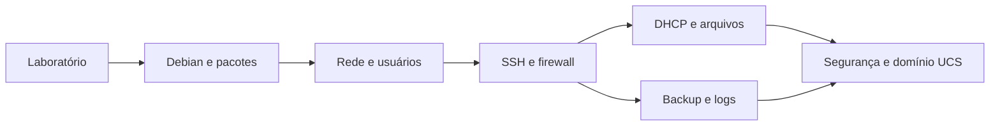

# 🐧 Servidores Linux — guia de estudos

**Do primeiro terminal à administração de serviços em rede.** Aprenda a instalar, configurar e administrar servidores com explicações e atividades práticas em máquinas virtuais.

## Comece por aqui

Um servidor é um computador que oferece serviços a outros computadores: distribuir endereços de rede, receber arquivos ou autenticar usuários, por exemplo. Linux é o núcleo do sistema; Debian é uma distribuição que reúne esse núcleo, programas e um gerenciador de pacotes.

Você pode começar mesmo que nunca tenha administrado um sistema Linux. Neste guia, vamos usar o Debian 13 (Trixie). Você precisará de um computador capaz de executar máquinas virtuais, acesso à internet para baixar os programas e tempo para repetir os exercícios. A configuração sugerida de cada VM é uma escolha didática, não um requisito mínimo oficial.

> [!IMPORTANT]
> Execute os comandos **dentro das VMs Linux**, salvo quando um bloco estiver identificado como PowerShell. Use o computador principal para acompanhar a leitura e o console das VMs para realizar as atividades.

## 📚 Trilha de aprendizagem

| Ordem | Capítulo | Ao concluir, você conseguirá… |
| :---: | --- | --- |
| 00 | [Laboratório e fundamentos](capitulos/00-laboratorio.md) | Entender terminal, caminhos, privilégios e a topologia |
| 01 | [Instalação do Debian e interface gráfica](capitulos/01-instalacao.md) | Instalar uma VM e preparar o primeiro acesso |
| 02 | [Gerenciamento de pacotes](capitulos/02-pacotes.md) | Instalar, atualizar e investigar programas |
| 03 | [Configurações de rede](capitulos/03-rede.md) | Configurar IP, gateway e resolução de nomes |
| 04 | [Usuários, grupos e permissões](capitulos/04-usuarios.md) | Administrar contas e compartilhar diretórios |
| 05 | [Acesso remoto com SSH](capitulos/05-ssh.md) | Acessar o servidor com autenticação por chave |
| 06 | [Firewall com nftables e pfSense](capitulos/06-firewall.md) | Filtrar tráfego e proteger o acesso administrativo |
| 07 | [DHCP com Kea](capitulos/07-dhcp.md) | Distribuir configurações de rede aos clientes |
| 08 | [Backup e agendamento](capitulos/08-backup.md) | Criar, agendar e restaurar uma cópia de arquivos |
| 09 | [Transferência de arquivos: SFTP e FTP](capitulos/09-arquivos.md) | Transferir arquivos e distinguir os protocolos |
| 10 | [Logs e MariaDB](capitulos/10-logs-mariadb.md) | Investigar eventos e registrar mensagens em banco |
| 11 | [Segurança e diagnóstico](capitulos/11-seguranca.md) | Revisar a exposição e resolver falhas por evidências |
| 12 | [Domínio com Univention Corporate Server](capitulos/12-ucs.md) | Montar um domínio de laboratório e validar o DNS |

## Como usar os procedimentos

1. Leia o objetivo e os pré-requisitos antes de copiar comandos.
2. Registre os nomes reais das interfaces e os endereços da sua VM.
3. Crie um snapshot antes de mudanças em rede, acesso e firewall.
4. Faça a validação ao final de cada etapa. Um comando sem erro não comprova sozinho que o serviço funciona.
5. Guarde um relatório com o resultado esperado, o observado e a correção aplicada.

Os blocos `bash` contêm comandos para o terminal Linux; blocos `ini`, `json`, `nft` e `sql` são conteúdos de arquivos ou comandos do programa indicado. Não copie os delimitadores de Markdown. Quando aparecer uma senha de exemplo, substitua-a por uma senha exclusiva e nunca a publique no GitHub.

🧭 O que significam os avisos usados no guia?

- **NOTE:** informação que ajuda a entender o contexto.
- **TIP:** sugestão para facilitar a prática.
- **IMPORTANT:** condição necessária para o procedimento funcionar.
- **WARNING:** etapa que pode interromper acesso, apagar dados ou expor o laboratório.

## ✅ Marcos de estudo

- [ ] Instalar o Debian e explicar a diferença entre usuário comum e root.
- [ ] Atualizar pacotes e identificar qual serviço um pacote oferece.
- [ ] Configurar e testar IP, rota e DNS separadamente.
- [ ] Conectar por SSH com chave e validar as regras de firewall.
- [ ] Obter uma concessão DHCP em uma rede isolada.
- [ ] Restaurar um arquivo e encontrar uma mensagem nos logs e no banco.
- [ ] Transferir um arquivo com SFTP e conferir sua integridade.
- [ ] Criar um usuário de domínio e testar sua autenticação.

## Para aprofundar os estudos

Ao longo dos capítulos, você encontrará links para a documentação dos programas utilizados. A [lista de referências](docs/referencias.md) reúne esses materiais para consulta durante as atividades.
