# 00 · Instalação do Debian 13 (Trixie) no Laboratório

[← README](../README.md) · [Próximo: 01 · Comandos Básicos e Vim →](01-comandos-vim.md)

## Objetivo

Instalar e validar o sistema operacional base que será utilizado em toda a trilha de aprendizagem de servidores Linux. Neste guia, adotamos a distribuição oficial **Debian 13 (codinome Trixie)** na arquitetura `amd64`, configurando uma máquina virtual com os recursos necessários para atuar como servidor de rede (*headless*, sem interface gráfica).

Ao final deste capítulo, o estudante será capaz de:
- Planejar os recursos virtuais e a conectividade de rede da máquina virtual do servidor (`srv01`).
- Baixar a imagem oficial de instalação do Debian e verificar sua integridade criptográfica com SHA-256.
- Executar todas as etapas do instalador oficial do Debian (*Debian Installer - d-i*) com base nas capturas de tela e explicações técnicas.
- Compreender a separação de privilégios entre a conta `root` e a conta de usuário comum (`aluno`) com acesso ao `sudo`.
- Realizar o particionamento assistido do disco virtual no sistema de arquivos padrão `ext4`.
- Selecionar adequadamente os pacotes de software com `tasksel` para servidores.
- Efetuar o primeiro acesso via terminal, validar a instalação e registrar um snapshot de segurança da máquina limpa.

---

## 1. Planejamento do Laboratório e Recursos da VM

Um laboratório de máquinas virtuais (VMs) proporciona um ambiente controlado e seguro para executar comandos administrativos, testar serviços e recuperar eventuais falhas sem qualquer impacto sobre a máquina física ou a rede local existente.

### Topologia do laboratório

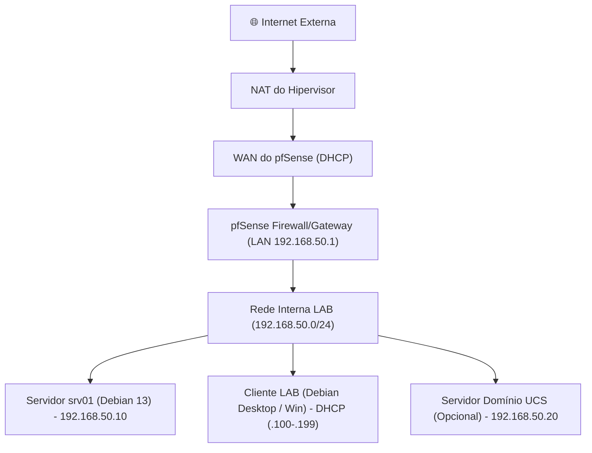

### Dimensionamento da máquina virtual (`srv01`)

Crie uma nova máquina virtual no seu hipervisor de preferência (VirtualBox, VMware Player/Workstation, Proxmox VE, QEMU/KVM ou Hyper-V) com os seguintes parâmetros recomendados:

| Parâmetro | Valor Recomendado | Justificativa Técnica |
| :--- | :--- | :--- |
| **Nome da VM** | `srv01` | Identificação padronizada utilizada em todos os exercícios da trilha. |
| **Tipo / Versão do SO** | `Linux` / `Debian (64-bit)` | Aplica as otimizações de virtualização do kernel do hipervisor. |
| **Processador (vCPU)** | 2 vCPUs | Garante fluidez na compilação e execução de múltiplos daemons. |
| **Memória RAM** | 2 GB (2048 MB) | Quantidade ideal para um servidor Linux em modo texto (CLI puro). |
| **Armazenamento (Disco)** | 25 GB a 30 GB | Disco virtual com alocação dinâmica (*thin provision*) em formato VDI/VMDK/QCOW2. |
| **Placa de Rede Inicial** | 1 interface em modo **NAT** | Utilizada temporariamente na instalação para download de pacotes via Netinst. |
| **Placa de Rede Final** | 1 interface em **Rede Interna** (`LAB`) | Conectada ao switch virtual privado para os exercícios de rede e firewall. |

> [!WARNING]
> Nunca utilize o modo de rede em ponte (*Bridge*) no adaptador de rede de máquinas de treinamento que executarão servidores DHCP ou roteadores. Um serviço DHCP em ponte distribuirá endereços e gateways concorrentes para a rede física da sua instituição, residência ou trabalho, causando queda de conectividade para outros dispositivos.

---

## 2. Obtenção e Verificação da Mídia de Instalação

O Debian disponibiliza diferentes tipos de imagens de instalação. Para este laboratório, utilizamos a imagem oficial mínima de rede (**Netinst**), que inclui o instalador e o sistema base essencial, baixando os pacotes atualizados diretamente dos repositórios oficiais durante a instalação.

1. Acesse o portal oficial de download do Debian: [https://www.debian.org/distrib/](https://www.debian.org/distrib/)
2. Baixe a imagem **Netinst** para arquitetura de computadores convencionais de 64 bits (`amd64`). Para a versão Debian 13 (Trixie), localize a compilação oficial da imagem `.iso` e os arquivos de hash correspondentes (`SHA256SUMS` ou `SHA512SUMS`).

### Verificação da integridade do arquivo baixado

Arquivos de imagem ISO podem sofrer corrupção de dados durante o download. A verificação criptográfica do hash compara a assinatura matemática do arquivo local com o valor publicado pelo projeto Debian.

#### No Windows (PowerShell):
```powershell
Get-FileHash -Algorithm SHA256 -LiteralPath "$HOME\Downloads\debian-13-netinst.iso"
```

#### No Linux / macOS (Terminal):
```bash
sha256sum debian-13-netinst.iso
```

Compare a sequência de caracteres gerada com a linha correspondente no arquivo `SHA256SUMS` oficial. Se forem idênticas, o arquivo está íntegro e autêntico.

### Preparação do dispositivo de boot
- **Em Máquina Virtual:** Conecte diretamente o arquivo `.iso` à controladora de CD/DVD virtual da VM nas configurações de armazenamento do hipervisor.
- **Em Computador Físico:** Grave a ISO em um pendrive utilizando ferramentas como Ventoy, Rufus (em modo DD) ou através do utilitário `dd` no Linux (`sudo dd if=debian-13.iso of=/dev/sdX bs=4M status=progress`).

> [!CAUTION]
> Ao gravar imagens em pendrives físicos ou particionar discos reais, certifique-se da letra ou identificador correto da unidade de destino. A gravação sobrescreve e apaga irrevogavelmente todo o conteúdo da unidade selecionada.

---

## 3. Guia de Instalação Passo a Passo do Debian 13

Inicie a máquina virtual configurada com a mídia ISO anexada.

---

### Passo 1: Menu de inicialização (Boot Menu)

Ao ligar a máquina, o carregador de inicialização do instalador do Debian exibirá o menu de opções.

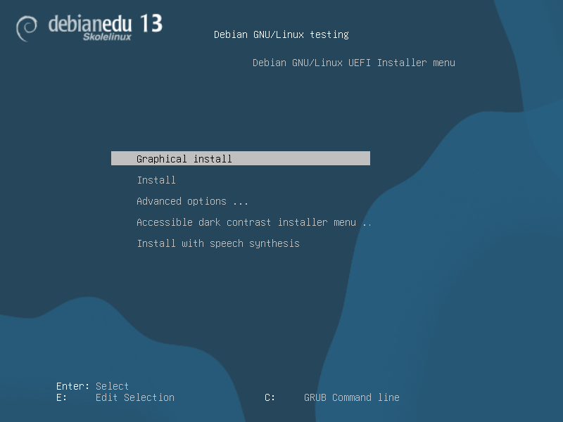

1. Selecione a opção **Graphical install** e pressione `Enter`.
2. *Nota técnica:* A opção gráfica (*Graphical install*) e a opção em modo texto (*Install*) possuem exatamente as mesmas etapas lógicas e opções de configuração. A versão gráfica é recomendada por oferecer melhor legibilidade de fontes e suporte a ponteiro de mouse.

---

### Passo 2: Seleção do idioma do sistema

O idioma selecionado definirá as instruções durante a instalação e o idioma padrão do sistema operacional instalado.

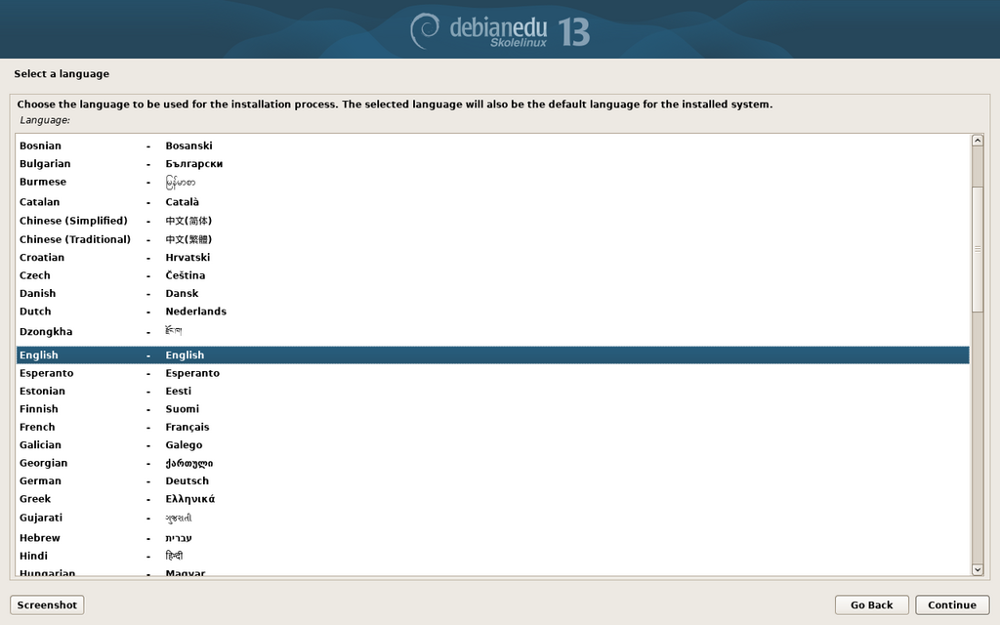

1. Localize e selecione **Portuguese (Brazil) - Português do Brasil**.
2. Clique no botão **Continue** (ou pressione `Enter`).

> [!TIP]
> Em ambientes corporativos de datacenter, muitos administradores optam pelo idioma *English* para facilitar buscas de logs em documentações internacionais. Para o aprendizado inicial do estudante, a interface em português facilita o entendimento dos conceitos de particionamento e permissões.

---

### Passo 3: Localização geográfica

A localização define os parâmetros de fuso horário, formato de moeda e os servidores de espelho (*mirrors*) mais próximos para download de pacotes.

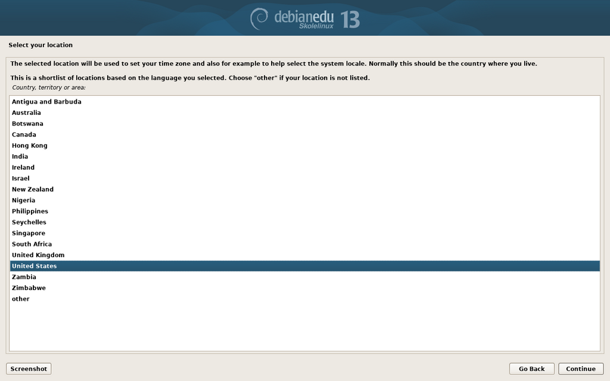

1. Selecione o país **Brasil**.
2. Clique em **Continuar**.

---

### Passo 4: Configuração do layout do teclado

Configura o mapa de teclas do console e terminal para coincidir com o teclado físico conectado ao computador.

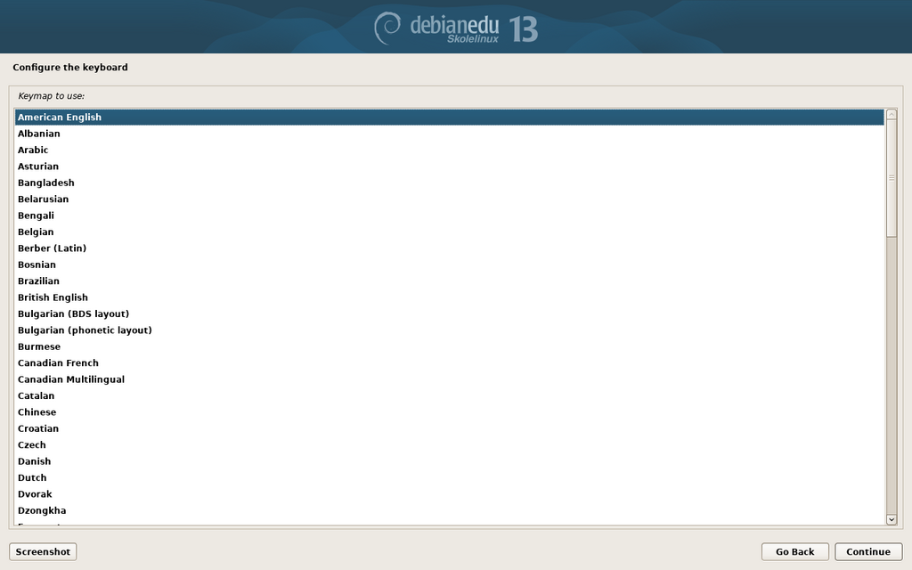

1. Se o seu teclado possui a tecla `ç`, selecione **Português Brasileiro (ABNT2)**.
2. Se o seu teclado for padrão americano (sem `ç`), selecione **Inglês (Estados Unidos)** ou **Inglês (internacional)**.
3. Clique em **Continuar**.

---

### Passo 5: Detecção de hardware e rede

O instalador carregará automaticamente os módulos de kernel e identificará os adaptadores de rede virtuais disponíveis.

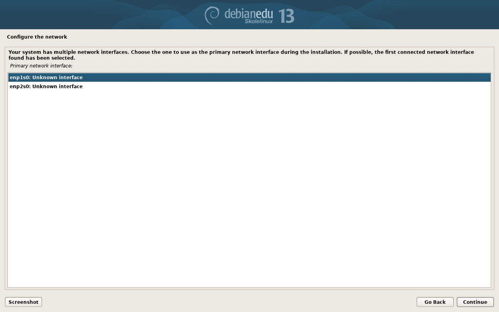

- Se a máquina virtual estiver conectada ao modo **NAT**, o instalador obterá automaticamente uma concessão de endereço IP via DHCP para permitir a comunicação com os servidores Debian na internet.
- Se a rede não possuir servidor DHCP, o instalador apresentará uma tela solicitando configuração manual de IP, máscara e gateway (detalhada no [Capítulo 03](03-rede.md)).

---

### Passo 6: Definição do nome da máquina (*Hostname*)

O *hostname* é o identificador único da máquina na rede local.

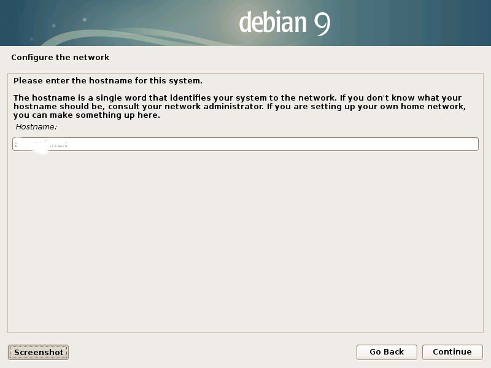

1. No campo **Nome da máquina** (*Hostname*), digite: `srv01`
2. Pressione **Continuar**.
3. *Convenção:* Em nosso laboratório, o primeiro servidor sempre se chamará `srv01`, facilitando os testes de resolução e comandos remotos em capítulos posteriores.

---

### Passo 7: Configuração do nome de domínio

O nome de domínio identifica a zona DNS da organização à qual a máquina pertence.

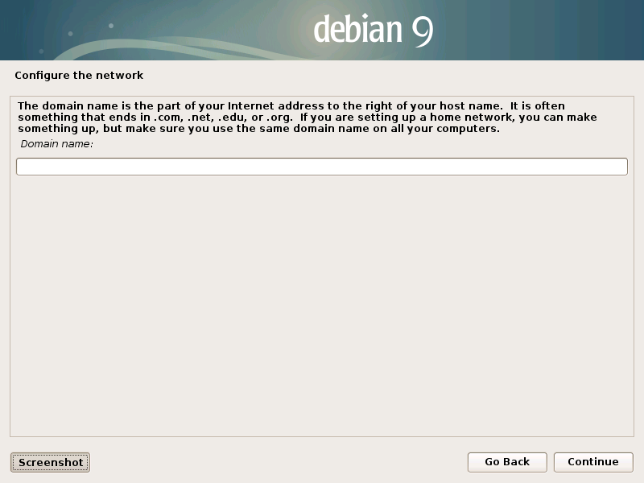

1. Para esta instalação inicial independente do servidor, **deixe o campo em branco**.
2. Clique em **Continuar**.
3. *Contexto didático:* No capítulo de domínio corporativo com UCS, abordaremos a integração de nomes de domínio totalmente qualificados (*FQDN*).

---

### Passo 8: Configuração da senha de root e habilitação do `sudo`

O Debian adota uma abordagem de segurança padronizada em relação à conta de superusuário (`root`).

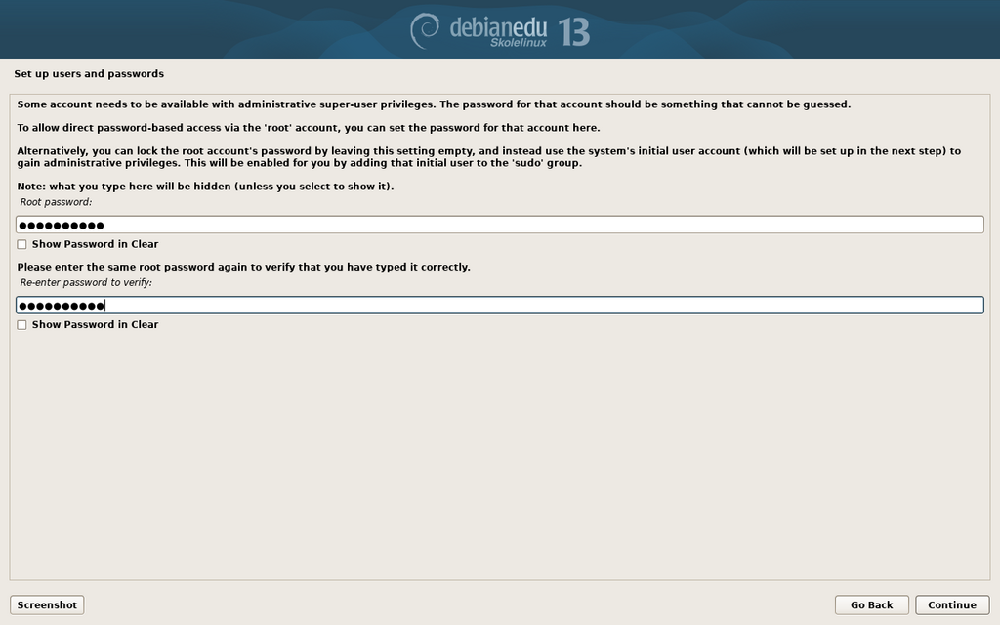

> [!IMPORTANT]
> **Boas Práticas Oficiais do Debian:**
> Se você **deixar a senha de root em branco**, a conta de acesso direto ao `root` será desativada por motivos de segurança, e o instalador concederá automaticamente privilégios administrativos via comando `sudo` ao primeiro usuário comum criado a seguir.
> 
> Caso você opte por digitar uma senha de root, o comando `sudo` não virá configurado por padrão para o usuário comum, exigindo que você use o comando `su -` para tarefas administrativas.

1. **Recomendação didática para o laboratório:** Deixe os dois campos de senha de root **completamente vazios**.
2. Clique em **Continuar**.

---

### Passo 9: Criação da conta de usuário comum

Crie uma conta para o uso rotineiro do sistema pelo estudante.

#### A. Nome completo do usuário
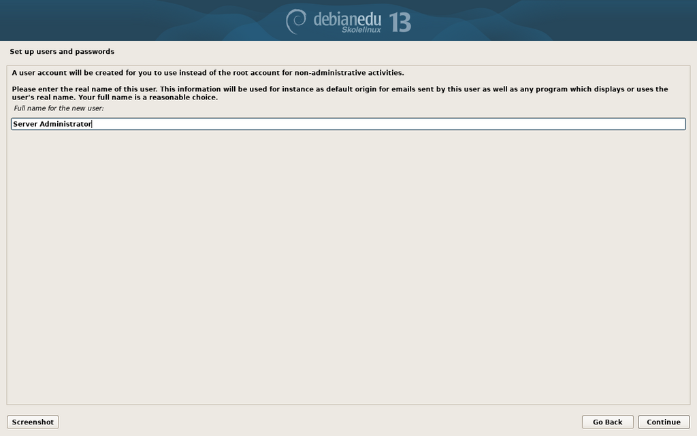
- Digite o nome completo de identificação, por exemplo: `Aluno da Silva` ou `Aluno`.
- Clique em **Continuar**.

#### B. Nome de usuário para a conta
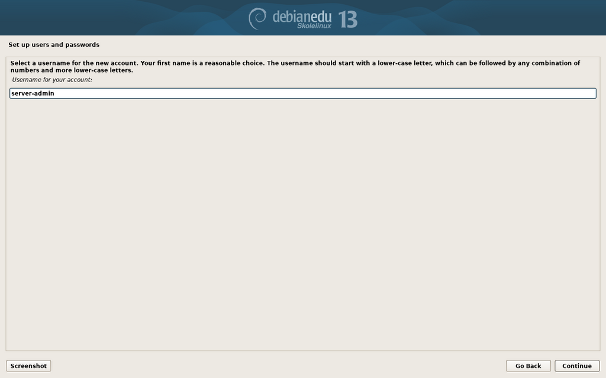
- Digite o identificador de login (somente letras minúsculas, sem acentos ou espaços): `aluno`
- Clique em **Continuar**.

#### C. Senha do usuário
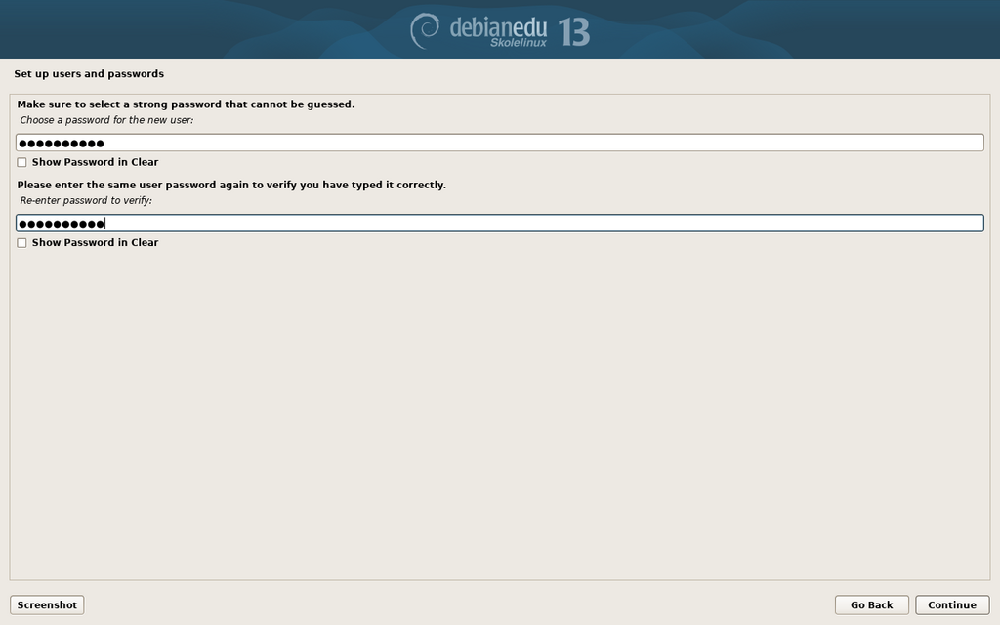
- Defina uma senha para o usuário `aluno` (por exemplo, em ambiente de laboratório isolado de estudo, utilize uma senha memorizável como `aluno123` ou uma senha forte de sua escolha).
- Confirme a mesma senha no campo inferior.
- Clique em **Continuar**.

---

### Passo 10: Particionamento do disco de armazenamento

O particionamento define a organização das unidades lógicas e formatação dos sistemas de arquivos.

#### A. Método de particionamento
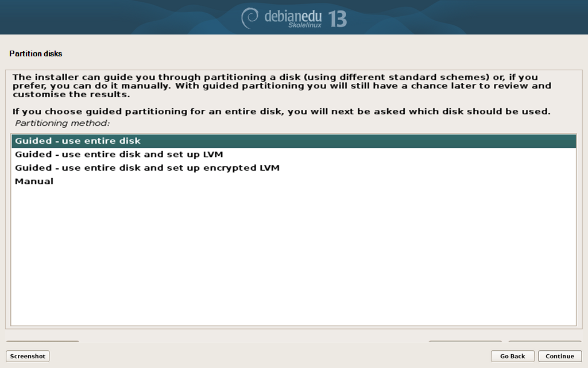
1. Selecione a opção **Assistido - usar o disco inteiro** (*Guided - use entire disk*).
2. Clique em **Continuar**.

#### B. Seleção do disco de destino
- O instalador exibirá o disco virtual criado no hipervisor (ex: `SCSI1 (0,0,0) (sda) - 25.0 GB ATA VBOX HARDDISK` ou disco virtual QEMU/VMware).
- Confirme a seleção do disco e clique em **Continuar**.

#### C. Esquema de particionamento
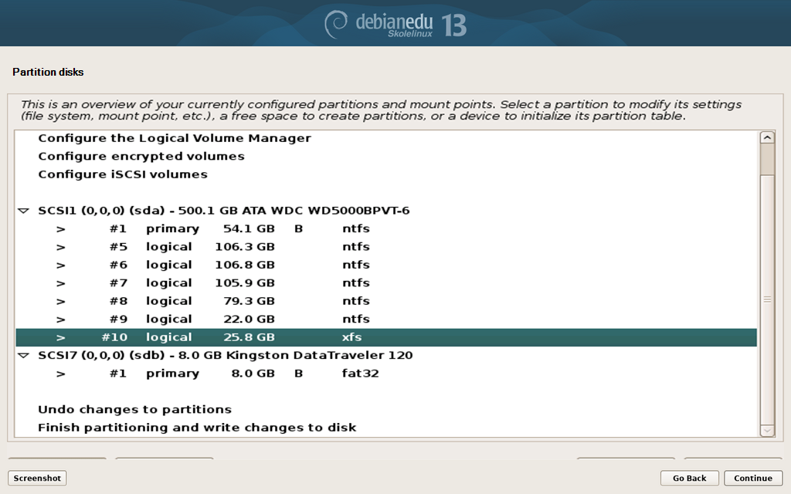
1. Selecione a opção **Todos os arquivos em uma partição (para iniciantes)**.
2. Clique em **Continuar**.
3. O assistente criará automaticamente a estrutura padrão com a partição raiz (`/`) formatada em `ext4` e a partição de troca (`swap`).

#### D. Confirmação e gravação das alterações
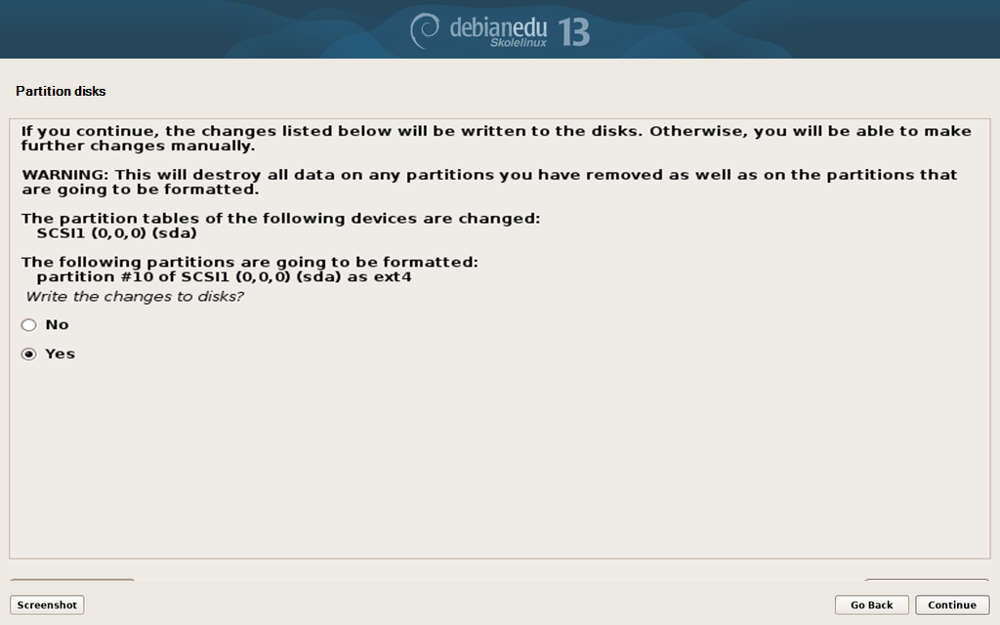
1. Revise a tabela de alterações proposta.
2. Na pergunta *"Escrever as mudanças nos discos?"* (*Write the changes to disks?*), marque obrigatoriamente a opção **Sim** (*Yes*).
3. Clique em **Continuar**. O disco virtual será formatado e a instalação do sistema base começará.

---

### Passo 11: Configuração do gerenciador de pacotes (APT)

O APT (*Advanced Package Tool*) gerencia o download e atualização de programas a partir de servidores espelhos confiáveis na internet.

#### A. Mídia adicional de instalação
- Quando o instalador perguntar *"Ler outra mídia de instalação?"*, selecione **Não** e clique em **Continuar**.

#### B. País do espelho de pacotes
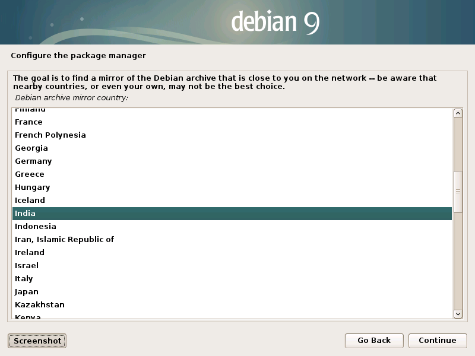
- Selecione **Brasil** e clique em **Continuar**.

#### C. Servidor do espelho do repositório
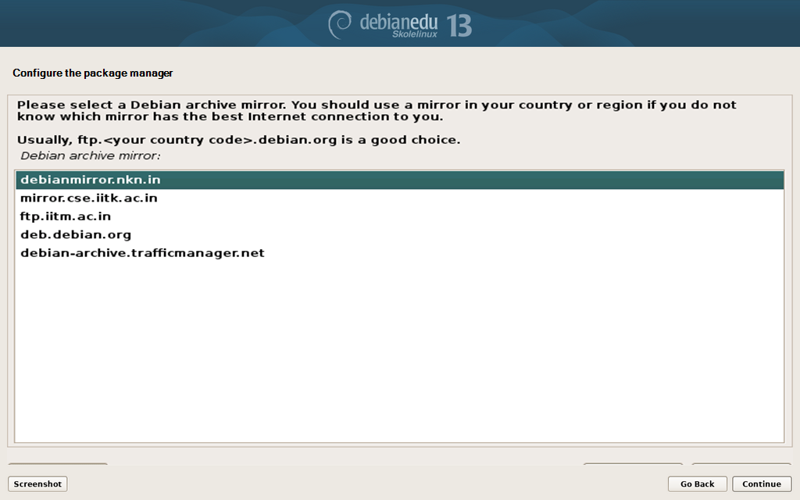
- Selecione o espelho oficial unificado: **deb.debian.org** (rede CDN distribuída global do projeto Debian).
- Clique em **Continuar**.

#### D. Informação de proxy HTTP
- Se você não utiliza proxy corporativo na rede, **deixe o campo em branco**.
- Clique em **Continuar**.

---

### Passo 12: Pesquisa de popularidade de pacotes (*popularity-contest*)

O pacote `popularity-contest` envia estatísticas anônimas ao Debian sobre os programas mais executados pela comunidade.

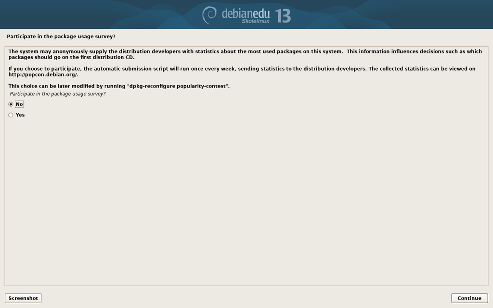

1. Para servidores de laboratório de estudos, selecione **Não**.
2. Clique em **Continuar**.

---

### Passo 13: Seleção de softwares (*tasksel*)

Esta é a etapa mais crítica para servidores. Aqui selecionamos quais componentes farão parte do sistema operacional.

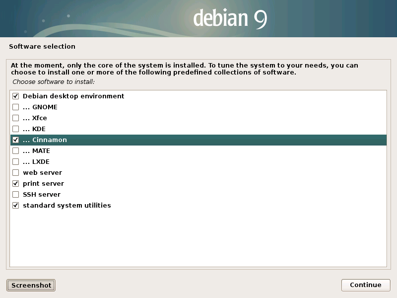

> [!IMPORTANT]
> **Perfil de Servidor (*Headless*):**
> Em servidores de produção e em nosso servidor de laboratório `srv01`, **não instalamos interface gráfica**. A ausência de interface gráfica reduz o consumo de memória RAM de ~1,5 GB para menos de 150 MB, fecha dezenas de portas de vulnerabilidades e economiza processamento.
>
> Utilize as setas do teclado e a **barra de espaço** para marcar ou desmarcar os itens conforme as instruções abaixo:

| Item | Estado | Justificativa |
| :--- | :---: | :--- |
| **Ambiente de área de trabalho do Debian** | ❌ **Desmarcado** | Servidores não usam interface gráfica de desktop. |
| **GNOME / Xfce / KDE / Cinnamon / MATE** | ❌ **Desmarcado** | Certifique-se de que nenhum ambiente gráfico esteja marcado. |
| **Servidor web** | ❌ **Desmarcado** | Instalaremos servidores específicos manualmente nos capítulos dedicados. |
| **Servidor de impressão** | ❌ **Desmarcado** | Desnecessário para este laboratório de redes e infraestrutura. |
| **Servidor SSH** | ✅ **MARCADO** | Essencial para permitir acesso administrativo remoto seguro via terminal. |
| **Utilitários padrão do sistema** | ✅ **MARCADO** | Fornece comandos essenciais de terminal como `curl`, `nano`, `ip`, `tar`. |

Após ajustar as marcações exatamente como na tabela acima, selecione **Continuar** e pressione `Enter`.

---

### Passo 14: Instalação do carregador de inicialização GRUB

O GRUB (*Grand Unified Bootloader*) é o programa responsável por carregar o kernel do Linux ao ligar a máquina.

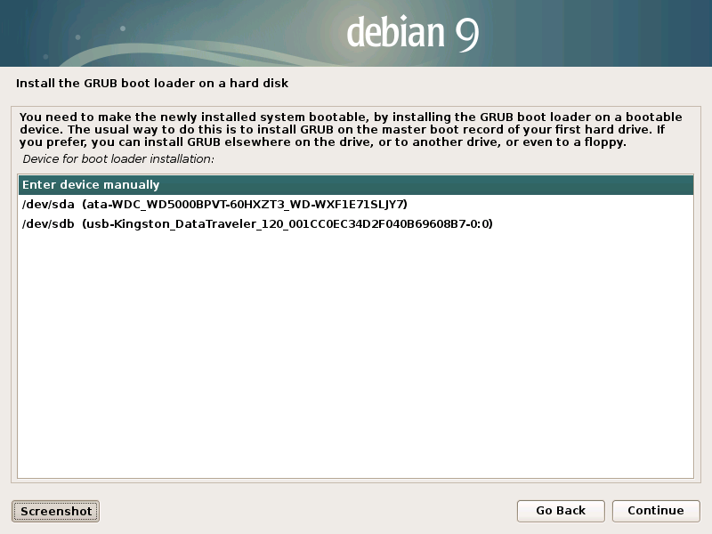

1. Quando o instalador perguntar *"Instalar o carregador de inicialização GRUB no registro mestre de inicialização?"*, selecione **Sim**.
2. Na tela de seleção de dispositivo, escolha a unidade primária do disco virtual (por exemplo: `/dev/sda` ou `/dev/vda`).
3. Clique em **Continuar**.

> [!WARNING]
> Nunca deixe a opção "Digitar o dispositivo manualmente" selecionada sem preenchê-la, caso contrário a máquina não conseguirá carregar o sistema operacional após a reinicialização.

---

### Passo 15: Finalização da instalação e reinício

O assistente confirmará a gravação de todos os pacotes e configurações.

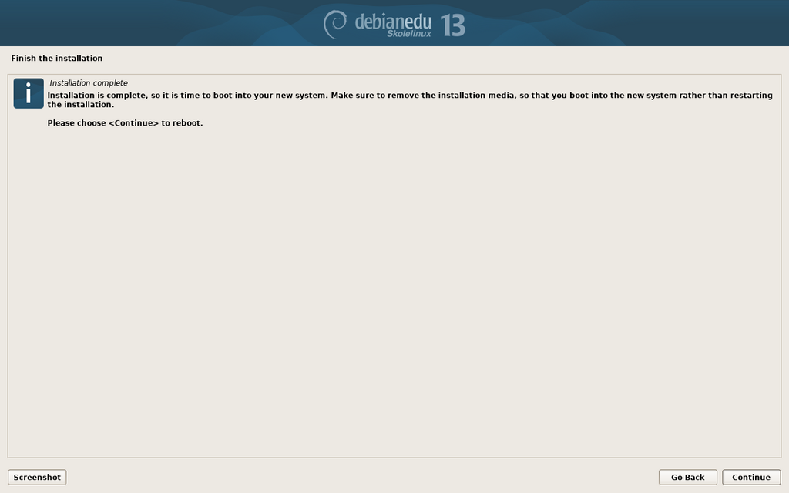

1. Remova ou desanexe a imagem `.iso` do leitor de CD/DVD virtual do seu hipervisor (nas configurações da VM) para evitar que o instalador carregue novamente no próximo boot.
2. Clique no botão **Continuar**.
3. A máquina virtual reiniciará automaticamente e carregará o Debian 13 diretamente a partir do disco virtual.

---

## 4. Pós-Instalação: Primeiro Acesso e Validação Operacional

Após a reinicialização, o console exibirá o prompt de autenticação em modo texto (*TTY*):

```text
Debian GNU/Linux 13 srv01 tty1

srv01 login: 
```

### 1. Autenticação inicial
1. Digite o usuário: `aluno` e tecle `Enter`.
2. Digite a senha cadastrada durante a instalação (lembre-se: no Linux os caracteres da senha não são exibidos na tela por segurança). Tecle `Enter`.

### 2. Validação da versão e integridade do sistema
Execute os seguintes comandos no terminal do `srv01` para checar as informações da instalação:

```bash
# Verifica a versão exata do sistema operacional Debian 13 (Trixie)
cat /etc/os-release

# Exibe o nome da máquina, arquitetura e versão do Kernel Linux
hostnamectl

# Confirma o particionamento do disco e tipos de sistemas de arquivos
lsblk -f

# Exibe as interfaces e os endereços IP atualmente ativos
ip -br address

# Valida se o usuário aluno possui autorização para executar comandos com sudo
sudo -v
```

**Saída esperada em `/etc/os-release`:**
```ini
PRETTY_NAME="Debian GNU/Linux 13 (trixie)"
NAME="Debian GNU/Linux"
VERSION_CODENAME=trixie
ID=debian
HOME_URL="https://www.debian.org/"
SUPPORT_URL="https://www.debian.org/support"
BUG_REPORT_URL="https://bugs.debian.org/"
```

### 3. Caso o `sudo` não esteja disponível para o usuário
Se você definiu uma senha para o usuário `root` no Passo 8, execute o procedimento abaixo para habilitar o comando `sudo` para a conta `aluno`:

```bash
# Entrar temporariamente como root usando a senha do superusuário
su -

# Atualizar a lista de pacotes e instalar o utilitário sudo
apt update && apt install -y sudo

# Adicionar o usuário aluno ao grupo administrativo sudo
usermod -aG sudo aluno

# Sair da sessão de root
exit
```
Em seguida, encerre a sessão do usuário `aluno` com o comando `exit`, faça login novamente e teste o acesso com `sudo whoami` (o resultado deve ser `root`).

### 4. Fundamentos e comandos essenciais de terminal

| Comando | Função Técnica | Exemplo Prático |
| :--- | :--- | :--- |
| `whoami` | Exibe o nome do usuário da sessão atual | `whoami` (exibe `aluno`) |
| `pwd` | Mostra o caminho absoluto da pasta atual (*Print Working Directory*) | `pwd` (exibe `/home/aluno`) |
| `ls -lah` | Lista arquivos com detalhes (permissões, tamanhos humanos e ocultos) | `ls -lah /var/log` |
| `cd <diretório>` | Muda o diretório atual de trabalho | `cd /etc` |
| `cd ~` | Retorna para o diretório pessoal do usuário logado | `cd ~` |
| `man <comando>` | Abre o manual oficial do comando (saia pressionando `q`) | `man ip` |
| `nano <arquivo>` | Editor de texto simples no terminal (salve com `Ctrl+O`, saia com `Ctrl+X`) | `sudo nano /etc/hosts` |

---

## 5. Criação do Snapshot de Segurança Inicial

O **snapshot** é uma fotografia instantânea do estado exato do disco e da memória da máquina virtual naquele momento.

> [!TIP]
> Antes de fazer qualquer modificação de rede, firewall ou instalação de pacotes nos próximos capítulos:
> 1. Desligue a máquina virtual com o comando:
>    ```bash
>    sudo poweroff
>    ```
> 2. No menu do seu hipervisor (VirtualBox, VMware, Proxmox), acesse a aba **Snapshots** / **Instantâneos**.
> 3. Crie um snapshot com o nome: `00-Instalacao-Limpa-Debian13`.
> 4. Descrição: *Instalação oficial do Debian 13 concluída com sucesso, usuário aluno no grupo sudo, SSH ativo e disco particionado.*

Caso ocorra qualquer erro de configuração irreversível nos capítulos futuros, você poderá reverter a máquina virtual para esse snapshot limpo em segundos.

---

## 6. Interface Gráfica Opcional (Para a VM Cliente)

No laboratório de estudos, podemos manter o servidor `srv01` exclusivamente em modo texto (*CLI*), enquanto uma segunda máquina virtual, denominada **Cliente**, pode rodar uma interface gráfica leve para testes de navegação web, acesso a painéis de controle do pfSense e validação de resolução DNS.

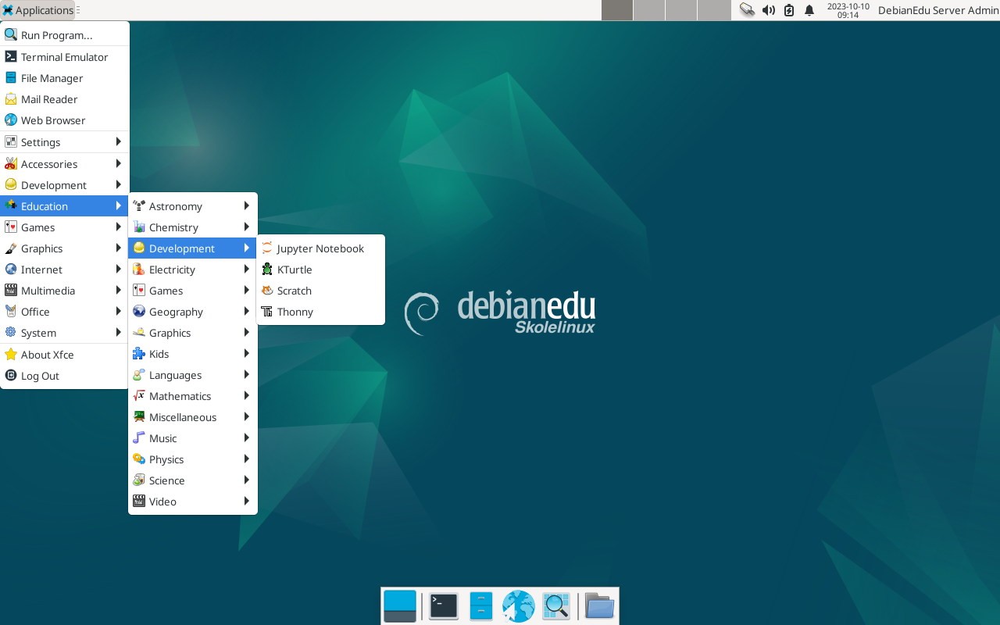

Se desejar instalar a interface gráfica **XFCE** (recomendada pelo baixo consumo de recursos de memória e processamento) na sua VM Cliente, execute:

```bash
# Atualiza os índices de repositório
sudo apt update

# Instala a suíte desktop leve XFCE
sudo apt install -y task-xfce-desktop

# Reinicia a máquina para carregar o gerenciador de login gráfico LightDM
sudo reboot
```

---

## 7. Checklist de Validação do Estudante

Antes de avançar para o próximo capítulo da trilha, confirme cada um dos itens abaixo:

- [ ] A máquina virtual inicializa diretamente pelo disco virtual sem depender do arquivo `.iso`.
- [ ] O comando `cat /etc/os-release` exibe a distribuição `Debian GNU/Linux 13 (trixie)`.
- [ ] O comando `hostname` confirma o nome de rede `srv01`.
- [ ] O usuário `aluno` consegue autenticar localmente e executar comandos com `sudo`.
- [ ] O serviço SSH está ativo e respondendo na porta 22 (`systemctl status ssh` ou `ss -tlpn`).
- [ ] O snapshot `00-Instalacao-Limpa-Debian13` foi devidamente registrado no hipervisor.

---

## Referências Oficiais Debian

- [Debian 13 (Trixie) Installation Guide](https://www.debian.org/releases/trixie/installmanual)
- [Debian Wiki — DebianInstaller](https://wiki.debian.org/DebianInstaller)
- [Debian CD/DVD Verification Guide](https://www.debian.org/CD/verify)
- [Debian Edu Trixie Installation Tour](https://wiki.debian.org/DebianEdu/Documentation/Trixie/Installation)

---

[← Voltar ao README](../README.md) · [Avançar para 01 · Comandos Básicos e Vim →](01-comandos-vim.md)

