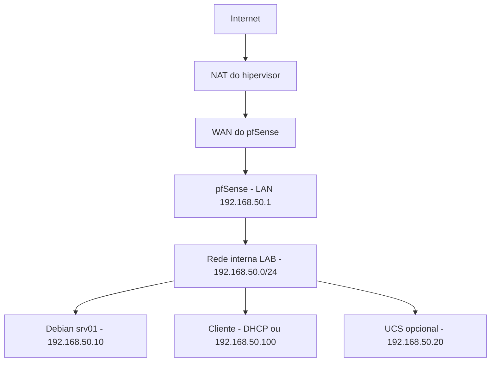

# 00 · Laboratório e fundamentos

[← README](../README.md) · [Guia Ilustrado de Instalação do Debian 13 →](00-instalacao.md) · [Próximo: instalação →](01-instalacao.md)

> [!NOTE]
> O guia oficial passo a passo com capturas de tela e ilustrações para a instalação do Debian 13 (Trixie) no laboratório está detalhado em **[00 · Instalação do Debian 13 no Laboratório](00-instalacao.md)**.

## Objetivo

Criar um ambiente em que erros possam ser corrigidos sem afetar a rede real. Uma **máquina virtual (VM)** simula um computador. O **hipervisor** é o programa que executa as VMs. Um **snapshot** registra um estado ao qual você pode retornar; ele não substitui um backup independente.

## Topologia adotada



| Máquina | Configuração didática | Papel |
| --- | --- | --- |
| `srv01` | 2 vCPU, 2 GB RAM, 25 GB de disco | Debian sem interface gráfica |
| Cliente | 2 vCPU, 4 GB RAM, 30 GB de disco | Debian com interface gráfica ou Windows compatível |
| pfSense | 2 vCPU, 2 GB RAM, 20 GB de disco, duas interfaces | Gateway do laboratório |
| UCS, opcional | 2 vCPU, 4 GB RAM, 40 GB de disco | Identidade e DNS do domínio |

Na rede interna, somente VMs conectadas ao mesmo segmento se comunicam. NAT permite saída para a internet. Bridge conecta a VM à rede física e não é a escolha deste guia para exercícios de DHCP.

> [!WARNING]
> Nunca conecte o DHCP de treinamento à rede da escola, empresa ou residência. Um segundo servidor DHCP pode fornecer gateway e DNS incorretos aos outros dispositivos.

Antes de instalar o pfSense, você pode usar temporariamente uma interface NAT no Debian para baixar pacotes. Depois, conecte Debian e cliente à rede interna `LAB`. Para acessar o servidor, use o cliente dessa rede ou o console do hipervisor; o host Windows não participa automaticamente de uma rede interna. Não abra portas na WAN para contornar essa separação.

## Convenções que serão reutilizadas

| Item | Exemplo | Explicação |
| --- | --- | --- |
| Rede | `192.168.50.0/24` | Rede privada com máscara `255.255.255.0` |
| Gateway e DNS inicial | `192.168.50.1` | pfSense; habilitar resolução DNS para a LAN |
| Servidor | `192.168.50.10` | Endereço fixo fora do conjunto DHCP |
| DHCP | `.100` a `.199` | Intervalo de endereços dos clientes |
| Usuário administrativo | `aluno` | Conta de exemplo criada na instalação |
| Interface do Debian | `enp0s3` | Exemplo: confirme com `ip -br link` |

Em uma rede `/24`, `.0` identifica a rede e `.255` é broadcast; não os atribua a máquinas. Um **gateway** encaminha tráfego a outras redes. **DNS** traduz nomes em endereços. Não são o mesmo serviço, mesmo quando o mesmo equipamento fornece ambos.

## Primeiros passos no terminal

Execute no Debian após a instalação:

```bash
whoami
pwd
ls -lah
cd /etc
ls
cd ~
cat /etc/os-release
man ls
```

`pwd` mostra o diretório atual; `ls` lista arquivos; `cd` muda de diretório; `~` é a pasta pessoal. `/` é a raiz da árvore de arquivos, diferente da conta `root`. No manual, use as setas e saia com `q`. Se `man` não estiver instalado, instale `man-db` no capítulo de pacotes.

| Caminho | Conteúdo típico |
| --- | --- |
| `/etc` | Configurações do sistema |
| `/home/aluno` | Arquivos pessoais do aluno |
| `/var/log` | Logs gravados em arquivos |
| `/srv` | Dados oferecidos por serviços |
| `/usr/local/sbin` | Scripts administrativos locais |

`sudo` executa um comando com privilégios administrativos. Esses privilégios permitem alterar todo o sistema. Não adicione `sudo` quando estiver apenas lendo seus arquivos pessoais. Em `sudo comando > arquivo`, o redirecionamento é feito pelo shell atual; para gravar arquivos protegidos, este guia usa um editor com `sudo` ou `sudo tee`.

<details>
<summary>Como editar um arquivo com nano</summary>

Abra com `sudo nano /caminho/do/arquivo`, faça a alteração, salve com `Ctrl+O`, confirme com Enter e saia com `Ctrl+X`. Antes de substituir uma configuração existente, crie uma cópia com outro nome e anote como restaurá-la.

</details>

## Validação e exercício

- [ ] Identifique qual interface virtual está na WAN e qual está na LAN.
- [ ] Tire um snapshot da instalação limpa e anote o nome dele.
- [ ] Explique por que DHCP e bridge podem interferir em outras máquinas.
- [ ] Localize sua pasta pessoal e a versão instalada sem usar a interface gráfica.

**Entrega:** desenho da rede e tabela dos endereços reais escolhidos. Use essa tabela em todos os capítulos.
