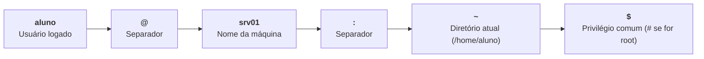
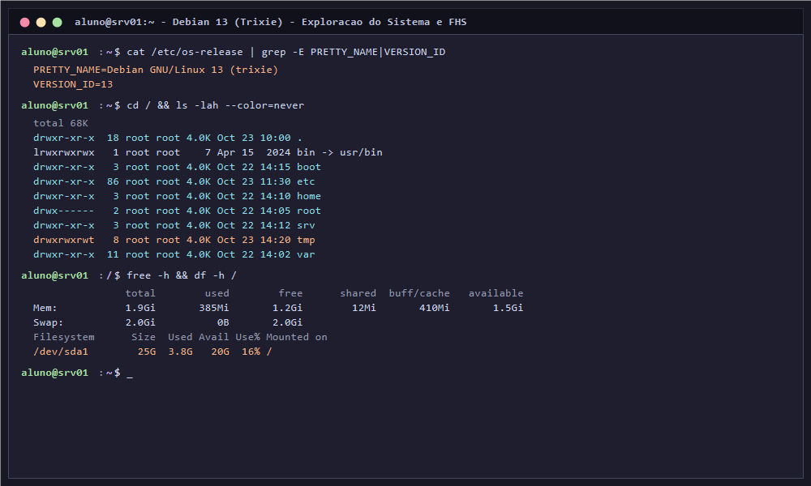
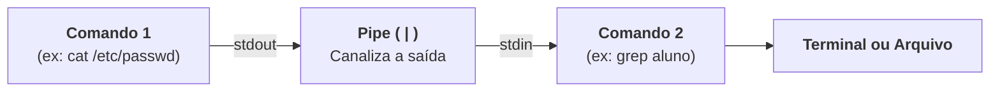
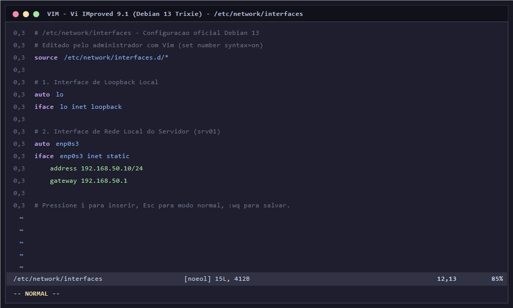
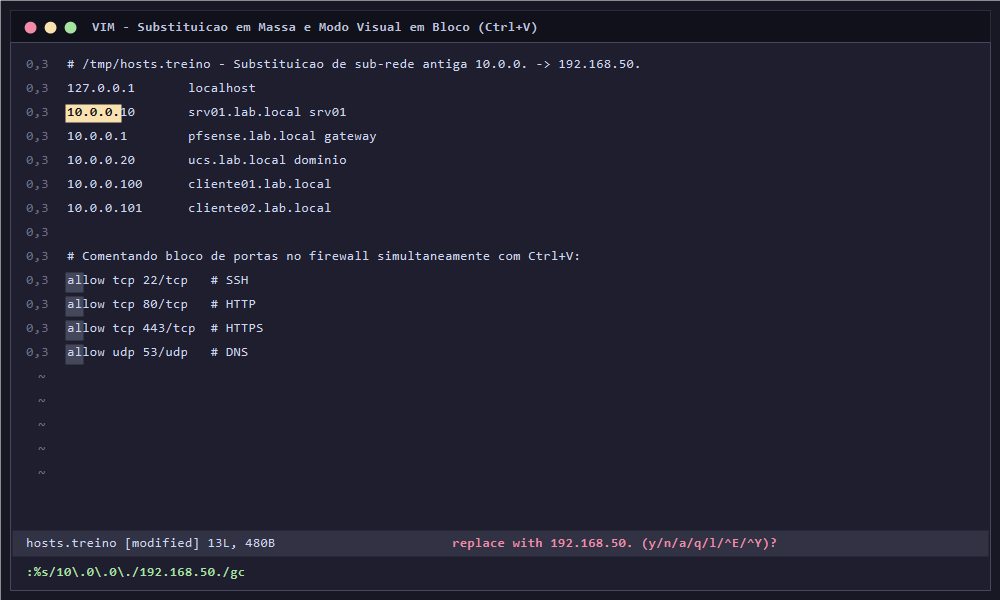
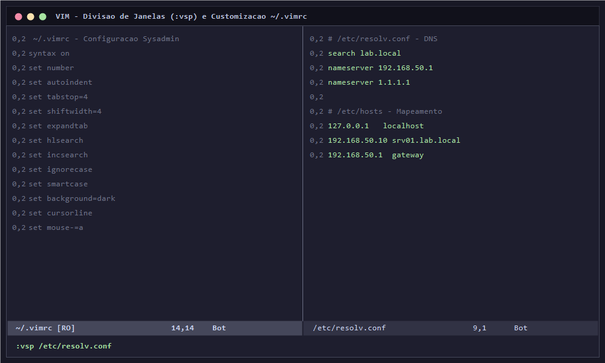

# 01 · Comandos Básicos do Linux e Dominando o Editor Vim no Debian 13

[← 00 · Instalação](00-instalacao.md) · [README](../README.md) · [Próximo: Pacotes →](02-pacotes.md)

## Objetivo e Competências

Capacitar o estudante a operar com autonomia, segurança e agilidade o terminal do **Debian 13 (Trixie)**, compreendendo a estrutura hierárquica de diretórios do Linux (FHS), dominando comandos de inspeção, manipulação e filtragem de arquivos, e desenvolvendo proficiência prática avançada no editor de texto canônico de sistemas Unix/Linux: o **Vim (*Vi IMproved*)**.

Ao final deste capítulo, o estudante será capaz de:
- Identificar os componentes do prompt Bash, consultar dados da sessão e reconhecer a separação de privilégios (`aluno` vs `root`).
- Navegar pela árvore de diretórios do Linux (FHS) e diferenciar caminhos absolutos de caminhos relativos.
- Executar operações estruturadas de arquivos e diretórios (`mkdir`, `touch`, `cp`, `mv`, `rm`) com salvaguardas de integridade.
- Inspecionar conteúdos e monitorar arquivos de log em tempo real com `cat`, `less`, `head`, `tail` e `tail -f`.
- Filtrar dados e conectar comandos através de fluxos de entrada/saída, pipes (`|`) e redirecionamentos (`>`, `>>`, `tee`).
- Compreender a arquitetura modal do **Vim** (Modo Normal, Modo de Inserção, Modo Visual e Modo de Linha de Comando/Ex).
- Operar a gramática de edição do Vim (`Operador + Movimento`) para navegar, duplicar, recortar, alterar e desfazer edições com agilidade e precisão sem utilizar o mouse.
- Realizar buscas e substituições em massa globais e interativas (`:%s/.../.../gc`) em arquivos de configuração de servidores.
- Utilizar o Modo Visual em Bloco (`Ctrl+V`) para comentar ou descomentar blocos inteiros de diretivas simultaneamente.
- Trabalhar com janelas divididas (`:sp` e `:vsp`) e personalizar o arquivo de inicialização `~/.vimrc` para máxima produtividade do administrador.
- Concluir missões práticas de sobrevivência e cirurgia de texto em ambiente de laboratório.

---

## 1. O Shell Bash e a Linha de Comando no Debian 13

O terminal de texto (*Command Line Interface - CLI*) é o meio de comunicação primário entre o administrador e o sistema operacional em servidores Linux. No Debian 13, o interpretador de comandos padrão é o **GNU Bash** (*Bourne Again SHell*).

### Anatomia do prompt de comando

Ao efetuar o login no terminal do Debian 13, o prompt apresenta o seguinte formato:

```text
aluno@srv01:~$
```



- **Usuário logado:** indica a conta sob a qual os comandos são despachados.
- **Nome do servidor (*hostname*):** identifica o nó de rede atual (evita enganos em conexões com múltiplos servidores).
- **Diretório de trabalho atual:** o til (`~`) representa o diretório pessoal (*home directory*) do usuário ativo (`/home/aluno`). A barra (`/`) representa a raiz do sistema.
- **Caractere de terminação de privilégio:**
  - `$` indica que o usuário possui privilégios de **usuário comum**.
  - `#` indica privilégios de **superusuário (`root`)**.

---

### Diagnóstico inicial do ambiente

Execute a sequência abaixo no terminal para obter a identidade do sistema:

```bash
# 1. Confirma o nome do usuário autenticado no shell atual
whoami

# 2. Exibe o UID (User ID), GID (Group ID) e grupos secundários aos quais o usuário pertence
id

# 3. Exibe o nome de rede configurado para o servidor
hostname

# 4. Exibe informações do Kernel Linux e arquitetura da máquina
uname -a

# 5. Consulta os metadados oficiais da versão do Debian
cat /etc/os-release | grep -E "PRETTY_NAME|VERSION_ID"

# 6. Informa a quantidade de memória RAM física e Swap utilizada
free -h

# 7. Informa a utilização das partições de disco montadas
df -h /
```



---

### Escalonamento de privilégios: `sudo` vs `su -`

No Debian 13 puro, o superusuário `root` possui poder irrestrito sobre o sistema de arquivos e processos. Para mitigar o risco de danos acidentais, a prática recomendada é operar como usuário comum (`aluno`) e elevar privilégios pontualmente com **`sudo`**:

```bash
# Executa um comando administrativo pontual com privilégio de root
sudo cat /etc/shadow

# Alterna para uma sessão interativa de superusuário preservando as variáveis de ambiente completas do root
sudo -i
# (ou 'su -' caso a senha de root tenha sido configurada)

# Para sair da sessão administrativa e retornar ao usuário aluno:
exit
```

> [!CAUTION]
> **Atenção com o uso de redirecionamentos com sudo:**
> O comando `sudo echo "texto" > /etc/arquivo.conf` **falhará com "Permission denied"**. Isso ocorre porque o redirecionamento (`>`) é interpretado pelo shell do usuário `aluno` antes do comando `sudo` entrar em ação. Para gravar com privilégios em arquivos protegidos, utilize:
> ```bash
> echo "texto" | sudo tee -a /etc/arquivo.conf
> ```
> Ou, de preferência, abra o arquivo diretamente em um editor com privilégios: `sudo vim /etc/arquivo.conf`.

---

### Atalhos fundamentais do terminal Bash

A agilidade no terminal depende do domínio dos seguintes atalhos de teclado:

| Atalho | Ação Técnica |
| :--- | :--- |
| `Tab` | Autocompleta comandos, parâmetros e nomes de arquivos. Pressionar duas vezes exibe todas as opções disponíveis. |
| `Ctrl + C` | Envia o sinal `SIGINT`, cancelando imediatamente o processo que estiver rodando em primeiro plano no terminal. |
| `Ctrl + L` | Limpa a tela do terminal (equivalente a executar o comando `clear`). |
| `Ctrl + D` | Envia o caractere de fim de arquivo (`EOF`), encerrando a sessão atual do shell ou saindo do usuário `root`. |
| `Ctrl + R` | Abre a busca reversa interativa no histórico de comandos digitados (*reverse-i-search*). |
| `Ctrl + A` / `Ctrl + E` | Move o cursor para o **início** (`Ctrl+A`) ou para o **fim** (`Ctrl+E`) da linha de comando atual. |
| `Ctrl + U` / `Ctrl + K` | Apaga todo o texto do cursor até o início (`Ctrl+U`) ou até o fim (`Ctrl+K`) da linha. |
| `history` | Exibe a lista numerada dos últimos comandos digitados. Execute `!n` para rodar o comando da linha `n`. |

---

## 2. A Hierarquia do Sistema de Arquivos Linux (FHS)

Diferente de sistemas operacionais baseados em letras de unidades (`C:`, `D:`), o Linux adota uma estrutura em árvore unificada denominada **FHS (*Filesystem Hierarchy Standard*)**, onde todo dispositivo, partição e recurso é mapeado a partir de um único diretório raiz: **`/`** (*root*).

```mermaid
flowchart TD
    ROOT["<b>/</b> (Diretório Raiz)"]
    
    ROOT --> ETC["<b>/etc</b><br>Arquivos de configuração do sistema"]
    ROOT --> VAR["<b>/var</b><br>Dados variáveis (logs, filas, bancos)"]
    ROOT --> HOME["<b>/home</b><br>Pastas pessoais dos usuários comuns"]
    ROOT --> ROOTDIR["<b>/root</b><br>Pasta pessoal do superusuário root"]
    ROOT --> SRV["<b>/srv</b><br>Dados hospedados por serviços de rede"]
    ROOT --> TMP["<b>/tmp</b><br>Arquivos temporários (limpos no boot)"]
    ROOT --> USR["<b>/usr</b><br>Programas e bibliotecas do sistema"]
    ROOT --> BOOT["<b>/boot</b><br>Kernel Linux e carregador GRUB"]
    ROOT --> DEV["<b>/dev</b><br>Arquivos especiais de dispositivos de hardware"]
    ROOT --> PROC["<b>/proc</b><br>Sistema virtual de processos e kernel"]
```



### Papel de cada diretório fundamental para servidores:

| Diretório | Papel Técnico no Servidor | Exemplo de Conteúdo |
| :--- | :--- | :--- |
| **`/etc`** | Central de configurações textuais de todos os serviços e programas do sistema. | `/etc/network/interfaces`, `/etc/resolv.conf`, `/etc/hosts`, `/etc/ssh/` |
| **`/var/log`** | Registros de eventos, auditoria e falhas do sistema operacional e dos daemons. | `/var/log/syslog`, `/var/log/auth.log`, `/var/log/journal/` |
| **`/home`** | Diretórios de trabalho de usuários comuns (`/home/aluno/`). | Documentos, rascunhos, scripts e arquivos `.bashrc` e `.vimrc` |
| **`/root`** | Diretório pessoal exclusivo do administrador `root`. Não fica em `/home/root`. | Scripts de manutenção interna e chaves de contingência |
| **`/srv`** | Local padronizado pelo FHS para armazenamento de dados oferecidos por serviços de rede. | Compartilhamentos Samba, repositórios locais, páginas web |
| **`/tmp`** | Armazenamento de arquivos temporários acessível a todos os usuários. Possui *Sticky Bit*. | Arquivos de treino, caches temporários e sockets de sessão |
| **`/usr/bin`** | Binários executáveis dos programas e comandos utilizados pelos usuários do sistema. | `vim`, `curl`, `grep`, `bash`, `ssh` |
| **`/usr/sbin`** | Comandos administrativos exclusivos de gerenciamento de rede e daemons. | `ip`, `nft`, `sshd`, `useradd` |
| **`/boot`** | Arquivos de inicialização estáticos, imagem do Kernel Linux (`vmlinuz`) e o `initramfs`. | `grub/`, `vmlinuz-6.12.x-amd64` |
| **`/proc`** e **`/sys`** | Sistemas de arquivos virtuais residentes em memória RAM que expõem o estado do Kernel. | `/proc/cpuinfo`, `/proc/meminfo`, `/proc/sys/net/ipv4/ip_forward` |

---

### Caminhos absolutos vs caminhos relativos

- **Caminho Absoluto:** Começa sempre pelo caractere raiz **`/`**. Identifica de maneira inequívoca a localização de um arquivo a partir da raiz, independentemente de qual seja o seu diretório atual:
  ```bash
  cat /etc/network/interfaces
  ```
- **Caminho Relativo:** Não começa por `/`. É interpretado a partir do **diretório atual de trabalho** onde o terminal está posicionado:
  ```bash
  cd /etc
  # Estando em /etc, o caminho relativo abaixo aponta para /etc/network/interfaces
  cat network/interfaces
  ```

#### Caracteres especiais de navegação:
- `.` (ponto simples): Representa o **diretório atual**.
- `..` (ponto duplo): Representa o **diretório pai** (um nível acima na árvore).
- `~` (til): Representa a **pasta pessoal** do usuário atual (`$HOME`).
- `-` (hífen): Retorna imediatamente ao **diretório anterior** onde você estava antes do último `cd`.

---

## 3. Comandos Fundamentais de Arquivos, Filtros e Redirecionamentos

Antes de editar arquivos de configuração de servidores, o administrador precisa saber listar, criar, copiar, buscar e auditar textos na linha de comando.

### 1. Navegação e listagem

```bash
# Imprime o caminho absoluto do diretório de trabalho atual (Print Working Directory)
pwd

# Navega para o diretório raiz
cd /

# Retorna para o diretório pessoal do usuário (/home/aluno)
cd ~
# (ou simplesmente 'cd' sem argumentos)

# Lista arquivos em formato longo, incluindo arquivos ocultos (que iniciam com ponto) e tamanhos legíveis
ls -lah

# Lista arquivos ordenando pela data da última modificação (mais recentes primeiro)
ls -laht
```

---

### 2. Criação, cópia, movimentação e remoção segura

```bash
# Cria uma árvore de diretórios encadeada com a opção -p (parent)
mkdir -p /tmp/laboratorio/backup

# Cria um arquivo vazio ou atualiza o carimbo de data/hora de um existente
touch /tmp/laboratorio/teste.txt

# Copia um arquivo preservando atributos originais com -p (permissions/timestamps)
cp -p /tmp/laboratorio/teste.txt /tmp/laboratorio/teste.txt.bkp

# Copia um diretório inteiro de forma recursiva com -r
cp -r /tmp/laboratorio /tmp/laboratorio-copia

# Move ou renomeia arquivos e pastas
mv /tmp/laboratorio/teste.txt /tmp/laboratorio/relatorio.txt

# Remove arquivos solicitando confirmação de segurança com -i (interactive)
rm -i /tmp/laboratorio/relatorio.txt

# Remove um diretório e seu conteúdo recursivamente (CUIDADO!)
rm -rf /tmp/laboratorio-copia
```

> [!WARNING]
> O comando `rm -rf` no Linux não possui "Lixeira". A exclusão é imediata e irreversível na camada do sistema de arquivos. Nunca execute `rm -rf` com curingas sem conferir exatamente o diretório de destino!

---

### 3. Visualização e paginação de arquivos de texto

```bash
# Exibe todo o conteúdo de um arquivo na saída padrão do terminal
cat /etc/hosts

# Exibe o conteúdo numerando todas as linhas com nl
nl /etc/hosts

# Permite navegação paginada em arquivos longos (setas para rolar, /termo para buscar, q para sair)
less /etc/services

# Exibe apenas as 10 primeiras linhas de um arquivo
head -n 10 /etc/passwd

# Exibe apenas as 10 últimas linhas de um arquivo
tail -n 10 /etc/passwd

# Monitora um arquivo em tempo real conforme novas linhas são adicionadas (essencial para auditoria de logs!)
sudo tail -f /var/log/syslog
# (Pressione Ctrl+C para encerrar o monitoramento)
```

---

### 4. Pesquisa de padrões com `grep` e localização com `find`

O `grep` filtra textos linha por linha com base em expressões regulares:

```bash
# Busca linhas que contenham o termo "aluno" em /etc/passwd
grep "aluno" /etc/passwd

# Busca ignorando maiúsculas/minúsculas (-i) e exibindo o número da linha (-n)
grep -in "ssh" /etc/services

# Inverte o filtro (-v): exibe apenas linhas que NÃO começam com comentário (#) e não estão vazias
grep -v "^#" /etc/network/interfaces | grep -v "^$"

# Busca recursiva (-r) por uma palavra dentro de todos os arquivos de um diretório
grep -rn "nameserver" /etc/
```

O `find` localiza arquivos na estrutura de disco:

```bash
# Procura arquivos com extensão .conf dentro do diretório /etc
find /etc -type f -name "*.conf"

# Procura arquivos modificados nas últimas 24 horas no sistema
find /var/log -type f -mtime -1
```

---

### 5. Redirecionamentos de fluxos e Pipes (`|`)

Todo comando executado no Linux possui três canais de comunicação padrão mantidos pelo Kernel:
- **`stdin` (0):** Entrada padrão (teclado).
- **`stdout` (1):** Saída padrão (terminal).
- **`stderr` (2):** Saída de erro padrão (terminal).



| Operador | Ação | Exemplo Prático |
| :--- | :--- | :--- |
| `>` | Redireciona a saída padrão **sobrescrevendo** o arquivo de destino. | `uname -a > /tmp/sistema.txt` |
| `>>` | Redireciona a saída padrão **adicionando ao final** (*append*) do arquivo. | `date >> /tmp/sistema.txt` |
| `2>` | Redireciona exclusivamente as **mensagens de erro** para um arquivo. | `ls /diretorio_inexistente 2> /tmp/erros.log` |
| `&>` | Redireciona simultaneamente a **saída normal e a saída de erro**. | `ping -c 2 1.1.1.1 &> /tmp/ping.log` |
| `|` | O **Pipe**: conecta a saída de um comando diretamente à entrada do próximo comando. | `ps aux | grep systemd | wc -l` |
| `tee` | Divide o fluxo: grava em um arquivo e exibe no terminal ao mesmo tempo. | `echo "srv01" | sudo tee /etc/hostname` |

---

## 4. O Editor Vim — Por que Dominá-lo é Essencial em Servidores?

Em servidores corporativos, o acesso é feito quase exclusivamente via terminal em modo texto. Embora editores básicos como o `nano` sejam acessíveis a iniciantes, eles são limitados para a administração de grandes parques de infraestrutura.

O **Vim (*Vi IMproved*)** é o editor de escolha dos administradores de sistemas Linux em todo o mundo pelos seguintes motivos:
1. **Onipresença Absoluta:** O editor `vi`/`vim` está presente em 100% das distribuições Unix/Linux, desde o menor contêiner Docker e sistemas de recuperação (*initramfs*) até supercomputadores.
2. **Eficiência 100% por Teclado:** Seus comandos são operados exclusivamente na linha de digitação, sem necessidade de tirar as mãos do teclado para alcançar o mouse ou menus gráficos.
3. **Fluidez em Conexões Remotas:** Funciona com velocidade instantânea mesmo em conexões SSH corporativas com alta latência.
4. **Capacidades Cirúrgicas:** Permite buscas globais, substituição em massa com expressões regulares, indentação de blocos inteiros, navegação precisa por linhas e edição em coluna vertical.

### Pacotes do Vim no Debian 13: `vim.tiny` vs `vim` completo

Ao instalar o Debian 13 no modo servidor sem interface gráfica, o instalador inclui por padrão o binário **`vim.tiny`** (executado ao digitar `vi`). O `vim.tiny` é uma versão reduzida que não traz realce de sintaxe nem módulos avançados.

Para obter a experiência completa do Vim no laboratório (com suporte a cores, realce de sintaxe e autocompletar):

```bash
# Atualiza os índices de pacotes e instala o Vim completo
sudo apt update && sudo apt install -y vim

# Opcional: define o Vim como editor padrão global do sistema
sudo update-alternatives --set editor /usr/bin/vim.basic
```

---

## 5. A Arquitetura Modal do Vim

A principal barreira de quem tem o primeiro contato com o Vim é tentar utilizá-lo como um editor comum (como o Bloco de Notas ou Word). O Vim é um editor **modal**: uma mesma tecla desempenha funções completamente distintas dependendo do **modo de operação ativo**.

```mermaid
stateDiagram-v2
    [*] --> ModoNormal: Abrir arquivo (vim arquivo)
    
    ModoNormal --> ModoInsercao: i, I, a, A, o, O
    ModoInsercao --> ModoNormal: Tecla Esc
    
    ModoNormal --> ModoVisual: Tecla v (caractere)
    ModoNormal --> ModoVisualLinha: Tecla V (linha inteira)
    ModoNormal --> ModoVisualBloco: Tecla Ctrl + v (coluna vertical)
    ModoVisual --> ModoNormal: Tecla Esc
    ModoVisualLinha --> ModoNormal: Tecla Esc
    ModoVisualBloco --> ModoNormal: Tecla Esc
    
    ModoNormal --> ModoLinhaComando: Tecla :
    ModoLinhaComando --> ModoNormal: Enter (após comando) ou Esc
```

### Os 4 Modos Fundamentais do Vim:

1. **Modo Normal (Comando / Navegação):**
   - É o **modo central** de repouso do Vim. Todas as teclas executam navegação de cursor, cópias, exclusões e disparos de operadores.
   - Sempre que estiver em dúvida sobre qual modo está ativo, pressione a tecla **`Esc`** uma ou duas vezes para retornar imediatamente ao Modo Normal.
2. **Modo de Inserção (`-- INSERT --`):**
   - É o modo onde o texto é efetivamente digitado e inserido no arquivo.
   - Entra-se neste modo a partir do Modo Normal pressionando teclas como `i` (inserir antes do cursor), `a` (inserir após o cursor) ou `o` (abrir nova linha abaixo).
   - O rodapé do terminal exibirá explicitamente a indicação `-- INSERT --`.
3. **Modo Visual (`-- VISUAL --`):**
   - Permite selecionar blocos de texto com o teclado para posterior cópia, exclusão ou formatação.
   - Pressione `v` para seleção por caractere, `V` maiúsculo para seleção por linha inteira ou **`Ctrl + V`** para seleção em coluna/bloco vertical.
4. **Modo de Linha de Comando / Ex (`:`):**
   - Iniciado ao pressionar dois pontos (**`:`**) no Modo Normal. O cursor se desloca para a última linha da tela.
   - Utilizado para gravar arquivos (`:w`), sair (`:q`), substituir termos (`:%s/.../.../g`) e ajustar opções do editor (`:set number`).



---

## 6. Guia Prático de Comandos do Vim

A lógica do Vim é estruturada como uma linguagem própria composta por **Verbos (Operadores)**, **Quantificadores** e **Substantivos (Movimentos)**:
> **A gramática do comando no Vim:**
> `[Quantidade] + Operador + Movimento`


*Exemplo:* `3dd` significa "execute o operador de deletar (`d`) em `3` linhas inteiras (`d`)".

---

### Tabela 1: Navegação de Cursor no Modo Normal

| Tecla | Movimento / Ação |
| :--- | :--- |
| `h` `j` `k` `l` | Movimentação básica: `h` (esquerda), `j` (baixo), `k` (cima), `l` (direita). As setas também funcionam. |
| `w` / `b` | Avança para o início da **próxima palavra** (`w`) ou retrocede para a **palavra anterior** (`b`). |
| `e` | Salta para o **final** da palavra atual. |
| `0` (zero) / `$` | Salta para o **início absoluto** da linha (`0`) ou para o **final da linha** (`$`). |
| `^` | Salta para o primeiro caractere não vazio (não espaço/tab) da linha atual. |
| `gg` | Salta imediatamente para a **primeira linha** do arquivo. |
| `G` (maiúsculo) | Salta imediatamente para a **última linha** do arquivo. |
| `:n` ou `nG` | Salta diretamente para a linha de número `n` (ex: `:50` ou `50G` salta para a linha 50). |
| `%` | Salta para o par correspondente de parênteses `()`, colchetes `[]` ou chaves `{}`. |
| `Ctrl + F` / `Ctrl + B` | Rola a tela uma página inteira para frente (*Forward*) ou para trás (*Backward*). |
| `Ctrl + D` / `Ctrl + U` | Rola meia página para baixo (*Down*) ou para cima (*Up*). |

---

### Tabela 2: Transição para o Modo de Inserção

| Tecla | Como entra no Modo de Inserção |
| :--- | :--- |
| `i` | Insere texto **antes** da posição atual do cursor. |
| `I` | Insere texto no **início** da linha atual. |
| `a` | Insere texto **após** (*append*) a posição atual do cursor. |
| `A` | Insere texto no **final** da linha atual. |
| `o` | Abre uma **nova linha em branco abaixo** da linha atual e posiciona o cursor em modo de inserção. |
| `O` (maiúsculo) | Abre uma **nova linha em branco acima** da linha atual e entra no modo de inserção. |
| `s` | Apaga o caractere sob o cursor e entra no modo de inserção. |

---

### Tabela 3: Operadores de Exclusão, Cópia e Alteração

| Comando | Ação no Modo Normal |
| :--- | :--- |
| `x` | Apaga o único caractere sob o cursor (equivalente à tecla Delete). |
| `dd` | **Recorta / Apaga a linha inteira** onde o cursor está posicionado. |
| `5dd` | Recorta / Apaga as **5 linhas** subsequentes a partir do cursor. |
| `dw` | Apaga do cursor até o início da próxima palavra. |
| `d$` ou `D` | Apaga do cursor até o final da linha atual. |
| `d0` | Apaga do cursor até o início da linha. |
| `dG` | Apaga da linha atual até o final absoluto do arquivo. |
| `yy` | **Copia (*Yank*) a linha inteira** para a área de transferência do Vim. |
| `3yy` | Copia as **3 linhas** subsequentes. |
| `yw` | Copia a palavra atual. |
| `p` (minúsculo) | **Cola (*Put*)** o texto copiado/recortado **abaixo** da linha atual (ou após o cursor). |
| `P` (maiúsculo) | Cola o texto copiado/recortado **acima** da linha atual (ou antes do cursor). |
| `cw` | Altera a palavra (*Change Word*): apaga a palavra atual e já entra em modo de inserção. |
| `cc` | Limpa a linha inteira e entra em modo de inserção. |
| `r` + caractere | Substitui apenas o caractere sob o cursor pelo novo caractere digitado (sem sair do modo normal). |
| `R` | Entra no Modo de Sobrescrever (*Replace* contínuo). |
| `u` | **Desfaz (*Undo*)** a última alteração realizada. Pode ser pressionado repetidamente. |
| `Ctrl + R` | **Refaz (*Redo*)** a última alteração desfeita. |
| `.` (ponto) | **Repete** a última ação de edição executada (um dos recursos mais poderosos do Vim!). |

---

### Tabela 4: Salvar e Sair no Modo Linha de Comando (`:`)

| Comando Ex | Ação |
| :--- | :--- |
| `:w` | Grava (*Write*) as alterações realizadas no disco sem sair do editor. |
| `:w /novo/caminho` | Grava uma cópia do arquivo atual no caminho especificado (Salvar Como). |
| `:q` | Sai (*Quit*) do editor. Só funciona se nenhuma alteração tiver sido feita desde o último salvamento. |
| `:wq` ou `:x` | **Grava as alterações e sai** do Vim de forma segura. |
| `ZZ` (no modo normal) | Atalho rápido para gravar e sair sem precisar digitar dois pontos. |
| `:q!` | **Sai descartando todas as alterações** feitas sem salvar (o comando de sobrevivência!). |
| `:w !sudo tee %` | Grava o arquivo com `sudo` mesmo se você esqueceu de abrir o Vim com privilégios administrativos! |

---

### Busca e Substituição Avançada no Vim

A busca e substituição em arquivos de configuração de servidores é feita com alta velocidade:

#### 1. Pesquisa direta e reversa
- Pressione **`/`** no Modo Normal, digite a palavra desejada e tecle `Enter` (ex: `/nameserver`).
- Pressione **`n`** para saltar para a **próxima ocorrência** da palavra em direção ao final do arquivo.
- Pressione **`N`** (maiúsculo) para retornar à **ocorrência anterior** em direção ao topo.
- Pressione **`?`** para efetuar a busca reversa (do cursor em direção ao topo do arquivo).
- Para desativar o destaque amarelo das palavras encontradas na tela: digite **`:noh`** (*no highlight*) e tecle `Enter`.

#### 2. Substituição global em todo o arquivo
A sintaxe do comando de substituição no Modo Ex segue a fórmula:
```text
:%s/padrao_antigo/padrao_novo/g
```
- `%`: especifica que a operação deve ser aplicada em **todas as linhas** do arquivo.
- `s`: comando de substituição (*substitute*).
- `/padrao_antigo/`: termo ou regex que será localizado.
- `/padrao_novo/`: termo que substituirá o original.
- `g`: modificador global (substitui todas as ocorrências de cada linha, não apenas a primeira).
- `c`: *(Recomendado)* adiciona o modificador de **confirmação interativa** (*confirm*). O Vim solicitará confirmação em cada ocorrência:
  ```text
  replace with 192.168.50. (y/n/a/q/l/^E/^Y)?
  ```
  - `y` (*yes*): substitui esta ocorrência.
  - `n` (*no*): pula esta ocorrência sem alterar.
  - `a` (*all*): substitui todas as ocorrências restantes de uma vez.
  - `q` (*quit*): encerra a operação de substituição imediatamente.



---

### O Superpoder do Modo Visual em Bloco (`Ctrl + V`)

Uma das operações mais frequentes em servidores é **comentar ou descomentar um bloco inteiro de linhas** de um arquivo de configuração (como desativar uma regra de firewall ou um repositório).

#### Como comentar 10 linhas simultaneamente com `Ctrl + V`:
1. Posicione o cursor no primeiro caractere da primeira linha que deseja comentar.
2. Pressione **`Ctrl + V`** (o rodapé exibirá `-- VISUAL BLOCK --`).
3. Pressione a tecla **`j`** várias vezes (ou digite `9j`) para estender a seleção vertical pelas 10 linhas.
4. Pressione a letra **`I`** (maiúsculo) para entrar no modo de inserção em coluna no início da seleção.
5. Digite o caractere de comentário desejado (ex: `# `). *Nota: você verá o caractere apenas na primeira linha neste momento.*
6. Pressione a tecla **`Esc`**.
7. O Vim aplicará automaticamente o `# ` em **todas** as linhas selecionadas simultaneamente!

#### Como descomentar o bloco de linhas:
1. Posicione o cursor sobre o primeiro caractere `#` da primeira linha.
2. Pressione **`Ctrl + V`**.
3. Pressione `j` até selecionar a coluna de caracteres `#` de todas as linhas.
4. Pressione a tecla **`d`** (ou `x`).
5. Todos os comentários da coluna serão apagados instantaneamente!

---

### Divisão de Janelas (*Splits*) e Execução de Comandos Externos

O Vim permite dividir a janela do terminal para visualizar ou comparar múltiplos arquivos lado a lado:

- **`:sp arquivo.conf`** (*split* horizontal): divide a tela horizontalmente e abre o segundo arquivo.
- **`:vsp arquivo.conf`** (*vertical split*): divide a tela verticalmente lado a lado.
- **Alternar entre janelas divididas:** pressione **`Ctrl + W`** e em seguida a tecla de direção desejada (`h`, `j`, `k`, `l` ou seta).
- **Fechar a janela atual:** digite `:q` na janela ativa.
- **Importar saída de comando externo diretamente para o texto:**
  - Digite **`:r !ip -br address`** e tecle `Enter`. A lista completa de endereços IP da máquina será colada diretamente dentro do arquivo aberto na posição atual do cursor!

---

## 7. Personalização Profissional do Vim (`~/.vimrc`)

Para que você não precise digitar `:set number` ou `:syntax on` toda vez que abrir o Vim, criamos o arquivo de configuração pessoal **`~/.vimrc`** (ou global em `/etc/vim/vimrc.local` para todos os usuários).

Abra o arquivo no seu diretório de usuário:

```bash
vim ~/.vimrc
```

Insira as diretivas recomendadas para administração de servidores:

```vim
" ~/.vimrc - Configuracao de alta produtividade para servidores Debian 13

" Ativa realce sintatico de cores de arquivos (.conf, .sh, .yml, .json)
syntax on

" Exibe o numero absoluto de cada linha na margem esquerda
set number

" Mantem a mesma indentacao da linha anterior ao teclar Enter
set autoindent

" Define o tamanho de tabulacao padrao em 4 espacos
set tabstop=4
set shiftwidth=4
set expandtab

" Destaca visualmente os resultados de buscas com a barra (/)
set hlsearch
set incsearch

" Busca sem diferenciacao de maiusculas/minusculas, exceto se digitar letra maiuscula
set ignorecase
set smartcase

" Destaca sutilmente a linha onde o cursor esta posicionado
set cursorline

" Define o tema escuro como base de contraste
set background=dark

" Desativa a captura de cliques do mouse para facilitar selecionar e colar texto via terminal
set mouse-=a
```

Salve com `:wq`. A partir deste momento, qualquer arquivo aberto pelo usuário `aluno` carregará essa configuração profissional automaticamente.



---

## 8. Laboratório Prático: Treinamento Intensivo no Vim (5 Missões)

Execute os exercícios abaixo no terminal da sua máquina virtual `srv01` para sedimentar a memória muscular no teclado.

---

### Missão 1: Criação e Sobrevivência Básica
1. Crie um diretório de treino com `mkdir -p /tmp/treino-vim && cd /tmp/treino-vim`.
2. Abra um novo arquivo com `vim inventario.txt`.
3. Pressione a tecla `i` e digite um breve relatório do servidor:
   ```text
   Servidor: srv01.lab.local
   Sistema Operacional: Debian 13 Trixie
   Administrador: aluno
   ```
4. Pressione `Esc`, digite `:w` e tecle `Enter` para gravar no disco.
5. Digite algumas linhas de rascunho sem sentido.
6. Pressione `Esc`, digite `:q!` e saia descartando as alterações de rascunho.
7. Abra novamente com `vim inventario.txt` e confirme que seu arquivo original está intacto. Saia com `:q`.

---

### Missão 2: Cirurgia de Texto e Duplicação sem Mouse
1. Copie o arquivo de serviços de rede do sistema para o laboratório de testes:
   ```bash
   cp /etc/services /tmp/treino-vim/servicos.txt
   ```
2. Abra o arquivo com `vim /tmp/treino-vim/servicos.txt`.
3. Salte diretamente para a linha 40 digitando `:40` e teclando `Enter`.
4. Copie a linha 40 para a memória com `yy`.
5. Salte para o final do arquivo com a tecla `G` (maiúsculo) e cole a linha com `p`.
6. Salte para o topo do arquivo com `gg`.
7. Apague as 5 primeiras linhas digitando `5dd`.
8. Desfaça a exclusão acidental pressionando a tecla `u` (*undo*).
9. Saia salvando as alterações com `:wq`.

---

### Missão 3: Substituição em Massa de Sub-redes de Laboratório
1. Crie um arquivo com uma tabela simulada de endereços IP de uma empresa que será migrada:
   ```bash
   cat << 'EOF' > /tmp/treino-vim/ips.txt
   router 10.0.0.1
   servidor-web 10.0.0.10
   servidor-bd 10.0.0.20
   gateway-secundario 10.0.0.254
   EOF
   ```
2. Abra o arquivo com `vim /tmp/treino-vim/ips.txt`.
3. No Modo Normal, digite o comando de substituição interativa:
   ```vim
   :%s/10\.0\.0\./192.168.50./gc
   ```
4. Tecle `Enter`. O Vim solicitará a confirmação em cada IP encontrado. Digite `y` para confirmar cada alteração.
5. Grave e saia digitando `:wq`.
6. Valide no terminal com `cat /tmp/treino-vim/ips.txt`. Todos os IPs devem começar com `192.168.50.`.

---

### Missão 4: Comentando Diretivas com Modo Visual de Bloco
1. Crie uma lista simulada de portas de firewall:
   ```bash
   cat << 'EOF' > /tmp/treino-vim/firewall.txt
   allow 22/tcp
   allow 80/tcp
   allow 443/tcp
   allow 53/udp
   EOF
   ```
2. Abra com `vim /tmp/treino-vim/firewall.txt`.
3. Posicione o cursor no `a` da primeira linha.
4. Pressione `Ctrl + V`, desça até a última linha com `j`.
5. Pressione `I` (maiúsculo), digite `# ` e pressione `Esc`.
6. Observe todas as linhas serem comentadas simultaneamente!
7. Agora posicione o cursor sobre o primeiro `#`, pressione `Ctrl + V`, desça com `j`, aperte a seta direita para cobrir `# ` e tecle `d`.
8. Todas as linhas foram descomentadas! Salve e saia com `:wq`.

---

### Missão 5: O Tutorial Oficial Integrado (`vimtutor`)
O projeto Vim inclui um programa oficial de treinamento prático de 30 minutos em português que roda interativamente dentro do próprio editor:

```bash
# Executa o tutorial oficial interativo do Vim
vimtutor pt
```

Complete as lições de 1 a 6 do `vimtutor`. Ele criará uma cópia temporária do manual para que você edite, apague e teste cada comando diretamente no texto da aula sem receio de danificar arquivos reais.

---

## 9. Checklist de Validação do Estudante

Antes de avançar para o **Capítulo 02 · Gerenciamento de Pacotes**, certifique-se de que você é capaz de realizar cada uma das seguintes atividades no terminal:

- [ ] Identifica corretamente cada elemento do prompt do Bash e o nível de privilégio (`$` vs `#`).
- [ ] Consegue explicar a função dos diretórios `/etc`, `/var/log`, `/srv` e `/home` na estrutura FHS.
- [ ] Executa criação e remoção segura de diretórios e arquivos (`mkdir -p`, `touch`, `cp -p`, `rm -i`).
- [ ] Filtra arquivos e conecta saídas utilizando pipes (`|`), redirecionamento (`>`) e `grep`.
- [ ] Consegue abrir qualquer arquivo no Vim, inserir texto e sair gravando (`:wq`) ou descartando (`:q!`) sem travar o terminal.
- [ ] Utiliza a navegação sem mouse no Vim (`gg`, `G`, `:n`, `w`, `b`, `0`, `$`).
- [ ] Executa operações de recortar (`dd`), copiar (`yy`), colar (`p`), alterar palavra (`cw`) e desfazer (`u`).
- [ ] Executa substituições com `:%s/antigo/novo/gc` com confirmação individual.
- [ ] Utiliza a seleção de bloco vertical (`Ctrl+V`) para comentar e descomentar blocos de linhas de configuração.
- [ ] Criou o arquivo `~/.vimrc` com as diretivas recomendadas e testou o `vimtutor pt`.

---

## Exercícios Práticos e Teóricos

1. **Prático:** Crie um script ou arquivo de texto no seu diretório pessoal chamado `meu-servidor.txt` utilizando o Vim. O arquivo deve conter: data atual, versão do kernel (`uname -r`), memória total disponível e nome da máquina. Configure o Vim com `:set number` antes de salvar.
2. **Prático:** Abra o arquivo `/tmp/treino-vim/servicos.txt` no Vim, faça uma busca pela porta `22` utilizando `/22/` e encontre a linha correspondente ao serviço `ssh`. Qual comando você utiliza para desativar a marcação amarela de busca após encontrá-la?
3. **Teórico:** Explique qual é a diferença entre os comandos `sudo echo "nameserver 1.1.1.1" > /etc/resolv.conf` e `echo "nameserver 1.1.1.1" | sudo tee /etc/resolv.conf`. Por que o primeiro falha mesmo tendo sido prefixado com `sudo`?
4. **Teórico:** Em um arquivo com 500 linhas no Vim, descreva a sequência exata de teclas que você digitaria no Modo Normal para ir até a linha 300, apagar as 15 linhas subsequentes e, em caso de engano, restaurá-las imediatamente.

---

## Referências Oficiais Debian e Vim

- [Debian Reference — Chapter 1: GNU/Linux tutorials](https://www.debian.org/doc/manuals/debian-reference/ch01.en.html)
- [Vim Official Documentation — Interactive User Manual](https://www.vim.org/docs.php)
- [Filesystem Hierarchy Standard (FHS) 3.0 Specification](https://refspecs.linuxfoundation.org/FHS_3.0/fhs/index.html)
- [Debian Manpages (Trixie) — vim(1)](https://manpages.debian.org/trixie/vim/vim.1.en.html)
- [Debian Manpages (Trixie) — bash(1)](https://manpages.debian.org/trixie/bash/bash.1.en.html)

---

[← Voltar para 00 · Instalação](00-instalacao.md) · [README](../README.md) · [Avançar para 02 · Pacotes →](02-pacotes.md)
