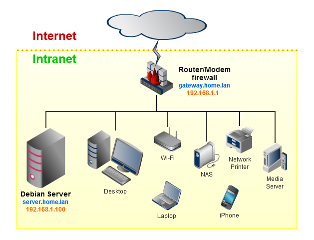
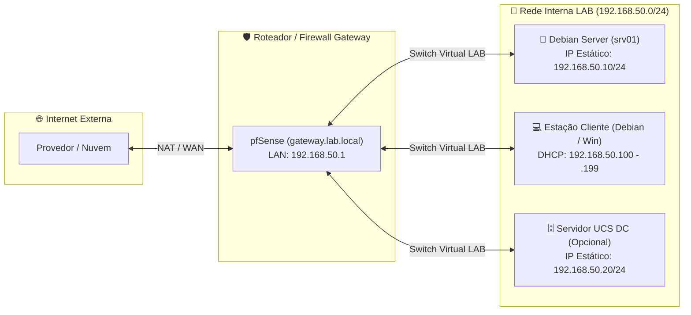
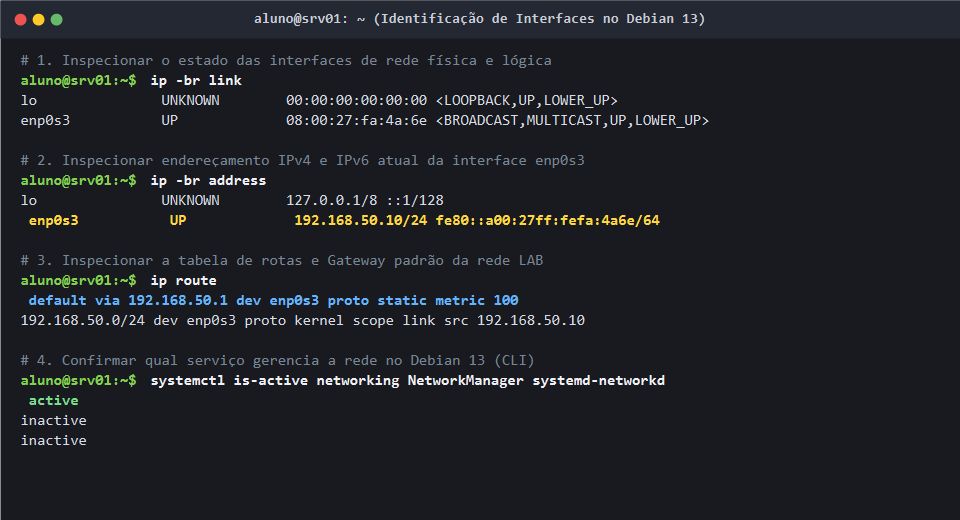
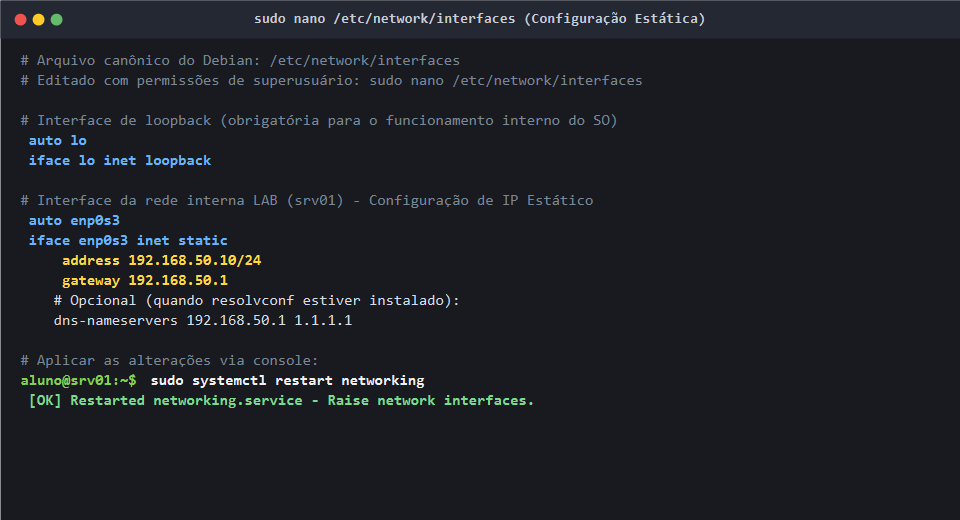
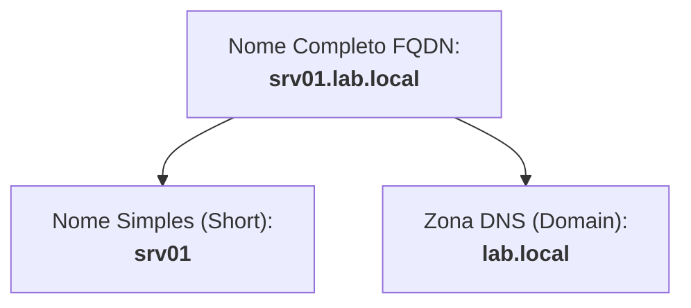
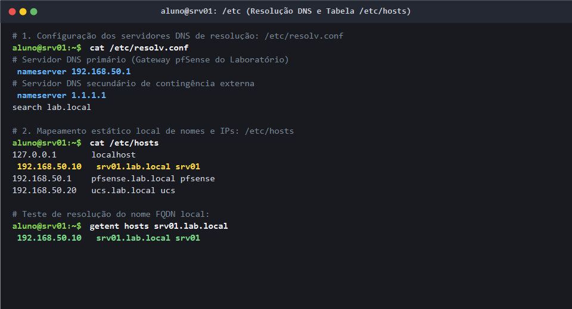
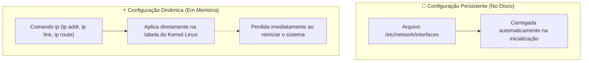
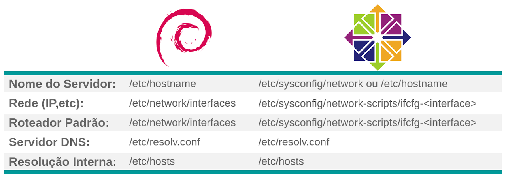
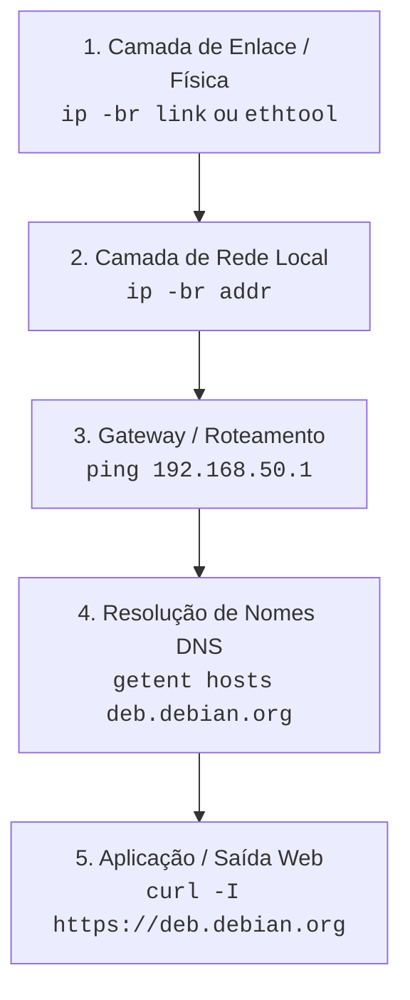
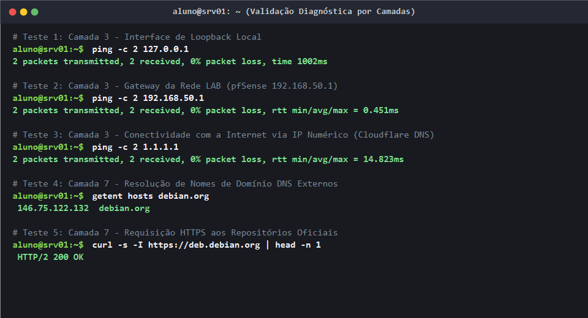

# 03 · Configurações de Rede no Debian 13 (Trixie)

[← 02 · Pacotes](02-pacotes.md) · [README](../README.md) · [Próximo: Usuários →](04-usuarios.md)

## Objetivo e Competências

Configurar, administrar e validar a conectividade de rede do servidor Linux (`srv01`), garantindo endereçamento IPv4 previsível, roteamento padrão seguro e resolução de nomes interna e externa.

Ao final deste capítulo, o estudante será capaz de:
- Aplicar práticas de segurança e controle de alterações antes de modificar arquivos críticos do sistema (cópia de segurança e auditoria com `diff`).
- Compreender a arquitetura de interfaces de rede sob o padrão *Predictable Network Interface Names* (`enp0s3`, `enp0s8`, `eno1`).
- Dominar a suíte moderna **`iproute2`** (`ip`, `ss`), reconhecendo a descontinuação da antiga suíte `net-tools` (`ifconfig`, `netstat`, `route`).
- Configurar interfaces de rede com endereço IP estático e dinâmico (DHCP) através do arquivo oficial `/etc/network/interfaces` no **Debian 13 (Trixie)**.
- Configurar o resolvedor de nomes DNS no arquivo `/etc/resolv.conf` e gerenciar a ordem de precedência no `/etc/nsswitch.conf`.
- Definir o *hostname* e o nome de domínio totalmente qualificado (*FQDN*) com `hostnamectl` e `/etc/hosts`.
- Executar administração em tempo de execução: manipulação de rotas, interfaces virtuais com alias (`label`) e renovação de concessões DHCP com os clientes suportados no Debian 13 (`dhcpcd` / `dhclient`).
- Utilizar ferramentas do NetworkManager (`nmtui` e `nmcli`) e correlacionar a arquitetura Debian com distribuições da família Red Hat / Enterprise Linux.
- Diagnosticar falhas de conectividade de ponta a ponta por camadas e registrar o snapshot de segurança do laboratório.

---

## 1. "Instalei e agora?" — Precauções e Cópias de Segurança

A configuração de um servidor Linux consiste, fundamentalmente, na instalação de pacotes de software e na parametrização detalhada dos seus arquivos de configuração textual em `/etc`.

Quando um serviço é instalado, ele traz uma configuração padrão básica e segura, muitas vezes inativa ou restrita ao endereço de loopback (`127.0.0.1`). Para ativar e obter o potencial necessário de infraestrutura, é indispensável personalizar essas diretivas. No entanto, uma falha de sintaxe em um arquivo de rede pode isolar o servidor imediatamente, derrubando o acesso remoto via SSH.

> [!CAUTION]
> **Regra de Ouro da Administração de Servidores:**
> **Nunca** altere um arquivo de configuração sem antes criar uma cópia de segurança (*backup*) do original. Em caso de falha ou comportamento inesperado, você poderá restabelecer a operação original em segundos.

### Cópia de segurança preventiva

Antes de qualquer modificação no arquivo `/etc/network/interfaces`, gere uma cópia com a extensão `.ori` ou `.bkp`:

```bash
# Cria uma cópia fiel do arquivo original
sudo cp /etc/network/interfaces /etc/network/interfaces.ori
```

### Edição e auditoria com o comando `diff`

Após realizar alterações no arquivo com seu editor preferido (`sudo nano /etc/network/interfaces` ou `sudo vim /etc/network/interfaces`), utilize o comando `diff` para auditar exatamente o que foi adicionado, modificado ou removido:

```bash
# Compara o arquivo original com o arquivo recém-editado
diff -u /etc/network/interfaces.ori /etc/network/interfaces
```

**Exemplo de saída do `diff -u`:**
```diff
--- /etc/network/interfaces.ori 2026-10-22 10:00:00.000000000 -0300
+++ /etc/network/interfaces     2026-10-22 10:15:00.000000000 -0300
@@ -4,4 +4,6 @@
 auto lo
 iface lo inet loopback
 
-iface enp0s3 inet dhcp
+auto enp0s3
+iface enp0s3 inet static
+    address 192.168.50.10/24
+    gateway 192.168.50.1
```

> [!TIP]
> O parâmetro `-u` (*unified output*) exibe o contexto com sinais de `-` (linhas removidas) e `+` (linhas inseridas), facilitando a identificação imediata de divergências e erros de digitação.

---

## 2. Diagrama da Rede e Identificação de Interfaces

### Topologia do ambiente

Em um ambiente corporativo ou doméstico de pequeno porte, o servidor Linux localiza-se dentro de uma rede interna privada (*Intranet*), conectado a um roteador/modem com firewall integrado que fornece a conexão externa para a *Internet*.



No nosso laboratório didático de máquinas virtuais, essa arquitetura é reproduzida conectando o servidor `srv01` à **Rede Interna (`LAB`)**, tendo o firewall pfSense como gateway padrão:



### Parâmetros de endereçamento adotados

| Parâmetro | Valor no Laboratório LAB | Exemplo Típico Doméstico | Função Técnica |
| :--- | :--- | :--- | :--- |
| **Endereço de Rede** | `192.168.50.0/24` | `192.168.1.0/24` | Identificador do segmento lógico de rede local. |
| **Máscara de Sub-rede** | `255.255.255.0` (`/24`) | `255.255.255.0` (`/24`) | Delimita a porção de rede e a porção de host. |
| **Endereço do Servidor (`srv01`)** | `192.168.50.10` | `192.168.1.100` | Endereço IPv4 estático, fixo e previsível fora do pool DHCP. |
| **Gateway Padrão (Roteador)** | `192.168.50.1` | `192.168.1.1` | Roteador/Firewall que encaminha pacotes destinados fora da LAN. |
| **Servidor DNS Principal** | `192.168.50.1` | `192.168.1.1` | Servidor responsável pela resolução de nomes de domínio. |
| **Endereço de Broadcast** | `192.168.50.255` | `192.168.1.255` | Endereço especial reservado para comunicação com todos os nós da rede. |

> [!NOTE]
> Em uma rede `/24`, o primeiro endereço (`.0`) representa a rede e o último (`.255`) é o broadcast. Nenhum desses dois pode ser atribuído a interfaces de computadores ou servidores.

---

### Nomenclatura Previsível de Interfaces (*Predictable Network Interface Names*)

Historicamente, o kernel Linux atribuía nomes sequenciais como `eth0`, `eth1` e `wlan0`. O problema dessa abordagem é que a ordem de detecção dos dispositivos pelo hardware durante o boot não era determinística: uma placa `eth0` poderia facilmente virar `eth1` após a adição de um novo hardware ou reinicialização.

A partir do `systemd` e do subsistema `udev`, o Debian adota o padrão **Predictable Network Interface Names**, gerando nomes baseados na localização física e topologia do barramento:

| Padrão de Prefixo | Significado | Exemplo Prático |
| :--- | :--- | :--- |
| `lo` | Interface de Loopback local | `lo` (endereço `127.0.0.1`) |
| `enpXsY` | Interface Ethernet em barramento PCI (slot X, função Y) | `enp0s3`, `enp0s8` (muito comum no VirtualBox / KVM) |
| `ensX` | Interface Ethernet em slot de conexão hotplug | `ens33`, `ens160` (muito comum no VMware) |
| `enoX` | Interface Ethernet integrada à placa-mãe (*on-board*) | `eno1`, `eno2` (servidores físicos de rack Dell, HP, Lenovo) |
| `wl...` | Interface de rede sem fio (Wireless) | `wlp2s0` |

---

### A Suíte `iproute2` no Debian 13 vs `net-tools` (Obsoleto)

No **Debian 13 (Trixie)**, a antiga suíte `net-tools` (`ifconfig`, `netstat`, `route`, `arp`) está oficialmente obsoleta e descontinuada. O padrão nativo e obrigatório é a suíte **`iproute2`** (comandos `ip` e `ss`).

| Ação Desejada | Comando Legado (`net-tools` - Obsoleto) | Comando Moderno Debian 13 (`iproute2` - Oficial) |
| :--- | :--- | :--- |
| Exibir endereços IP | `ifconfig -a` | `ip address` ou `ip -br address` |
| Exibir estado físico do link | `ifconfig eth0` | `ip -br link` ou `ip link show dev enp0s3` |
| Exibir tabela de rotas | `route -n` ou `netstat -rn` | `ip route` ou `ip route show` |
| Portas e conexões ativas | `netstat -tlpn` | `ss -tlpn` |
| Tabela de vizinhança ARP | `arp -n` | `ip neigh` ou `ip neighbour show` |
| Ativar / desativar placa | `ifconfig eth0 up / down` | `sudo ip link set enp0s3 up / down` |

---

### Inspecionando o estado atual da rede



Execute os comandos abaixo para identificar o nome real da placa de rede da sua VM e verificar o endereçamento temporário recebido via DHCP na instalação:

```bash
# Exibe resumo visual e compacto das interfaces e status físico
ip -br link

# Exibe resumo compacto dos endereços IPv4 e IPv6
ip -br -c address

# Exibe detalhes completos da configuração de rede
ip address show
```

**Exemplo de saída detalhada do comando `ip a`:**
```text
1: lo: <LOOPBACK,UP,LOWER_UP> mtu 65536 qdisc noqueue state UNKNOWN group default qlen 1000
    link/loopback 00:00:00:00:00:00 brd 00:00:00:00:00:00
    inet 127.0.0.1/8 scope host lo
       valid_lft forever preferred_lft forever
    inet6 ::1/128 scope host noprefixroute 
       valid_lft forever preferred_lft forever
2: enp0s3: <BROADCAST,MULTICAST,UP,LOWER_UP> mtu 1500 qdisc fq_codel state UP group default qlen 1000
    link/ether 08:00:27:35:a1:c4 brd ff:ff:ff:ff:ff:ff
    altname enx08002735a1c4
    inet 192.168.50.154/24 brd 192.168.50.255 scope global dynamic enp0s3
       valid_lft 86320sec preferred_lft 86320sec
    inet6 fe80::a00:27ff:fe35:a1c4/64 scope link 
       valid_lft forever preferred_lft forever
```

<details>
<summary>🔍 O que significa cada campo da saída do comando ip?</summary>

- `<BROADCAST,MULTICAST,UP,LOWER_UP>`:
  - `UP`: A camada lógica da interface está ativa administrativamente.
  - `LOWER_UP`: A camada física (enlace/cabo virtual) está conectada e operando.
  - `BROADCAST`: A interface suporta envio para endereço de broadcast.
  - `MULTICAST`: A interface suporta grupos de transmissão multicast.
- `mtu 1500`: *Maximum Transmission Unit* (tamanho máximo do quadro Ethernet em bytes, padrão 1500).
- `link/ether 08:00:27:35:a1:c4`: Endereço físico MAC da placa de rede.
- `inet 192.168.50.154/24`: Endereço IPv4 com máscara em notação CIDR (`/24` = `255.255.255.0`).
- `scope global dynamic`: O endereço possui alcance de rede global e foi obtido **dinamicamente** (via DHCP).
- `valid_lft 86320sec`: Tempo restante de validade da concessão (*lease*) DHCP.

</details>

---

### Diagnóstico de Camada Física com `ethtool`

O utilitário `ethtool` consulta o driver e o controlador de rede diretamente, permitindo verificar a velocidade negociada, o modo duplex e a presença de sinal no cabo:

```bash
# No Debian 13, o ethtool pode ser instalado via APT caso ainda não esteja presente
sudo apt update && sudo apt install -y ethtool

# Consulta o status físico da interface enp0s3
sudo ethtool enp0s3
```

**Trecho relevante da saída:**
```text
Settings for enp0s3:
    Supported ports: [ TP ]
    Speed: 1000Mb/s
    Duplex: Full
    Port: Twisted Pair
    Auto-negotiation: on
    Link detected: yes
```
> [!IMPORTANT]
> O parâmetro `Link detected: yes` confirma que a placa de rede virtual está conectada ao switch virtual do hipervisor. Caso apareça `no`, verifique nas configurações da VM se o cabo de rede virtual está marcado como "Conectado".

---

## 3. Configuração Definitiva no Debian 13 (`/etc/network/interfaces`)

No perfil de servidor sem interface gráfica (*headless*), o Debian 13 utiliza o subsistema **`ifupdown`** gerenciado pelo arquivo `/etc/network/interfaces` e pelos scripts do diretório `/etc/network/interfaces.d/`.

### Opções fundamentais do arquivo `/etc/network/interfaces`

| Diretiva | Descrição Técnica |
| :--- | :--- |
| `source /etc/network/interfaces.d/*` | Inclui automaticamente arquivos de configuração modulares adicionais. |
| `auto <interface>` | Inicializa a interface automaticamente durante o boot do sistema. |
| `allow-hotplug <interface>` | Inicializa a interface sob demanda quando o kernel/udev detecta evento de conexão. |
| `iface <interface> inet static` | Define que a interface utilizará o protocolo IPv4 (`inet`) com configuração estática e fixa. |
| `iface <interface> inet dhcp` | Define que a interface obterá parâmetros dinâmicos via cliente DHCP. |
| `address <IP/Prefixo>` | Define o endereço IPv4. No Debian 13, recomenda-se a notação CIDR direta (ex: `192.168.50.10/24`). |
| `netmask <máscara>` | Máscara de rede tradicional em formato decimal pontuado (ex: `255.255.255.0`). Opcional se usar CIDR no `address`. |
| `gateway <IP>` | Endereço do roteador padrão da rede. **Deve existir apenas um gateway padrão no servidor.** |
| `broadcast <IP>` | *(Opcional)* Endereço de broadcast. O `ifupdown` no Debian 13 calcula automaticamente. |
| `network <IP>` | *(Opcional/Legado)* Endereço da rede. Também calculado automaticamente pela máscara. |

---

### Configurando o Servidor `srv01` com IP Estático

1. Certifique-se de que a máquina virtual está conectada à **Rede Interna (`LAB`)** nas opções de rede do hipervisor.
2. Abra o arquivo de configuração para edição:
   ```bash
   sudo nano /etc/network/interfaces
   ```
3. Edite o arquivo para definir a configuração estática da interface principal (substitua `enp0s3` pelo nome real da sua placa, caso seja diferente):

```ini
# /etc/network/interfaces — Configuração de Rede do srv01
source /etc/network/interfaces.d/*

# 1. Interface de Loopback local
auto lo
iface lo inet loopback

# 2. Interface de Rede Principal (Rede Interna LAB)
auto enp0s3
iface enp0s3 inet static
    address 192.168.50.10/24
    gateway 192.168.50.1
```

> [!NOTE]
> **Sintaxe Expandida Clássica vs Sintaxe CIDR no Debian 13:**
> No material de referência tradicional, as diretivas apareciam desmembradas:
> ```ini
> iface enp0s3 inet static
>     address 192.168.50.10
>     netmask 255.255.255.0
>     network 192.168.50.0
>     broadcast 192.168.50.255
>     gateway 192.168.50.1
> ```
> Ambas as sintaxes funcionam perfeitamente no Debian 13. A forma moderna compacta (`address 192.168.50.10/24`) é a recomendada pela documentação oficial atual (`man interfaces`), pois previne inconsistências de cálculo de sub-rede.

Salve o arquivo pressionando `Ctrl+O`, tecle `Enter` e saia com `Ctrl+X`.



---

### Aplicando a Nova Configuração com Segurança

No console da máquina virtual (ou janela do hipervisor), execute a aplicação das configurações:

```bash
# Método 1: Reinício formal do serviço de rede via systemd (Recomendado)
sudo systemctl restart networking

# Valida se o serviço subiu perfeitamente sem erros
sudo systemctl status networking --no-pager
```

Se preferir alternar a interface individualmente:
```bash
# Método 2: Desativar e reativar a interface específica
sudo ifdown enp0s3 && sudo ifup enp0s3
```

> [!WARNING]
> **Limpeza de IPs Antigos em Concessões DHCP:**
> Ao alternar uma interface de DHCP para estática em tempo de execução, o endereço IP atribuído anteriormente pelo DHCP pode permanecer associado à interface em memória. Caso `ip -br a` exiba dois IPs simultâneos na mesma placa, limpe os endereços residuais e reative a interface:
> ```bash
> sudo ip addr flush dev enp0s3
> sudo systemctl restart networking
> ```

---

## 4. Resolução de Nomes Externa (`/etc/resolv.conf`)

O arquivo `/etc/resolv.conf` é o arquivo de configuração principal da biblioteca resolvedora de nomes (*resolver*) da `glibc` no Linux. É ele que orienta as aplicações sobre quais servidores DNS consultar para traduzir nomes de domínio (como `deb.debian.org` ou `google.com.br`) em endereços IP.

### Diretivas suportadas no `/etc/resolv.conf`

```ini
# Especifica a lista de sufixos de domínio para buscas de nomes curtos (máx: 6 domínios ou 256 caracteres)
search lab.local senacsp.edu.br

# Especifica o endereço IPv4 do servidor DNS recursivo (pode ser repetido até 3 vezes)
nameserver 192.168.50.1
nameserver 1.1.1.1
```

- `nameserver <IP>`: Endereço do resolvedor DNS. As consultas são feitas na ordem em que aparecem. Se o primeiro não responder dentro do tempo limite (*timeout*), o segundo é consultado.
- `search <domínios>`: Lista de domínios para completar pesquisas automáticas de nomes curtos. Se você executar `ping srv02`, o resolvedor tentará sucessivamente `srv02.lab.local` e `srv02.senacsp.edu.br`.
- `domain <domínio>`: *(Legado)* Especifica o domínio local único. Na especificação da `glibc` no Debian 13, as palavras-chave `domain` e `search` são mutuamente exclusivas: caso ambas estejam presentes, **a última declarada prevalecerá**. Por isso, a boa prática oficial é utilizar exclusivamente a diretiva `search`.

Edite o arquivo `/etc/resolv.conf`:
```bash
sudo nano /etc/resolv.conf
```

Ajuste para os valores do laboratório:
```text
search lab.local
nameserver 192.168.50.1
nameserver 1.1.1.1
```

---

## 5. Nome do Sistema: `/etc/hostname`, `hostnamectl` e `/etc/hosts`

A identidade do servidor em rede compreende o seu nome simples (*short hostname*) e o seu nome de domínio totalmente qualificado (*Fully Qualified Domain Name - FQDN*).



### 1. Definindo o Hostname com `hostnamectl`

O arquivo `/etc/hostname` deve conter **apenas** o nome simples do computador, sem extensões de domínio.

No Debian 13 com `systemd`, o método padrão e seguro para alterar o nome da máquina é o comando `hostnamectl`:

```bash
# Define o novo hostname do servidor
sudo hostnamectl set-hostname srv01

# Valida o arquivo gerado
cat /etc/hostname
```

> [!NOTE]
> No material legado do Debian 10 / SysVinit, utilizava-se o comando `hostname -F /etc/hostname` para recarregar o nome a partir do arquivo. O utilitário `hostnamectl` executa essa atualização em memória e sincroniza o `/etc/hostname` imediatamente.

---

### 2. Mapeamento Local no `/etc/hosts`

O arquivo `/etc/hosts` funciona como um banco de dados estático e prioritário de resolução de nomes local. Ele garante que os serviços do próprio servidor consigam resolver seu FQDN e seu IP fixo mesmo que a rede ou os servidores DNS externos estejam inacessíveis.

Edite o `/etc/hosts`:
```bash
sudo nano /etc/hosts
```

Configure a estrutura padronizada conforme as boas práticas oficiais do Debian:

```text
127.0.0.1   localhost
192.168.50.10   srv01.lab.local srv01

# Definições padronizadas para hosts compatíveis com IPv6
::1     localhost ip6-localhost ip6-loopback
ff02::1 ip6-allnodes
ff02::2 ip6-allrouters
```

> [!IMPORTANT]
> A linha `192.168.50.10 srv01.lab.local srv01` deve relacionar o IP fixo da máquina ao seu FQDN completo primeiro e, em seguida, ao nome simples. Isso é indispensável para o correto funcionamento de serviços como MTA (Postfix/Exim), banco de dados e certificados SSL/TLS.



---

### 3. Bateria de Verificação de Identidade

Execute a sequência de comandos para confirmar se o sistema responde com os identificadores corretos:

```bash
# Exibe o status consolidado do sistema e virtualização
hostnamectl status

# Exibe apenas o nome simples da máquina
hostname --short
# Saída esperada: srv01

# Exibe o domínio configurado
hostname --domain
# Saída esperada: lab.local

# Exibe o FQDN completo associado ao servidor
hostname --fqdn
# Saída esperada: srv01.lab.local

# Exibe o IP associado ao hostname no /etc/hosts
hostname --ip-address
# Saída esperada: 192.168.50.10

# Exibe todos os endereços IPs atualmente operacionais nas interfaces
hostname -I
# Saída esperada: 192.168.50.10 ...
```

---

## 6. Ordem de Resolução de Nomes: `/etc/nsswitch.conf`

O arquivo `/etc/nsswitch.conf` (*Name Service Switch*) atua como a central de controle que determina quais bases de dados e serviços o sistema operacional deve consultar ao buscar informações de usuários (`passwd`), grupos (`group`) e, fundamentalmente, nomes de máquinas em rede (`hosts`).

Abra o arquivo para inspecionar a diretiva de resolução de hosts:
```bash
grep "^hosts:" /etc/nsswitch.conf
```

**Linha padrão no Debian 13:**
```text
hosts:          files dns
```
*(ou em instalações com `systemd` estendido: `hosts: files mdns4_minimal [NOTFOUND=return] dns myhostname`)*

### Entendendo a ordem das palavras-chave

1. `files`: O sistema consulta primeiramente o arquivo local `/etc/hosts`.
2. `dns`: Caso o nome não seja encontrado localmente em `files`, o sistema encaminha a consulta para os servidores especificados em `/etc/resolv.conf`.
3. `myhostname`: Módulo do `systemd` que resolve automaticamente o hostname local caso ele não esteja no `/etc/hosts`.

### Laboratório Prático: Experimentando a Ordem de Resolução

Para demonstrar como o `nsswitch.conf` controla a resolução, crie uma entrada de teste fictícia no `/etc/hosts`:

```bash
# Adiciona uma entrada fictícia vinculando um domínio externo a um IP local
echo "192.168.50.250 www.google.com.br" | sudo tee -a /etc/hosts
```

Agora teste o ping:
```bash
ping -c 2 www.google.com.br
```
*Resultado observado:* O ping tentará alcançar o IP `192.168.50.250`, comprovando que o `files` teve prioridade absoluta sobre o DNS externo da internet!

Remova a linha de teste ao concluir:
```bash
sudo sed -i '/192.168.50.250/d' /etc/hosts
```

---

## 7. Laboratório Prático: Administração Dinâmica com o Comando `ip`

Todas as alterações efetuadas em arquivos de configuração (`/etc/network/interfaces`) tornam-se permanentes após o boot. No entanto, o administrador de sistemas precisa saber manipular a rede **em tempo de execução**, utilizando o comando `ip`.



---

### Prática 1: Desativar e Reativar Interfaces e Remover Endereços

```bash
# 1. Visualizar o estado da interface enp0s3
ip address show enp0s3

# 2. Desativar a camada física/lógica da interface (estado passa para DOWN)
sudo ip link set enp0s3 down
ip -br link show dev enp0s3

# 3. Reativar a interface (estado passa para UP)
sudo ip link set enp0s3 up
ip -br link show dev enp0s3

# 4. Remover um endereço IP específico atribuído à interface
sudo ip addr del 192.168.50.10/24 dev enp0s3
ip -br address show dev enp0s3

# 5. Readicionar o endereço IP manualmente
sudo ip addr add 192.168.50.10/24 dev enp0s3
ip -br address show dev enp0s3
```

---

### Prática 2: Solicitação Manual de Concessão DHCP

Quando uma interface está sem endereço IP e você precisa solicitar parâmetros temporários a um servidor DHCP via linha de comando:

> [!IMPORTANT]
> **Mudança Importante no Debian 13 (Trixie):**
> O antigo pacote `isc-dhcp-client` (comando `dhclient`) atingiu o fim de vida (*End-of-Life*) pelo mantenedor ISC e foi substituído no Debian 13 pelo **`dhcpcd-base`** (comando `dhcpcd`) ou pelo utilitário `networkctl` / `nmcli`.
> - Se o seu sistema utiliza o cliente moderno: `sudo dhcpcd enp0s3` (ou `sudo dhcpcd -k enp0s3` para liberar o lease).
> - Se o seu sistema possuir o pacote legado instalado: `sudo dhclient enp0s3` (ou `sudo dhclient -r enp0s3` para release).

---

### Prática 3: Configuração de IP Virtual (*Alias de Interface*)

Um **IP Virtual** (ou *alias* de interface) permite que uma única placa de rede física responda por dois ou mais endereços IP distintos em sub-redes diferentes. Essa técnica é amplamente utilizada em servidores que hospedam múltiplos serviços, migrações de sub-redes ou isolamento de aplicações.

```bash
# Adiciona um IP secundário na interface enp0s3 com o rótulo (label) virtual enp0s3:0
sudo ip addr add 10.10.0.20/16 dev enp0s3 label enp0s3:0

# Inspeciona a interface e confirma o alias ativo
ip address show enp0s3

# Testa a conectividade local respondendo pelo novo IP virtual
ping -c 3 10.10.0.20
```

Para remover a interface virtual após o teste:
```bash
# Remove o IP virtual enp0s3:0
sudo ip addr del 10.10.0.20/16 dev enp0s3:0
```

---

### Prática 4: Manipulação da Rota Padrão (*Gateway*) com `ip route`

O gateway padrão é o endereço para onde todos os pacotes destinados a redes desconhecidas (como toda a Internet) são despachados.

```bash
# 1. Lista a tabela de roteamento atual do Kernel
ip route show

# Saída típica esperada:
# default via 192.168.50.1 dev enp0s3 onlink 
# 192.168.50.0/24 dev enp0s3 proto kernel scope link src 192.168.50.10

# 2. Testa a conectividade com a internet externa
ping -c 2 8.8.8.8

# 3. Remove a rota padrão (Gateway) do sistema
sudo ip route del default

# 4. Tenta novamente o ping para a internet
ping -c 2 8.8.8.8
# Resultado observado: "ping: connect: Network is unreachable"
# Explicação: Sem gateway padrão, o Linux não sabe por onde despachar pacotes fora da rede local!

# 5. Adiciona novamente a rota padrão apontando para o pfSense
sudo ip route add default via 192.168.50.1 dev enp0s3

# 6. Valida o restabelecimento imediato da saída para a internet
ping -c 2 8.8.8.8
```

---

## 8. NetworkManager e Comparativo Multi-Distribuição (Debian vs Red Hat/CentOS)

### O NetworkManager no Debian 13 (`nmtui` e `nmcli`)

Enquanto servidores puros costumam utilizar o `ifupdown` tradicional, estações de trabalho e servidores com interface gráfica utilizam o **NetworkManager**.

No Debian 13, você pode operar o NetworkManager diretamente pelo terminal:

```bash
# 1. Interface em modo texto interativa e amigável (semelhante ao instalador)
sudo nmtui
```

Ou através da ferramenta de linha de comando `nmcli`:
```bash
# Exibe o status geral do serviço
sudo nmcli general status

# Lista as interfaces físicas e seus estados
sudo nmcli device status

# Lista as conexões e perfis atualmente ativos
sudo nmcli connection show --active
```

---

### Comparativo: Família Debian vs Família Red Hat (RHEL/CentOS)

O ecossistema Linux possui convenções de arquivos de rede diferentes dependendo da distribuição base adotada:



| Recurso do Sistema | Debian GNU/Linux / Ubuntu | Red Hat Enterprise Linux / CentOS / Rocky |
| :--- | :--- | :--- |
| **Nome do Servidor** | `/etc/hostname` | `/etc/hostname` *(antigamente `/etc/sysconfig/network`)* |
| **Configuração de Interfaces** | `/etc/network/interfaces` | `/etc/NetworkManager/system-connections/*.nmconnection` *(legado: `/etc/sysconfig/network-scripts/ifcfg-<int>`)* |
| **Roteador Padrão (Gateway)** | Diretiva `gateway` em `/etc/network/interfaces` | Diretiva `GATEWAY` no script da interface ou `gateway4` |
| **Servidores DNS** | `/etc/resolv.conf` | `/etc/resolv.conf` |
| **Mapeamento de Nomes Locais**| `/etc/hosts` | `/etc/hosts` |
| **Gerenciador Padrão** | `ifupdown` / `systemd-networkd` / `NetworkManager` | `NetworkManager` (`nmcli`, `nmtui`) |

<details>
<summary>📋 Como era o arquivo ifcfg-enp0s3 no Red Hat / CentOS clássico?</summary>

Para fins de comparação didática com o `/etc/network/interfaces` do Debian:
```ini
# /etc/sysconfig/network-scripts/ifcfg-enp0s3 (Red Hat / CentOS 7)
DEVICE=enp0s3
BOOTPROTO=none
ONBOOT=yes
IPADDR=192.168.50.10
NETMASK=255.255.255.0
GATEWAY=192.168.50.1
DNS1=192.168.50.1
```
Observe como no Debian as palavras-chave são minúsculas (`address`, `gateway`, `netmask`), enquanto no RHEL eram maiúsculas (`IPADDR`, `GATEWAY`, `NETMASK`).

</details>

---

## 9. Roteiro de Validação e Diagnóstico por Camadas

Nunca conclua que a rede está plenamente funcional realizando apenas um teste isolado. Utilize o método de **diagnóstico por camadas**:



### Bateria de Testes em Camadas no Terminal:



```bash
# 1. Enlace físico (Cabo conectado e placa UP)
ip -br link show dev enp0s3

# 2. Endereço IP estático configurado corretamente
ip -br addr show dev enp0s3

# 3. Teste de conectividade com o Gateway (pfSense)
ping -c 3 192.168.50.1

# 4. Teste de conectividade com a internet externa por IP puro (descarta DNS)
ping -c 3 1.1.1.1

# 5. Teste de resolução de nomes DNS
getent hosts debian.org

# 6. Teste da camada de aplicação HTTP/HTTPS
curl -I https://deb.debian.org
```

### Matriz de Resolução de Problemas (*Troubleshooting*)

| Sintoma Observado | Causa Mais Provável | Ação Corretiva Recomendada |
| :--- | :--- | :--- |
| `Link detected: no` no ethtool | Placa desconectada no hipervisor | Ativar a opção "Cabo conectado" nas configurações de rede da VM. |
| Dois IPs na mesma interface | IP residual do DHCP antigo | Executar `sudo ip addr flush dev enp0s3` e reiniciar o networking. |
| `Network is unreachable` | Falta da rota padrão (Gateway) | Conferir diretiva `gateway 192.168.50.1` em `/etc/network/interfaces`. |
| IP alcança internet, mas nome não resolve | Falha no DNS ou `/etc/resolv.conf` | Verificar os `nameserver` em `/etc/resolv.conf` e se a porta UDP 53 está liberada. |
| Hostname curto resolve, FQDN não | Linha incompleta no `/etc/hosts` | Adicionar o FQDN antes do hostname curto na linha do IP no `/etc/hosts`. |

---

## 10. Criação do Snapshot de Segurança

Com a conectividade de rede totalmente validada e persistente, desligue a máquina e registre o snapshot:

```bash
# Desliga a VM de forma ordenada
sudo poweroff
```

No menu de Snapshots do seu hipervisor:
- **Nome do Snapshot:** `03-Rede-Estatica-Configurada`
- **Descrição:** *Endereço IP estático 192.168.50.10/24 configurado no interfaces, gateway 192.168.50.1 funcional, DNS resolvendo e hostname srv01.lab.local devidamente mapeado no hosts.*

---

## 11. Checklist de Validação do Estudante

Antes de avançar para o **Capítulo 04 · Administração de Usuários, Grupos e Permissões**, confirme o cumprimento de cada item:

- [ ] Realizou backup do arquivo `/etc/network/interfaces` e auditou com `diff -u`.
- [ ] O comando `ip -br link` confirma a interface principal com status `UP`.
- [ ] A interface possui o endereço IP estático fixado em `192.168.50.10/24`.
- [ ] O gateway padrão `192.168.50.1` está presente em `ip route` e responde ao `ping`.
- [ ] O arquivo `/etc/resolv.conf` aponta para os servidores DNS válidos e `getent hosts debian.org` resolve com sucesso.
- [ ] Os comandos `hostname -s` e `hostname -f` retornam respectivamente `srv01` e `srv01.lab.local`.
- [ ] Testou a manipulação dinâmica de rotas (`ip route del/add`) e o conceito de alias virtual (`label`).
- [ ] O snapshot `03-Rede-Estatica-Configurada` foi criado no hipervisor.

---

## Exercícios Práticos e Teóricos

1. **Prático:** Adicione um segundo IP virtual na interface de rede com o endereço `192.168.50.99/24` utilizando o rótulo `enp0s3:1`. Comprove que o servidor responde a ping em ambos os endereços e depois remova-o.
2. **Teórico:** Explique por que alterar apenas o servidor DNS em `/etc/resolv.conf` não restaura o acesso à internet se a rota padrão (`default gateway`) estiver ausente da tabela de rotas.
3. **Prático:** Altere temporariamente o `/etc/hosts` adicionando uma entrada associando o domínio `senacsp.edu.br` ao IP `127.0.0.1`. Execute `getent hosts senacsp.edu.br`, anote a resposta e explique qual diretiva do `/etc/nsswitch.conf` determinou esse comportamento.
4. **Teórico:** Qual a diferença fundamental entre as palavras-chave `auto` e `allow-hotplug` no arquivo `/etc/network/interfaces` do Debian?

---

## Referências Oficiais Debian

- [Debian Wiki — Network Configuration](https://wiki.debian.org/NetworkConfiguration)
- [Debian Reference — Chapter 5: Network setup](https://www.debian.org/doc/manuals/debian-reference/ch05.en.html)
- [Debian 13 (Trixie) Release Notes — Network Changes](https://www.debian.org/releases/trixie/release-notes/)
- [Manual Oficial man interfaces(5)](https://manpages.debian.org/trixie/ifupdown/interfaces.5.en.html)
- [Manual Oficial man ip-address(8) e man ip-route(8)](https://manpages.debian.org/trixie/iproute2/ip.8.en.html)
- [Manual Oficial man resolv.conf(5)](https://manpages.debian.org/trixie/manpages/resolv.conf.5.en.html)

---

[← Voltar para 02 · Pacotes](02-pacotes.md) · [README](../README.md) · [Avançar para 04 · Usuários →](04-usuarios.md)

