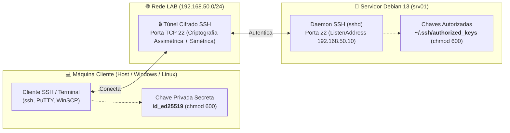
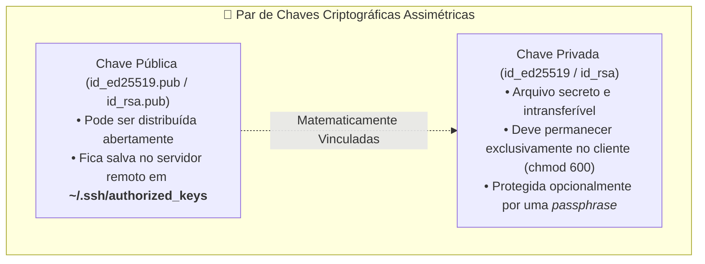

# 04 · Acesso Remoto com SSH no Debian 13 (Trixie)

[← 03 · Rede](03-rede.md) · [README](../README.md) · [Próximo: Usuários →](05-usuarios.md)

## Objetivo e Competências

Implementar, configurar e proteger o serviço de acesso remoto administrativo seguro através do protocolo **SSH (Secure Shell)** no servidor Linux (`srv01`), eliminando a necessidade de login físico no console da máquina virtual e estabelecendo autenticação forte baseada em pares de chaves criptográficas assimétricas.

Ao final deste capítulo, o estudante será capaz de:
- Compreender a arquitetura cliente-servidor do SSH, a separação de papéis entre `ssh_config` (cliente) e `sshd_config` (servidor), e o funcionamento da porta TCP padrão `22`.
- Instalar e gerenciar o daemon oficial `openssh-server` através do `systemd` no **Debian 13 (Trixie)**.
- Parametrizar opções críticas de segurança no servidor: restrição de interfaces de escuta (`ListenAddress`), desativação de senhas em branco (`PermitEmptyPasswords`) e bloqueio de login direto do superusuário (`PermitRootLogin no`).
- Compreender e aplicar a nova arquitetura modular de configuração do OpenSSH no Debian 13 com diretórios drop-in (`/etc/ssh/sshd_config.d/*.conf`).
- Gerar pares de chaves criptográficas com `ssh-keygen` utilizando os algoritmos suportados no Debian 13 (**Ed25519** e **RSA 4096 bits**), compreendendo o conceito de chave pública vs privada e o uso de *passphrase*.
- Distribuir a chave pública para o servidor com `ssh-copy-id` e entender a estrutura de permissões estritas no diretório `~/.ssh` e no arquivo `authorized_keys`.
- Realizar o endurecimento (*hardening*) do servidor desativando autenticação por senha convencional (`PasswordAuthentication no`) sem risco de bloqueio acidental.
- Transferir arquivos de forma cifrada utilizando `scp` e clientes gráficos SFTP (`WinSCP` e `FileZilla`).
- Diagnosticar falhas de autenticação com o modo verboso (`ssh -v`) e inspeção de eventos no `journalctl`.

---

## 1. O Protocolo SSH e a Arquitetura de Comunicação

Como regra fundamental da administração de infraestrutura, **não se deve operar fisicamente no console de um servidor**, exceto para manutenção ou reparo de hardware. Servidores modernos de datacenter operam em modo *headless* (sem monitor, teclado ou mouse físicos), e toda a gestão rotineira é realizada remotamente.

O protocolo **SSH (Secure Shell)** opera na camada de aplicação da pilha TCP/IP, criando um canal de comunicação bidirecional fortemente autenticado e criptografado de ponta a ponta sobre uma conexão TCP (porta padrão `22`). Ele substituiu protocolos inseguros do passado (como `telnet` e `rlogin`), que transmitiam comandos e senhas em texto puro pela rede local.



### Versatilidade do protocolo SSH
O protocolo SSH oferece múltiplos serviços além do terminal interativo:
1. **Emulação de Terminal Remoto (`ssh`):** Acesso à linha de comando com controle total de pseudoterminal (*TTY*).
2. **Transferência Segura de Arquivos (`sftp` e `scp`):** Cópia criptografada de dados utilizando os mesmos privilégios de acesso e chaves do usuário.
3. **Encaminhamento de Portas e Túneis Seguros (*Port Forwarding*):** Criação de túneis seguros criptografados para encapsular protocolos de outras aplicações (como HTTP, bancos de dados MariaDB/PostgreSQL e conexões VNC).

---

### Ecossistema de Clientes SSH

Os clientes SSH dividem-se em dois grandes grupos:

| Categoria | Função | Ferramentas no Linux | Ferramentas no Windows |
| :--- | :--- | :--- | :--- |
| **Terminal SSH** | Acesso interativo remoto à linha de comandos (*CLI*) | `openssh-client` (`ssh`), GNOME Terminal | **OpenSSH Client nativo** (PowerShell / Windows Terminal), PuTTY |
| **Cliente SFTP** | Gerenciador gráfico de transferência de arquivos | FileZilla, Nautilus, Dolphin | WinSCP, FileZilla, Cyberduck |

> [!TIP]
> No Windows 10 e Windows 11 modernos, o cliente oficial **OpenSSH** já vem integrado nativamente ao sistema. Você pode executar comandos como `ssh aluno@192.168.50.10` e `ssh-keygen` diretamente no **PowerShell** ou no **Windows Terminal**, sem necessidade imediata de instalar programas adicionais.

---

## 2. Instalação e Gerenciamento do Servidor SSH no Debian 13

No Debian 13, o serviço do servidor SSH é provido pelo pacote oficial **`openssh-server`**. Caso você já tenha marcado o item "Servidor SSH" durante o *tasksel* na instalação do [Capítulo 00](00-instalacao.md), o serviço já estará presente.

### Instalação dos pacotes
Execute no console do `srv01`:

```bash
# Atualiza os índices do repositório oficial
sudo apt update

# Instala o servidor e cliente SSH
sudo apt install -y openssh-server openssh-client
```

### Gerenciamento do serviço com o `systemd`

O daemon de serviço do SSH chama-se `ssh.service` (ou `sshd.service` como alias):

```bash
# Habilita a inicialização automática no boot e inicia o daemon imediatamente
sudo systemctl enable --now ssh

# Verifica o status operacional do daemon
sudo systemctl status ssh --no-pager
```

**Saída típica esperada:**
```text
● ssh.service - OpenBSD Secure Shell server
     Loaded: loaded (/usr/lib/systemd/system/ssh.service; enabled; preset: enabled)
     Active: active (running) since Thu 2026-10-22 10:30:00 -03; 5min ago
   Main PID: 742 (sshd)
      Tasks: 1 (limit: 2321)
     Memory: 4.8M
        CPU: 18ms
     CGroup: /system.slice/ssh.service
             └─742 "sshd: /usr/sbin/sshd -D [listener] 0 of 10-100 startups"
```

### Confirmando a porta em escuta com `ss`
No Debian 13, conferimos as portas em escuta utilizando a suíte `iproute2`:

```bash
# Exibe portas TCP em modo de escuta com identificação do processo
sudo ss -tlpn | grep :22
```

**Saída esperada:**
```text
LISTEN 0      128          0.0.0.0:22        0.0.0.0:*    users:(("sshd",pid=742,fd=3))
LISTEN 0      128             [::]:22           [::]:*    users:(("sshd",pid=742,fd=4))
```

---

## 3. Parametrização e Configuração do Servidor (`sshd_config`)

O serviço SSH é controlado por dois arquivos de configuração distintos:

| Arquivo de Configuração | Papel no Sistema | Escopo |
| :--- | :--- | :--- |
| **`/etc/ssh/sshd_config`** | Configurações do **Servidor SSH** (`sshd`) | Controla quem pode entrar, portas, métodos de autenticação e restrições. |
| **`/etc/ssh/ssh_config`** | Configurações do **Cliente SSH** (`ssh`) | Controla como as conexões originadas nesta máquina para outros servidores se comportam. |

---

### Arquitetura Drop-in Moderna no Debian 13 (`sshd_config.d/`)

No **Debian 13 (OpenSSH 9.9+)**, o arquivo `/etc/ssh/sshd_config` traz em sua primeira linha ativa a diretiva:

```ini
Include /etc/ssh/sshd_config.d/*.conf
```

> [!IMPORTANT]
> **Boas Práticas de Administração Moderna:**
> Em vez de editar diretamente o arquivo `/etc/ssh/sshd_config` original (o que pode gerar conflitos durante atualizações de pacotes com o `apt upgrade`), a recomendação oficial do Debian é criar arquivos de configuração modulares com extensão `.conf` dentro de `/etc/ssh/sshd_config.d/`.
> 
> *Atenção à Precedência:* O OpenSSH adota a regra do **primeiro valor encontrado** (*first match wins*). Arquivos que começam com numeração menor (ex: `00-seguranca.conf`) são avaliados primeiro e têm precedência sobre os parâmetros do arquivo base.

---

### Diretivas Essenciais do Servidor SSH

| Diretiva | Valor Padrão | Recomendação de Produção | Descrição Técnica |
| :--- | :---: | :---: | :--- |
| `Port` | `22` | `22` (ou porta alta personalizada) | Porta TCP onde o daemon aceita conexões de entrada. |
| `AddressFamily` | `any` | `inet` ou `any` | Família de endereços (`inet` para IPv4 exclusivo, `inet6` ou `any` para ambos). |
| `ListenAddress` | `0.0.0.0` | `192.168.50.10` | Restringe a escuta a um endereço IP de interface específica, ignorando outras placas. |
| `PermitRootLogin` | `prohibit-password` | `no` | Bloqueia totalmente o acesso direto com o usuário `root`. |
| `PermitEmptyPasswords` | `no` | `no` | Impede autenticação de contas de usuário sem senha cadastrada. |
| `PasswordAuthentication`| `yes` | `no` *(após cadastrar chaves)* | Exige que o cliente apresente uma chave criptográfica válida para autenticar. |
| `LoginGraceTime` | `2m` | `1m` ou `30s` | Tempo máximo que o servidor aguarda o cliente concluir o processo de autenticação. |

---

### Configuração de Parâmetros de Escuta e Segurança Inicial

Vamos criar uma configuração de segurança modular para o nosso servidor `srv01`:

```bash
# Cria o arquivo de configuração modular do laboratório
sudo nano /etc/ssh/sshd_config.d/00-srv01-seguranca.conf
```

Insira o conteúdo abaixo:

```ini
# /etc/ssh/sshd_config.d/00-srv01-seguranca.conf
# Configurações de Segurança e Escuta do srv01 — Debian 13

# 1. Porta de escuta padrão TCP
Port 22

# 2. Endereço da interface onde o serviço atenderá conexões
# Restringe o serviço exclusivamente ao IP estático da Rede Interna LAB
ListenAddress 192.168.50.10

# 3. Tempo limite para conclusão do login (previne ocupação de conexões órfãs)
LoginGraceTime 1m

# 4. Bloqueio de acesso administrativo direto do superusuário root
# O administrador deve conectar com a conta 'aluno' e elevar com 'sudo'
PermitRootLogin no

# 5. Proibição de contas sem senha
PermitEmptyPasswords no

# 6. Permitir autenticação por senha (mantido 'yes' temporariamente para a cópia inicial de chaves)
PasswordAuthentication yes
```

Salve o arquivo com `Ctrl+O`, tecle `Enter` e saia com `Ctrl+X`.

---

### Validação de Sintaxe e Aplicação Segura

> [!WARNING]
> Nunca reinicie o serviço SSH sem antes testar a sintaxe do arquivo de configuração. Uma linha com erro de digitação impedirá o daemon de subir, e você perderá o acesso remoto.

```bash
# Testa a integridade sintática de todos os arquivos de configuração do SSH
sudo sshd -t
```
*Se o comando não retornar nenhuma mensagem de erro, a sintaxe está perfeita.*

Para inspecionar os parâmetros efetivos que o daemon utilizará em tempo de execução:
```bash
# Inspeciona a configuração consolidada em memória
sudo sshd -T | grep -E 'port|listenaddress|permitrootlogin|permitemptypasswords|passwordauthentication'
```

Recarregue as configurações no daemon ativo:
```bash
# Aplica as alterações sem derrubar conexões já estabelecidas
sudo systemctl reload ssh
```

---

## 4. Autenticação por Chaves Assimétricas (Acesso SSH sem Senha)

A utilização de senhas estáticas apresenta fragilidades clássicas: senhas fracas podem ser quebradas por força bruta em ataques de dicionário, e senhas complexas são difíceis de memorizar.

O método mais seguro e profissional de autenticação no SSH é a **autenticação por chaves criptográficas assimétricas**.



Quando o cliente solicita a conexão, o servidor gera um desafio criptográfico assinado com a chave pública do usuário. Apenas quem possui a respectiva **chave privada** consegue decifrar o desafio e responder ao servidor, comprovando sua identidade instantaneamente sem que nenhuma senha trafegue pela rede.

---

### Algoritmos Suportados no Debian 13: RSA vs Ed25519

Ao gerar o par de chaves com o comando `ssh-keygen`, você deve especificar o algoritmo com o parâmetro `-t`:

| Algoritmo | Parâmetro | Segurança e Adoção | Situação no Debian 13 (Trixie) |
| :--- | :--- | :--- | :--- |
| **Ed25519** | `-t ed25519` | **Altíssima segurança** (Curva Elíptica de 256 bits, rápida e compacta). | **Padrão recomendado oficial** para todas as instalações modernas. |
| **RSA** | `-t rsa -b 4096` | Muito alta (desde que com tamanho mínimo de **2048 ou 4096 bits**). | Totalmente suportado para retrocompatibilidade com sistemas legados. |
| **DSA** | `-t dsa` | **Inseguro** (tamanho fixo de 1024 bits e algoritmo fraco). | ❌ **Descontinuado e removido** pelo OpenSSH 9.8+ no Debian 13. |

---

### Quando Utilizar ou Não uma *Passphrase* (Frase-Chave)?

Durante a geração da chave, o utilitário pergunta se você deseja definir uma *passphrase*:

1. **Com Passphrase (Recomendado para Usuários e Administradores):**
   - A chave privada é armazenada no disco cifrada com criptografia AES simétrica. Caso seu computador ou pendrive seja extraviado ou roubado, ninguém conseguirá usar a chave sem saber a frase-chave.
2. **Sem Passphrase (Chave Vazia — Para Scripts e Automações de Servidores):**
   - Necessário exclusivamente em rotinas automatizadas que rodam em segundo plano sem intervenção humana (como demonstrado no material de referência: *um servidor de backup ou de logs que precisa acessar um storage remoto periodicamente via SSH/SFTP*).

---

## 5. Roteiro Prático: Geração e Distribuição de Chaves Passo a Passo

Realize este procedimento a partir da sua **máquina cliente** (estação Linux ou PowerShell do Windows):

### Passo 1: Gerando o Par de Chaves no Cliente

Execute na máquina cliente:

```bash
# Opção Recomendada: Gera par de chaves moderno Ed25519
ssh-keygen -t ed25519 -C "aluno@lab-cliente"
```

*(Ou caso queira utilizar o formato clássico RSA de 4096 bits do material de referência: `ssh-keygen -t rsa -b 4096 -C "aluno@lab-cliente"`)*

O utilitário exibirá o processo de geração:

```text
Generating public/private ed25519 key pair.
Enter file in which to save the key (/home/aluno/.ssh/id_ed25519): [Pressione Enter]
Created directory '/home/aluno/.ssh'.
Enter passphrase (empty for no passphrase): [Digite sua frase-chave ou tecle Enter para sem senha]
Enter same passphrase again: [Repita a confirmação]
Your identification has been saved in /home/aluno/.ssh/id_ed25519
Your public key has been saved in /home/aluno/.ssh/id_ed25519.pub
The key fingerprint is:
SHA256:7QxFC+GHpHbOpTSnWfx/s1bTz9NrGoNydVidWdDKB3w aluno@lab-cliente
The key's randomart image is:
+--[ED25519 256]--+
|      .o.        |
|      ..o o .    |
|       . o o .   |
|      . + * o    |
|       S X *     |
|        = B +    |
|       . = * . o.|
|        . E =.++o|
|         . oo==o*|
+----[SHA256]-----+
```

Inspecione os arquivos criados na pasta oculta `~/.ssh`:
```bash
ls -la ~/.ssh/
```

- `id_ed25519` (ou `id_rsa`): **Chave Privada**. Permissão estrita obrigatória: `chmod 600`.
- `id_ed25519.pub` (ou `id_rsa.pub`): **Chave Pública**. Conteúdo de texto simples que pode ser distribuído.

---

### Passo 2: Copiando a Chave Pública para o Servidor

#### Método A: No Cliente Linux (Usando `ssh-copy-id`)

O utilitário `ssh-copy-id` automatiza a conexão com o servidor, cria o diretório `~/.ssh` remoto com as permissões corretas e anexa a chave pública ao arquivo `~/.ssh/authorized_keys`:

```bash
# Copia a chave pública para a conta aluno no servidor srv01
ssh-copy-id -i ~/.ssh/id_ed25519.pub aluno@192.168.50.10
```

**Saída esperada no terminal:**
```text
/usr/bin/ssh-copy-id: INFO: Source of key(s) to be installed: "/home/aluno/.ssh/id_ed25519.pub"
The authenticity of host '192.168.50.10 (192.168.50.10)' can't be established.
ED25519 key fingerprint is SHA256:wpURsJLrJT2teZQx+NOACE46B0TdrFhx7uDVjRSCZ58.
This key is not known by any other names.
Are you sure you want to continue connecting (yes/no/[fingerprint])? yes
/usr/bin/ssh-copy-id: INFO: attempting to log in with the new key(s), to filter out any that are already installed
/usr/bin/ssh-copy-id: INFO: 1 key(s) remain to be installed -- if you are prompted now it is to install the new keys
aluno@192.168.50.10's password: [Digite a senha do aluno]

Number of key(s) added: 1

Now try logging into the machine, with:   "ssh 'aluno@192.168.50.10'"
and check to make sure that only the key(s) you wanted were added.
```

---

#### Método B: No Cliente Windows (PowerShell) ou Instalação Manual

Se você estiver em um cliente Windows PowerShell (onde o `ssh-copy-id` pode não existir como comando nativo), você pode enviar a chave via terminal com uma única linha:

```powershell
# No PowerShell do Windows:
type $HOME\.ssh\id_ed25519.pub | ssh aluno@192.168.50.10 "mkdir -p ~/.ssh && chmod 700 ~/.ssh && cat >> ~/.ssh/authorized_keys && chmod 600 ~/.ssh/authorized_keys"
```

Ou manualmente pelo console do servidor `srv01`:
```bash
# No servidor srv01:
mkdir -p ~/.ssh
chmod 700 ~/.ssh
nano ~/.ssh/authorized_keys
# Cole o conteúdo da chave pública id_ed25519.pub (linha única começando com 'ssh-ed25519...' ou 'ssh-rsa...')
chmod 600 ~/.ssh/authorized_keys
```

> [!CAUTION]
> **Permissões Críticas do SSH no Linux:**
> O daemon OpenSSH possui verificações de integridade rigorosas (*StrictModes*). A conexão será recusada imediatamente se:
> - O diretório pessoal (`/home/aluno`) estiver com permissão de escrita para outros usuários (`chmod 755` é o padrão).
> - O diretório `~/.ssh` estiver diferente de `700` (`drwx------`).
> - O arquivo `authorized_keys` estiver diferente de `600` (`-rw-------`).

---

### Passo 3: Testando a Conexão por Chave

No terminal do seu computador cliente, execute:

```bash
# Conecta ao servidor utilizando a chave pública
ssh aluno@192.168.50.10
```

*Se você definiu uma passphrase na chave, digite-a. Se deixou vazia, o prompt de comando do servidor `aluno@srv01:~$` aparecerá imediatamente, sem solicitar a senha da conta do Linux!*

---

## 6. Endurecimento do Servidor (*Hardening*): Desativando Login por Senha

Após comprovar com sucesso que o acesso por chave está funcionando, você deve desativar a autenticação por senha no servidor. Isso torna o servidor completamente imune a ataques de força bruta vindos da rede.

> [!WARNING]
> **Precaução Obrigatória:**
> **Não feche a sessão atual do terminal.** Mantenha a janela atual conectada ou o console da VM no hipervisor aberto enquanto realiza esta alteração e testa em uma **segunda janela**. Caso ocorra qualquer imprevisto, você ainda terá a sessão administrativa aberta para restaurar a configuração.

No servidor `srv01`, edite o arquivo modular criado anteriormente:

```bash
sudo nano /etc/ssh/sshd_config.d/00-srv01-seguranca.conf
```

Atualize as diretivas de autenticação:

```ini
# Desativa a autenticação convencional por senha do sistema
PasswordAuthentication no

# Desativa autenticação interativa de teclado
KbdInteractiveAuthentication no

# Garante que a autenticação por chaves públicas permanece ativa
PubkeyAuthentication yes
```

Valide e recarregue o daemon:

```bash
# Valida a sintaxe
sudo sshd -t

# Recarrega o daemon com a nova política restritiva
sudo systemctl reload ssh
```

### Comprovando o Bloqueio de Senhas
Abra uma **nova janela de terminal** no cliente e tente forçar intencionalmente uma autenticação por senha:

```bash
# Força o cliente a não enviar chaves e tentar senha pura
ssh -o PubkeyAuthentication=no -o PreferredAuthentications=password aluno@192.168.50.10
```

**Resultado esperado:**
```text
aluno@192.168.50.10: Permission denied (publickey).
```
*O servidor rejeitou prontamente a conexão, exigindo estritamente uma chave pública autorizada!*

---

## 7. Transferência Criptografada de Arquivos com SCP e SFTP

Com o SSH em pleno funcionamento e autenticado por chaves, o servidor passa a aceitar transferências de arquivos criptografadas seguras através das ferramentas integradas:

### 1. Cópia rápida de arquivos com `scp` (*Secure Copy*)

O utilitário `scp` opera com a mesma sintaxe do comando tradicional `cp`, porém aceita o formato `usuario@servidor:/caminho`:

```bash
# 1. Enviar um arquivo do cliente para a pasta pessoal do servidor
scp -i ~/.ssh/id_ed25519 relatorio.txt aluno@192.168.50.10:/home/aluno/

# 2. Baixar um arquivo do servidor para o diretório atual do cliente
scp -i ~/.ssh/id_ed25519 aluno@192.168.50.10:/etc/os-release ./os-release-srv01.txt

# 3. Enviar uma pasta inteira de forma recursiva (opção -r)
scp -r -i ~/.ssh/id_ed25519 ./scripts aluno@192.168.50.10:/home/aluno/
```

---

### 2. Sessão Interativa com `sftp` (*Secure File Transfer Protocol*)

O `sftp` abre uma sessão interativa semelhante a um cliente FTP, porém operando dentro do túnel cifrado SSH na porta 22:

```bash
# Inicia a sessão SFTP com o servidor
sftp -i ~/.ssh/id_ed25519 aluno@192.168.50.10
```

Comandos essenciais da sessão `sftp`:
- `pwd`: Exibe o diretório atual no servidor remoto.
- `lpwd`: Exibe o diretório atual na máquina cliente local (*Local PWD*).
- `ls`: Lista arquivos no servidor remoto.
- `lls`: Lista arquivos na máquina cliente local (*Local LS*).
- `put <arquivo>`: Envia um arquivo local para o servidor remoto.
- `get <arquivo>`: Baixa um arquivo do servidor remoto para o cliente local.
- `exit` ou `bye`: Encerra a sessão SFTP.

---

### 3. Conexão via Clientes Gráficos (WinSCP / FileZilla)

Em ambientes de suporte ou estações Windows:
1. Abra o **WinSCP** ou **FileZilla**.
2. Selecione o protocolo **SFTP** e informe a porta `22`.
3. No campo **Nome do host**, digite `192.168.50.10`.
4. No campo **Nome de usuário**, digite `aluno`.
5. Em **Autenticação avançada**, aponte para o arquivo de chave privada (`id_rsa` / `id_ed25519` ou chave convertida para formato `.ppk` no caso do PuTTY/WinSCP).
6. Clique em **Conectar**.

---

## 8. Diagnóstico de Conexão, Logs e Solução de Problemas

Caso a conexão SSH falhe ou seja rejeitada, utilize o roteiro de diagnóstico abaixo:

### 1. Diagnóstico do lado do Cliente com Modo Verboso (`ssh -v`)

Adicione o parâmetro `-v` (ou `-vv` / `-vvv` para depuração profunda) ao comando `ssh` para identificar em qual estágio a conexão parou:

```bash
# Executa a conexão detalhando toda a negociação de criptografia e chaves
ssh -v aluno@192.168.50.10
```

**Principais linhas a inspecionar:**
- `Connecting to 192.168.50.10 [192.168.50.10] port 22`: Confirma que a camada de rede e porta alcançam o servidor.
- `Offering public key: ...`: Mostra quais chaves locais o cliente está apresentando.
- `Server accepts key: ...`: Confirma que o servidor localizou a chave correspondente em `authorized_keys`.
- `Authentication succeeded (publickey)`: Conexão aprovada com sucesso.

---

### 2. Diagnóstico do lado do Servidor com `journalctl`

No console da VM `srv01`, visualize os eventos de autenticação gerados pelo daemon:

```bash
# Monitora os últimos 30 registros gerados pelo serviço ssh
sudo journalctl -u ssh -n 30 --no-pager
```

Para monitorar novas tentativas de conexão em tempo real:
```bash
sudo journalctl -u ssh -f
```

---

### Matriz de Resolução de Problemas do SSH

| Mensagem de Erro | Causa Provável | Ação Corretiva Recomendada |
| :--- | :--- | :--- |
| `Connection refused` | Daemon `sshd` parado ou porta incorreta | Executar `sudo systemctl status ssh` e verificar a porta com `ss -tlpn`. |
| `Permission denied (publickey)` | Chave pública ausente ou permissões incorretas | Conferir o conteúdo de `~/.ssh/authorized_keys` e aplicar `chmod 700 ~/.ssh` e `chmod 600 ~/.ssh/authorized_keys`. |
| `Host key verification failed` | A chave de host do servidor mudou | Remover o registro antigo no cliente com `ssh-keygen -R 192.168.50.10`. |
| `Connection timed out` | Firewall bloqueando ou IP incorreto | Verificar IP com `ip -br a` no servidor e checar regras de firewall pfSense/nftables. |
| Login do root falha diretamente | `PermitRootLogin no` ativo | Conectar como usuário comum `aluno` e utilizar `sudo -i` para administrar. |

---

## 9. Criação do Snapshot de Segurança

Após validar a conexão por chave e o bloqueio de autenticação por senha, registre o snapshot de segurança da máquina virtual:

```bash
# Desliga a VM ordenadamente
sudo poweroff
```

No seu hipervisor (VirtualBox, VMware, Proxmox):
- **Nome do Snapshot:** `03-SSH-Chaves-Configuradas`
- **Descrição:** *Servidor SSH ativo na porta 22 no IP 192.168.50.10, login de root desativado, autenticação exclusiva por chave pública Ed25519/RSA configurada e login por senha bloqueado.*

---

## 10. Checklist de Validação do Estudante

Antes de avançar para o próximo capítulo da trilha, confirme cada um dos requisitos:

- [ ] O pacote `openssh-server` está instalado e ativo no `systemd` (`systemctl is-active ssh`).
- [ ] A porta TCP `22` está em escuta no IP estático `192.168.50.10` (`ss -tlpn`).
- [ ] Foi criado o arquivo modular `/etc/ssh/sshd_config.d/00-srv01-seguranca.conf` e validado com `sshd -t`.
- [ ] O acesso direto com a conta `root` está terminantemente bloqueado (`PermitRootLogin no`).
- [ ] O par de chaves foi gerado no cliente com `ssh-keygen` e a chave pública foi copiada com sucesso para o servidor.
- [ ] O diretório `~/.ssh` possui permissão `700` e o arquivo `authorized_keys` possui permissão `600`.
- [ ] A conexão remota por chave autentica com sucesso sem solicitar a senha do usuário do Linux.
- [ ] A diretiva `PasswordAuthentication no` foi ativada e tentativas de login com senha convencional são rejeitadas.
- [ ] Testou a transferência de arquivos via `scp` ou `sftp`.
- [ ] O snapshot `03-SSH-Chaves-Configuradas` foi registrado no hipervisor.

---

## Exercícios Práticos e Teóricos

1. **Prático:** Crie um segundo par de chaves no seu cliente com o algoritmo RSA de 4096 bits (`ssh-keygen -t rsa -b 4096 -f ~/.ssh/id_rsa_backup`). Adicione essa segunda chave pública ao arquivo `authorized_keys` do servidor e confirme que o acesso funciona com ambos os algoritmos (`ssh -i ~/.ssh/id_rsa_backup aluno@192.168.50.10`).
2. **Teórico:** No arquivo `sshd_config`, qual a diferença de segurança entre os valores `yes`, `prohibit-password` e `no` para a diretiva `PermitRootLogin`?
3. **Prático:** Crie um arquivo chamado `teste-upload.txt` na máquina cliente e utilize o utilitário `scp` para enviá-lo diretamente para `/home/aluno/teste-upload.txt` no servidor. Em seguida, entre por SSH e confira a integridade do arquivo.
4. **Teórico:** Por que os arquivos de chaves privadas (`id_rsa` / `id_ed25519`) exigem obrigatoriamente a permissão de acesso estrita `600` (`-rw-------`) sob pena de recusa imediata de conexão pelo cliente SSH?

---

## Referências Oficiais Debian e OpenSSH

- [Debian Wiki — SSH](https://wiki.debian.org/SSH)
- [OpenSSH Official Documentation — sshd_config(5)](https://manpages.debian.org/trixie/openssh-server/sshd_config.5.en.html)
- [OpenSSH Official Documentation — ssh-keygen(1)](https://manpages.debian.org/trixie/openssh-client/ssh-keygen.1.en.html)
- [OpenSSH Official Documentation — ssh(1)](https://manpages.debian.org/trixie/openssh-client/ssh.1.en.html)
- [Debian 13 (Trixie) Release Notes — Deprecated Cryptographic Algorithms](https://www.debian.org/releases/trixie/release-notes/)

---

[← Voltar para 03 · Rede](03-rede.md) · [README](../README.md) · [Avançar para 05 · Usuários →](05-usuarios.md)

