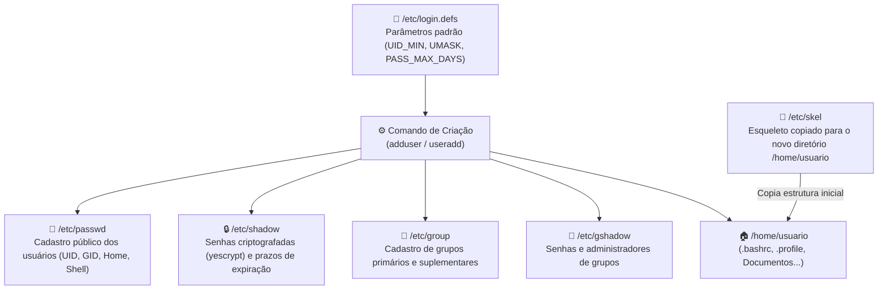
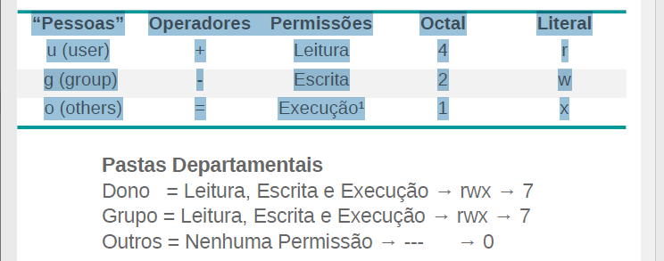
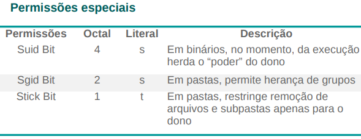

# 05 · Administração de Usuários, Grupos e Permissões no Debian 13 (Trixie)

[← 04 · SSH](04-ssh.md) · [README](../README.md) · [Próximo: Servidor FTP →](06-ftp.md)

## Objetivo e Competências

Planejar, provisionar e auditar o controle de acesso local de identidades no **Debian 13 (Trixie)**, estruturando contas de usuários, políticas de expiração de senhas, grupos corporativos e diretórios departamentais com isolamento estrito por permissões literais/octais, máscara padrão (`umask`) e bits especiais de herança (`SGID`, `SUID` e `Sticky Bit`).

Ao final deste capítulo, o estudante será capaz de:
- Compreender a arquitetura de bancos de dados locais de autenticação (`/etc/passwd`, `/etc/shadow`, `/etc/group`, `/etc/gshadow`, `/etc/login.defs` e `/etc/skel`).
- Interpretar cada campo dos arquivos `/etc/passwd` e `/etc/shadow`, incluindo as faixas reservadas de `UID`/`GID` e o algoritmo de hash padrão do Debian 13 (**yescrypt** `$y$`).
- Auditar identidades e sessões ativas com `getent`, `id`, `groups`, `finger`, `who` e `w`.
- Gerenciar o ciclo de vida completo de contas com `adduser`, `useradd`, `passwd`, `usermod`, `userdel` e editores seguros com trava de concorrência (`vipw` e `vigr`).
- Padronizar a criação automática de diretórios pessoais corporativos através de `/etc/skel`.
- Implementar políticas de expiração e envelhecimento de senhas com `chage` e bloqueio preventivo de contas em férias (`usermod -L` / `-U`).
- Estruturar grupos (`groupadd`, `gpasswd`) e diretórios departamentais (`/srv/empresa`) ajustando posse (`chown`, `chgrp`) e permissões (`chmod`) nos modos simbólico (literal) e octal.
- Calcular e persistir máscaras de criação padrão (`umask`) e aplicar o bit especial **SGID (`2770` / `g+s`)** para garantir herança automática de grupo em diretórios compartilhados.

---

## 1. Arquitetura de Arquivos na Criação de um Usuário

O Linux é um sistema operacional nativamente multiusuário. Toda execução de processo, abertura de arquivo ou conexão de rede ocorre sob a identidade de um usuário (`UID`) e de um ou mais grupos (`GID`). Quando criamos uma conta no Debian 13, seis estruturas fundamentais do sistema de arquivos interagem:



### Papel de cada arquivo e diretório do subsistema de contas

| Caminho no Sistema | Permissão Padrão | Função Principal na Arquitetura |
| :--- | :--- | :--- |
| `/etc/passwd` | `644` (`-rw-r--r--`) | Armazena as informações cadastrais das contas de usuários (visível para todos os processos para tradução de `UID` em nome). |
| `/etc/shadow` | `640` (`-rw-r-----`) | Armazena os hashes das senhas dos usuários e métricas de expiração. Leitura restrita a `root` e ao grupo `shadow`. |
| `/etc/group` | `644` (`-rw-r--r--`) | Armazena as informações dos grupos do sistema e a lista de membros secundários. |
| `/etc/gshadow` | `640` (`-rw-r-----`) | Armazena senhas seguras e administradores delegados dos grupos. |
| `/etc/login.defs` | `644` (`-rw-r--r--`) | Define diretrizes globais para criação de contas (faixas de UID/GID, algoritmo de criptografia, `UMASK` e validade de senhas). |
| `/etc/skel` | `755` (`drwxr-xr-x`) | Diretório-esqueleto cujo conteúdo oculto e visível é copiado integralmente para o `HOME` de todo novo usuário criado. |

> [!NOTE]
> No material de referência original pode aparecer a grafia `/etc/logins.defs`, porém o nome exato do arquivo no sistema de arquivos do Debian é **`/etc/login.defs`** (no singular).

---

### 1.1. Anatomia do arquivo `/etc/passwd`

Cada linha do arquivo `/etc/passwd` representa uma conta e é dividida em **7 campos** delimitados por dois-pontos (`:`):

```text
bob:x:1001:1001:Analistas Infra:/srv/homes/bob:/bin/bash
─┬─ ┬ ──┬─ ──┬─ ───────┬─────── ───────┬────── ────┬────
 │  │   │    │         │               │           └─ 7º Shell padrão de login
 │  │   │    │         │               └───────────── 6º Diretório pessoal (HOME)
 │  │   │    │         └───────────────────────────── 5º Comentário / GECOS (Nome, Depto, Ramal)
 │  │   │    └─────────────────────────────────────── 4º GID (Identificador do Grupo Primário)
 │  │   └──────────────────────────────────────────── 3º UID (Identificador Único do Usuário)
 │  └──────────────────────────────────────────────── 2º Placeholder de senha ('x' aponta para /etc/shadow)
 └─────────────────────────────────────────────────── 1º Login do usuário
```

1. **1º Campo — Login do usuário:** Nome curto utilizado na autenticação (ex.: `root`, `suporte`, `bob`).
2. **2º Campo — Senha do usuário:** O caractere `x` indica que a senha criptografada está protegida no arquivo `/etc/shadow`.
3. **3º Campo — UID (*User Identifier*):** Número inteiro único que identifica o usuário perante o kernel Linux.
4. **4º Campo — GID (*Group Identifier*):** Número do **grupo primário** ao qual o usuário pertence por padrão.
5. **5º Campo — GECOS / Informações adicionais:** Nome completo, departamento, telefone ou observações administrativas.
6. **6º Campo — Home:** Caminho absoluto do diretório pessoal do usuário (carregado na variável `$HOME` após o login).
7. **7º Campo — Shell padrão:** Interpretador de comandos executado quando o usuário inicia sessão interativa (ex.: `/bin/bash`). Contas de serviço usam `/usr/sbin/nologin` ou `/bin/false` para impedir login interativo.

#### Faixas de UID e GID (Debian vs Red Hat / CentOS)

Tanto no **Debian** quanto em distribuições da família Enterprise Linux (**CentOS / RHEL / Rocky Linux** modernizados), a convenção de numeração segue a mesma divisão estrutural definida em `/etc/login.defs`:

| Faixa Numérica | Classificação de UID (Usuários) | Classificação de GID (Grupos) |
| :--- | :--- | :--- |
| **`0`** | Superusuário administrador **`root`** | Grupo administrativo **`root`** |
| **`1` a `999`** | Usuários de sistema e serviços (daemons como `sshd`, `www-data`, `_apt`) | Grupos de sistema e serviços |
| **`1000` a `60000`** *(até `65533`)* | Usuários humanos normais | Grupos departamentais e de usuários normais |
| **`65534`** | Conta especial `nobody` (sem privilégios) | Grupo especial `nogroup` |

---

### 1.2. Anatomia do arquivo `/etc/shadow`

O arquivo `/etc/shadow` armazena as credenciais e políticas de expiração de cada conta em **9 campos** separados por dois-pontos (`:`):

```text
bob:$y$j9T$AbCdEf...:20018:2:30:7:5:20380:
─┬─ ────────┬─────── ──┬── ┬ ─┬ ┬ ┬ ──┬── ┬
 │          │          │   │  │ │ │   │   └─ 9º Campo reservado para uso futuro
 │          │          │   │  │ │ │   └───── 8º Expiração absoluta da conta (dias desde 01/01/1970; vazio/-1 = não expira)
 │          │          │   │  │ │ └───────── 7º Período de inatividade após expirar até bloqueio da conta (dias)
 │          │          │   │  │ └─────────── 6º Aviso prévio de expiração ao usuário (dias antes de vencer)
 │          │          │   │  └───────────── 5º Prazo máximo para expirar a senha (validade em dias)
 │          │          │   └──────────────── 4º Idade mínima da senha (dias travada antes de permitir nova troca)
 │          │          └──────────────────── 3º Data da última alteração de senha (dias desde o Epoch: 01/01/1970)
 │          └─────────────────────────────── 2º Senha criptografada (Hash + Salt). '!' ou '*' indicam conta bloqueada
 └────────────────────────────────────────── 1º Login do usuário
```

> [!IMPORTANT]
> **Atualização Debian 13 (Trixie) — Criptografia `yescrypt` (`$y$`):**
> Enquanto versões antigas do Debian utilizavam hashes SHA-512 (identificados pelo prefixo `$6$`), o **Debian 13** utiliza por padrão o algoritmo **`yescrypt`** (identificado pelo prefixo **`$y$`** no 2º campo do `/etc/shadow`), configurado via `ENCRYPT_METHOD YESCRYPT` em `/etc/login.defs`. O `yescrypt` é resistente a ataques de força bruta baseados em GPUs e ASICs por exigir alto consumo de memória (*memory-hard*).

---

## 2. Coletando Informações de Usuários Existentes

Antes de criar ou alterar contas, o administrador deve saber consultar a base de identidades local ou integrada à rede (NSS — *Name Service Switch*).

### Passo 1 — Consultar bases de usuários e grupos com `getent`

Autenticado com o usuário administrativo (`suporte` ou `aluno`), inspecione as bases `passwd` e `group`:

```bash
sudo getent passwd
sudo getent group
```

Realize um levantamento específico sobre uma conta de usuário (ex.: `suporte` ou `bob`):

```bash
sudo id bob
sudo groups bob
sudo getent passwd bob
sudo getent shadow bob
```

### Passo 2 — Auditar detalhes cadastrais e sessões ativas (`finger`, `who`, `w`)

O utilitário clássico `finger` formata de maneira legível o login, nome real, diretório pessoal, shell e status de login:

```bash
# No Debian 13 instalação mínima, instale o pacote finger caso não esteja presente:
sudo apt update && sudo apt install -y finger

# Exibe informações detalhadas do usuário suporte
sudo finger suporte
```

Verifique quais usuários estão conectados ao servidor neste exato momento e quais processos estão executando:

```bash
who
w
```

### Referência Rápida — Comandos de Consulta e Auditoria

| Comando | Descrição Técnica |
| :--- | :--- |
| `sudo` | Permite a usuários autorizados obter privilégios de outro usuário (por padrão, o `root`). |
| `getent passwd` | Lista os usuários cadastrados consultando as bases configuradas no `/etc/nsswitch.conf`. |
| `getent group` | Lista todos os grupos existentes no sistema. |
| `getent shadow` | Exibe a entrada de senha criptografada e prazos do arquivo `/etc/shadow` (requer `sudo`). |
| `id <usuario>` | Exibe o `UID`, o `GID` primário e todos os grupos secundários de um usuário. |
| `groups <usuario>` | Lista de forma simplificada os nomes dos grupos aos quais um usuário está vinculado. |
| `finger <usuario>` | Exibe de maneira formatada os dados cadastrais, diretório `HOME`, shell e último login. |
| `who` | Lista as sessões de usuários atualmente conectadas nos terminais (`tty` / `pts`). |
| `w` | Lista todos os usuários logados na máquina, tempo de atividade (*uptime*), carga da CPU e o comando em execução. |

---

## 3. Adicionando, Modificando e Padronizando Contas de Usuários

No Debian, existem dois utilitários para criação de contas:
- **`useradd`:** Binário de baixo nível padrão POSIX. Se executado sem parâmetros, não cria diretório `HOME` nem pede senha interativamente (a menos que seja usada a flag `-m`).
- **`adduser`:** Script interativo de alto nível oficial do Debian (escrito em Perl) que cria automaticamente o grupo primário, copia os arquivos de `/etc/skel` para `/home/usuario`, ajusta permissões e solicita a senha e dados cadastrais (GECOS).

### 3.1. Adicionando usuários com `adduser` e `passwd`

Verifique as opções de ajuda do `adduser` e crie os usuários de laboratório (`dexter`, `alice`, `bob`, `bacon`, `bryan`):

```bash
# Consulta opções de ajuda do adduser
sudo adduser --help

# Criação interativa de usuários
sudo adduser dexter
sudo adduser alice
sudo adduser bob
sudo adduser bacon
sudo adduser bryan
```

Para redefinir ou alterar a senha de qualquer usuário posteriormente:

```bash
sudo passwd bryan
```

Confirme se os novos registros foram gravados nos três arquivos de banco de dados e se os diretórios pessoais foram criados:

```bash
sudo tail -n 5 /etc/passwd /etc/group /etc/shadow
ls -la /home
```

> [!WARNING]
> **Atualização Debian 13 (Trixie) — Nomes de usuários com ponto (`.`):**
> Por padrão, o `adduser` no Debian valida nomes de contas segundo uma expressão regular restrita. Caso precise criar logins corporativos separados por ponto (como `antony.brooks` ou `joao.silva`):
> - No Debian 10/11 usava-se `sudo adduser --force-badname antony.brooks`.
> - No **Debian 13 (`adduser` 3.137+)**, a opção `--force-badname` foi depreciada e substituída por **`--allow-bad-names`**:
>   ```bash
>   sudo adduser --allow-bad-names antony.brooks
>   ```

---

### 3.2. Modificando contas existentes com `usermod`

Nunca edite o arquivo `/etc/passwd` manualmente com editores comuns para alterar diretórios ou comentários. Utilize sempre o utilitário **`usermod`**.

Vamos criar uma nova base de diretórios pessoais em `/srv/homes` e migrar a `HOME` do usuário `bob` (ou `dexter`) movendo automaticamente seus arquivos existentes:

```bash
# Verifica as pastas atuais
ls -l /home

# Cria o novo diretório base em /srv/homes
sudo mkdir -p /srv/homes

# Altera (-d) e move (-m) o conteúdo do diretório pessoal do usuário bob para /srv/homes/bob
sudo usermod -m -d /srv/homes/bob bob
```

Verifique se o diretório foi transferido e se o `/etc/passwd` reflete o novo caminho:

```bash
ls -l /srv/homes
sudo tail -n 5 /etc/passwd
```

Para alterar apenas o nome completo/cargo (5º campo — GECOS) do usuário, utilize a flag `-c`:

```bash
sudo usermod -c 'Analistas Infra' bob
sudo getent passwd bob
```

#### Opções essenciais do `usermod` e editores seguros de sistema

| Comando / Opção | Função Administrativa |
| :--- | :--- |
| `usermod -d <novo_home> <user>` | Define um novo diretório de login para a conta de usuário. |
| `usermod -m -d <novo_home> <user>` | Move (`-m`) todo o conteúdo do diretório pessoal atual para a nova localização (usar sempre em conjunto com `-d`). |
| `usermod -c "Texto" <user>` | Altera o campo de comentário/nome completo (GECOS) no `/etc/passwd`. |
| `vipw` | Edita o arquivo `/etc/passwd` com trava de segurança (*lock*) contra corrupção simultânea. |
| `vipw -s` | Edita com segurança as configurações de senhas diretamente no `/etc/shadow`. |
| `vigr` | Edita com segurança as configurações de grupos diretamente no `/etc/group`. |
| `vigr -s` | Edita com segurança as configurações de senhas de grupos diretamente no `/etc/gshadow`. |

---

### 3.3. Padronizando pastas para novos usuários (`/etc/skel`) e removendo contas (`userdel`)

Em ambientes corporativos, é recomendável que todo novo colaborador já receba uma estrutura organizada de pastas em seu diretório pessoal assim que sua conta for criada.

1. Liste o conteúdo atual (incluindo arquivos ocultos) do diretório `/etc/skel`:
   ```bash
   ls -a /etc/skel
   ```
2. Crie a estrutura padrão de pastas (`Documentos`, `Downloads`, `Imagens`) dentro de `/etc/skel`:
   ```bash
   sudo mkdir -p /etc/skel/{Documentos,Downloads,Imagens}
   ls -a /etc/skel
   ```
3. Qualquer usuário criado a partir deste momento com `adduser` receberá automaticamente essas três pastas em seu `HOME`.

#### Removendo contas de usuários com `userdel`

Quando um colaborador é desligado e sua conta precisa ser removida completamente (incluindo seu diretório pessoal e caixa de mensagens local):

```bash
# Remove apenas a conta, mantendo os arquivos em /home
sudo userdel bacon

# Remove a conta E apaga recursivamente (-r) o diretório pessoal e spool de e-mail
sudo userdel -r bryan
```

---

## 4. Políticas de Senhas (`chage`) e Bloqueio de Contas

Para atender normas de conformidade e segurança da informação, senhas não devem ter validade infinita nem permitir trocas consecutivas imediatas para burlar históricos de senhas. O comando **`chage`** (*change age*) gerencia os campos de tempo do `/etc/shadow`.

### Passo 1 — Inspecionar e aplicar política de expiração

1. Verifique a política atual de envelhecimento da senha do usuário `bob`:
   ```bash
   sudo chage -l bob
   ```
2. Configure a senha de `bob` para expirar a cada **30 dias** (`-M 30`) e exigir um intervalo mínimo de **2 dias** (`-m 2`) entre trocas de senha:
   ```bash
   sudo chage -M 30 -m 2 bob
   sudo chage -l bob
   ```
3. Teste o comportamento assumindo a sessão do usuário `bob` e tentando trocar a senha imediatamente:
   ```bash
   su - bob
   passwd
   ```
   > O sistema impedirá que o usuário comum troque a senha antes de decorridos os 2 dias mínimos configurados na diretiva `-m`. Digite `exit` para retornar ao seu usuário administrativo.

### Passo 2 — Bloquear e desbloquear usuários em férias (`usermod -L` / `-U`)

Quando um colaborador sai de férias ou licença médica, nunca devemos excluir sua conta. Em vez disso, bloqueamos temporariamente o hash da senha (o sistema insere um ponto de exclamação `!` no início do 2º campo do `/etc/shadow`):

```bash
# Bloqueia a senha da conta do usuário (Lock)
sudo usermod -L bob

# Verifica o caractere '!' inserido antes do hash no /etc/shadow
sudo getent shadow bob

# Desbloqueia a conta quando o colaborador retornar (Unlock)
sudo usermod -U bob
```

### Parâmetros principais do comando `chage`

| Opção | Descrição |
| :--- | :--- |
| `-l` | Exibe informações detalhadas sobre a validade e idade da senha e da conta. |
| `-M <dias>` | Define o número **máximo** de dias em que a senha permanece válida antes de expirar. |
| `-m <dias>` | Define o número **mínimo** de dias que o usuário deve aguardar antes de poder trocar a senha novamente. |
| `-W <dias>` | Define quantos dias antes da expiração o usuário começará a receber avisos de troca ao logar. |
| `-I <dias>` | Define quantos dias após a senha expirar a conta será bloqueada por inatividade. |
| `-E <AAAA-MM-DD>` | Define uma data fixa de expiração para a conta inteira (ideal para prestadores temporários/estagiários). |
| `-d 0` | Força o usuário a trocar sua senha imediatamente no próximo login. |

---

## 5. Gerenciamento de Grupos e Diretórios Departamentais

Para organizar o controle de acesso de uma empresa no servidor Linux, criamos **grupos departamentais** e vinculamos cada colaborador ao seu respectivo setor.

### Passo 1 — Criar os grupos corporativos (`groupadd`)

Crie quatro grupos departamentais (`diretores`, `vendedores`, `financeiro` e `analistas`):

```bash
sudo groupadd diretores
sudo groupadd vendedores
sudo groupadd financeiro
sudo groupadd analistas
```

Confirme a criação dos grupos no sistema:

```bash
getent group | tail -n 4
tail -n 4 /etc/group
```

> [!TIP]
> Para remover um grupo que não seja grupo primário de nenhum usuário ativo, utilize o comando `sudo groupdel <nome_do_grupo>`.

### Passo 2 — Associar usuários aos grupos (`gpasswd`)

Crie os usuários de exemplo (caso ainda não existam) e adicione-os aos seus respectivos grupos departamentais utilizando o comando **`gpasswd`**:

```bash
# Cria contas de exemplo para o laboratório departamental (caso ainda não existam)
sudo useradd -m -s /bin/bash pedro_silva
sudo useradd -m -s /bin/bash ana_maria
sudo useradd -m -s /bin/bash ana
sudo useradd -m -s /bin/bash jose
sudo useradd -m -s /bin/bash maria

# Adiciona (-a) usuários ao grupo diretores
sudo gpasswd -a pedro_silva diretores
sudo gpasswd -a ana_maria diretores
sudo gpasswd -a bob diretores

# Adiciona usuários aos demais departamentos
sudo gpasswd -a ana vendedores
sudo gpasswd -a jose financeiro
sudo gpasswd -a maria analistas
```

Verifique os membros vinculados a cada grupo:

```bash
getent group diretores vendedores financeiro analistas
tail -n 4 /etc/group
```

Para **remover** um usuário de um grupo suplementar sem excluir sua conta, utilize a flag `-d` (*delete*):

```bash
sudo gpasswd -d pedro_silva diretores
```

---

### Passo 3 — Criar a estrutura de diretórios departamentais (`/srv/empresa`) e ajustar posse (`chown` / `chgrp`)

Agora construiremos a árvore de diretórios compartilhados da empresa em `/srv/empresa` e atribuiremos o responsável (dono) e o grupo de cada departamento:

```bash
# 1. Cria a pasta base da empresa e acessa o diretório
sudo mkdir -p /srv/empresa
cd /srv/empresa

# 2. Cria simultaneamente uma pasta para cada departamento usando expansão de chaves
sudo mkdir {Diretoria,Vendas,Financeiro,Infra}
ls -l

# 3. Altera o usuário dono de cada pasta departamental com chown
sudo chown bob Diretoria
sudo chown ana Vendas
sudo chown jose Financeiro
sudo chown maria Infra

# 4. Altera o grupo dono de cada pasta para o grupo do respectivo departamento com chgrp
sudo chgrp diretores Diretoria
sudo chgrp vendedores Vendas
sudo chgrp financeiro Financeiro
sudo chgrp analistas Infra

# 5. Audita o resultado
ls -l /srv/empresa
```

> [!TIP]
> **Atalho profissional com `chown`:** O comando `chown` permite alterar o usuário dono e o grupo dono em um único comando usando a sintaxe `usuario:grupo`. Exemplo:
> ```bash
> sudo chown bob:diretores /srv/empresa/Diretoria
> ```

---

### Resumo Geral de Comandos de Usuários e Grupos

| Comando | Descrição |
| :--- | :--- |
| `sudo` | Obtém privilégios administrativos de outro usuário (em geral o `root`). |
| `getent passwd` | Lista todos os usuários existentes no sistema. |
| `getent group` | Lista todos os grupos existentes no sistema. |
| `id` | Verifica o `UID`, `GID` e grupos suplementares de um usuário. |
| `groups` | Lista os grupos aos quais um usuário está vinculado. |
| `finger` | Exibe informações cadastrais e de sessão dos usuários. |
| `who` | Verifica os usuários logados e seus terminais. |
| `w` | Verifica todos os usuários logados na máquina e seus processos ativos. |
| `adduser` / `userdel` | Cria e remove contas de usuários no sistema. |
| `passwd` | Modifica a senha de um usuário no sistema. |
| `usermod` | Altera informações cadastrais, diretório `HOME`, bloqueio e grupos de usuários. |
| `vipw` / `vipw -s` | Edita com trava de segurança `/etc/passwd` e `/etc/shadow`. |
| `vigr` / `vigr -s` | Edita com trava de segurança `/etc/group` e `/etc/gshadow`. |
| `su - <usuario>` | Alterna para a identidade de outro usuário carregando seu ambiente completo de login. |
| `chage` | Configura prazos de validade e políticas de expiração de senha do usuário. |
| `date` | Exibe ou define a data e a hora do sistema operacional. |
| `groupadd` / `groupdel` | Cria e remove grupos no sistema. |
| `gpasswd` | Adiciona (`-a`) ou remove (`-d`) usuários de grupos. |
| `chown` | Altera o usuário dono (e opcionalmente o grupo) de pastas e arquivos. |
| `chgrp` | Altera o grupo dono de pastas e arquivos. |

---

## 6. Permissões de Arquivos e Diretórios no Linux

No modelo clássico POSIX do Linux, todo arquivo ou diretório possui **3 conjuntos de permissões** atribuídos a **3 classes de "Pessoas" (Entidades)**:

```text
   d  rwx  r-x  ---   2  bob  diretores  4096 out 22 19:00 Diretoria
   ┬  ─┬─  ─┬─  ─┬─      ─┬─  ────┬────
   │   │    │    │        │       └────── Grupo Dono (Group - g)
   │   │    │    │        └────────────── Usuário Dono (User - u)
   │   │    │    └─────────────────────── Permissões para Outros (Others - o): nenhuma (0)
   │   │    └──────────────────────────── Permissões para o Grupo Dono (g): Leitura e Execução (5)
   │   └───────────────────────────────── Permissões para o Dono (u): Leitura, Escrita e Execução (7)
   └───────────────────────────────────── Tipo do objeto ('d' = diretório, '-' = arquivo comum)
```

### 6.1. Identificando o Tipo de Arquivo (1º Caractere de `ls -l`)

Ao executar `ls -l`, o primeiro caractere da listagem identifica a natureza do objeto no sistema de arquivos:

| Caractere | Tipo de Objeto no Linux | Exemplo Prático |
| :---: | :--- | :--- |
| **`-`** | Arquivo comum (texto, binário, imagem, script) | `/etc/passwd` |
| **`d`** | Diretório (pasta) | `/srv/empresa/Diretoria` |
| **`l`** | Link simbólico (*symlink* / atalho) | `/bin` -> `usr/bin` |
| **`p`** | *Named Pipe* (FIFO para comunicação entre processos) | `/run/systemd/initctl/fifo` |
| **`s`** | *Socket* de domínio Unix | `/run/dbus/system_bus_socket` |
| **`c`** | Dispositivo de caractere (*Character device*) | `/dev/tty1`, `/dev/null` |
| **`b`** | Dispositivo de bloco (*Block device* — discos/partições) | `/dev/sda`, `/dev/vda1` |

---

### 6.2. Entendendo "Pessoas", Operadores e Permissões (Literal vs Octal)

Após o caractere de tipo, os três blocos de três caracteres (`rwx`) representam as permissões. Se um hífen (`-`) estiver presente, aquela permissão está ausente.

| "Pessoas" (Alvo) | Operadores Simbólicos | Permissão | Valor Octal | Símbolo Literal | Efeito em Arquivos | Efeito em Diretórios |
| :--- | :--- | :--- | :---: | :---: | :--- | :--- |
| **`u`** (*user* — Dono)<br>**`g`** (*group* — Grupo)<br>**`o`** (*others* — Outros)<br>**`a`** (*all* — Todos) | **`+`** (Adiciona permissão)<br>**`-`** (Remove permissão)<br>**`=`** (Define exatamente) | **Leitura (*Read*)** | **`4`** | **`r`** | Ler o conteúdo do arquivo | Listar os nomes dos arquivos (`ls`) |
| ^ | ^ | **Escrita (*Write*)** | **`2`** | **`w`** | Modificar o conteúdo do arquivo | Criar, renomear ou excluir arquivos dentro da pasta |
| ^ | ^ | **Execução (*Execute*)** | **`1`** | **`x`** | Executar o arquivo como programa/script | Entrar/atravessar o diretório (`cd`) |

#### Tabela de Conversão Octal Completa

A representação octal soma os valores de Leitura (`4`), Escrita (`2`) e Execução (`1`) para cada uma das três posições (Dono, Grupo, Outros):

| Valor Octal | Binário | Literal | Significado Detalhado |
| :---: | :---: | :---: | :--- |
| **`0`** | `000` | `---` | Nenhuma permissão |
| **`1`** | `001` | `--x` | Somente execução / travessia |
| **`2`** | `010` | `-w-` | Somente escrita |
| **`3`** | `011` | `-wx` | Escrita e execução (`2 + 1`) |
| **`4`** | `100` | `r--` | Somente leitura |
| **`5`** | `101` | `r-x` | Leitura e execução (`4 + 1`) |
| **`6`** | `110` | `rw-` | Leitura e escrita (`4 + 2`) |
| **`7`** | `111` | `rwx` | Permissão total: Leitura, escrita e execução (`4 + 2 + 1`) |

---

### 6.3. Prática — Isolando os Diretórios Departamentais com `chmod`

Por padrão, quando criamos as pastas em `/srv/empresa`, elas receberam permissão `755` (`rwxr-xr-x`), permitindo que colaboradores de outros setores entrem e leiam arquivos alheios. Vamos corrigir isso garantindo acesso total (`rwx`) apenas ao dono e ao grupo do departamento, e **nenhuma permissão (`---`) para outros usuários**, exercitando tanto o modo literal quanto o modo octal:

```bash
cd /srv/empresa

# 1. Diretoria: Usuário (u) e Grupo (g) recebem rwx; Outros (o) ficam sem nenhuma permissão
sudo chmod u=rwx,g=rwx,o= Diretoria

# 2. Financeiro: Grupo ganha (+) escrita (w); Outros perdem (-) leitura e execução (rx)
sudo chmod g+w,o-rx Financeiro

# 3. Infra: Usuário e Grupo simultaneamente (ug) recebem rwx; Outros (o) ficam vazios
sudo chmod ug=rwx,o= Infra

# 4. Vendas: Aplicação direta em modo Octal (7 para dono, 7 para grupo, 0 para outros)
sudo chmod 770 Vendas

# 5. Verifica o resultado padronizado (todas as pastas devem exibir drwxrwx---)
ls -l /srv/empresa
```



---

## 7. Gerenciando `umask` e Permissões Especiais (`SGID`, `SUID`, `Sticky Bit`)

### 7.1. Permissionamento Padrão com `umask`

A **`umask`** (*user file-creation mode mask*) define a máscara de bits que serão **subtraídos** quando um usuário cria um novo arquivo ou diretório.

#### Regra de Cálculo da `umask` (Exemplo padrão Debian: `0022`)

1. **Para Diretórios:** A permissão base máxima de um diretório é **`777`**. Subtraímos o valor da `umask` atual (`022`):
   $$\text{Permissão do Diretório} = 777 - 022 = 755 \quad (\text{rwxr-xr-x})$$

2. **Para Arquivos:** Por segurança, um arquivo novo **não nasce com permissão de execução (`x`)** por padrão. Subtraímos a `umask` e removemos o bit de execução (`1`) dos dígitos ímpares (ou calculamos a partir da base `666`):
   $$\text{Cálculo Diretório} = 777 - 022 = 755 \xrightarrow{-\,111\text{ (retira }x\text{ de ímpares)}} 644 \quad (\text{rw-r--r--})$$

#### Regra de Cálculo para Ambientes Corporativos Colaborativos (`umask 007`)

Quando os colaboradores trabalham em pastas departamentais compartilhadas pelo grupo, queremos que os novos diretórios nasçam com **`770`** (`rwxrwx---`) e os novos arquivos com **`660`** (`rw-rw----`), bloqueando totalmente o acesso de "Outros" (`o`):

| Parâmetro | Com `umask 0022` (Padrão) | Com `umask 0007` (Corporativo) |
| :--- | :---: | :---: |
| **Permissão Base de Diretório** | `777` | `777` |
| **Valor da `umask`** | `- 022` | `- 007` |
| **Permissão Final do Diretório** | **`755`** (`drwxr-xr-x`) | **`770`** (`drwxrwx---`) |
| **Permissão Final do Arquivo** | **`644`** (`-rw-r--r--`) | **`660`** (`-rw-rw----`) |

#### Persistindo a `umask 007` para usuários atuais e futuros

Para verificar a `umask` da sessão atual, basta digitar `umask`. Para torná-la permanente:

```bash
# 1. Para fixar a umask 007 para um usuário existente (ex.: bob), adicione ao final do ~/.bashrc dele:
echo "umask 007" | sudo tee -a /srv/homes/bob/.bashrc

# 2. Para padronizar a umask 007 para TODOS os novos usuários criados no servidor, adicione ao /etc/skel/.bashrc:
echo "umask 007" | sudo tee -a /etc/skel/.bashrc
```

---

### 7.2. Permissões Especiais e Herança de Grupo (`SGID`)

Além dos 3 dígitos octais convencionais, o Linux possui um **4º dígito octal** (à esquerda) para configurar três bits especiais:

| Bit Especial | Valor Octal | Símbolo Literal | Efeito em Arquivos Executáveis | Efeito em Diretórios |
| :--- | :---: | :---: | :--- | :--- |
| **SUID** (*Set User ID*) | **`4`** (`4000`) | `u+s` (`rwsr-xr-x`) | O binário executa com os privilégios do **usuário dono** do arquivo (ex.: `/usr/bin/passwd`). | Ignorado no Linux. |
| **SGID** (*Set Group ID*) | **`2`** (`2000`) | `g+s` (`rwxrws---`) | O binário executa com a identidade do **grupo dono** do arquivo. | **Herança de Grupo:** Todo arquivo ou subpasta criado dentro do diretório herda automaticamente o **grupo do diretório pai**, e não o grupo primário do criador. |
| **Sticky Bit** | **`1`** (`1000`) | `+t` (`rwxrwxrwt`) | Sem efeito moderno em arquivos. | **Proteção contra exclusão:** Qualquer usuário pode criar arquivos na pasta, mas **somente o dono do arquivo (ou `root`) pode apagá-lo** (ex.: `/tmp`). |

#### Resolvendo o problema de herança de grupos nas pastas departamentais (`SGID`)

Sem o bit **SGID**, quando `pedro_silva` cria um arquivo dentro de `/srv/empresa/Diretoria`, o arquivo pertence ao grupo primário `pedro_silva`, impedindo que `ana_maria` (também do grupo `diretores`) edite o documento em conjunto.

Para corrigir esse comportamento e forçar todos os arquivos criados dentro de cada departamento a herdarem o grupo da pasta:

```bash
cd /srv/empresa

# Aplica o bit SGID em modo literal (g+s) na pasta Diretoria
sudo chmod g+s Diretoria

# Aplica o bit SGID em modo Octal (dígito 2 à esquerda -> 2770) nas demais pastas
sudo chmod 2770 Financeiro Infra Vendas

# Verifica a presença do 's' na posição de execução do grupo (drwxrws---)
ls -l /srv/empresa
```



> [!TIP]
> Observe na listagem `drwxrws---` que o `x` do grupo foi substituído por um **`s` minúsculo**. Se aparecesse um **`S` maiúsculo** (`drwxrwS---`), significaria que o bit SGID foi ativado, mas faltou a permissão de execução/travessia (`x`) para o grupo.

### Resumo dos Comandos de Posse e Permissões

| Comando | Descrição |
| :--- | :--- |
| `chown` | Permite alterar o usuário dono (e grupo) de pastas e arquivos. |
| `chgrp` | Permite alterar o grupo dono de pastas e arquivos. |
| `chmod` | Permite alterar as permissões de dono, grupo, outros e bits especiais (`SUID`/`SGID`/`Sticky`). |
| `umask` | Exibe ou altera a máscara padrão de criação de arquivos e diretórios da sessão. |

---

## 8. Criação do Snapshot de Segurança

Após validar a estrutura de usuários, grupos e diretórios departamentais com herança `SGID`, registre o snapshot da máquina virtual:

```bash
sudo poweroff
```

No hipervisor:
- **Nome do Snapshot:** `04-Usuarios-Grupos-Permissoes`
- **Descrição:** *Usuários, políticas de senha chage, estrutura departamental /srv/empresa e permissões 2770 (SGID) + umask 007 configurados.*

---

## 9. Checklist de Validação do Estudante

- [ ] Consultou as bases de usuários e grupos com `getent passwd`, `getent group` e `getent shadow`.
- [ ] Padronizou a estrutura `/etc/skel/{Documentos,Downloads,Imagens}` e `umask 007` no `/etc/skel/.bashrc`.
- [ ] Criou usuários e migrou o diretório pessoal com `usermod -m -d`.
- [ ] Configurou políticas de expiração de senha com `chage -M 30 -m 2` e testou o bloqueio com `usermod -L` e `-U`.
- [ ] Criou os quatro grupos departamentais (`diretores`, `vendedores`, `financeiro`, `analistas`) e vinculou membros com `gpasswd -a`.
- [ ] Criou `/srv/empresa/{Diretoria,Vendas,Financeiro,Infra}` e ajustou dono e grupo com `chown` e `chgrp`.
- [ ] Aplicou permissões `2770` (`drwxrws---`) com bit **SGID** ativo em todos os diretórios departamentais.
- [ ] Criou o snapshot `04-Usuarios-Grupos-Permissoes`.

---

## Exercícios Práticos e Teóricos

1. **Prático:** Crie um arquivo de teste dentro de `/srv/empresa/Diretoria` autenticado com o usuário `pedro_silva` (`touch /srv/empresa/Diretoria/relatorio.txt`) e execute `ls -l /srv/empresa/Diretoria`. Comprove que o grupo do arquivo criado é `diretores` (graças ao bit SGID) e que `ana_maria` consegue editá-lo, enquanto o usuário `jose` (do grupo `financeiro`) recebe `Permission denied`.
2. **Prático:** Adicione o **Sticky Bit** na pasta `/srv/empresa/Vendas` (`sudo chmod 3770 /srv/empresa/Vendas` ou `sudo chmod +t /srv/empresa/Vendas`). Explique o que muda quando dois vendedores trabalham na mesma pasta: um vendedor consegue apagar o arquivo criado por outro colega do mesmo grupo?
3. **Teórico:** Calcule qual será a permissão octal e literal de um **diretório** e de um **arquivo comum** criados sob uma sessão configurada com `umask 0027`.
4. **Teórico:** Por que devemos utilizar `vipw` e `vigr` em vez de abrir `/etc/passwd` ou `/etc/group` diretamente com `nano` ou `vim` em servidores com múltiplos administradores?

---

## Referências Oficiais Debian

- [Debian Administrator's Handbook — Managing Users and Groups](https://www.debian.org/doc/manuals/debian-handbook/sect.user-group-databases.en.html)
- [Debian Manpages (Trixie) — adduser(8)](https://manpages.debian.org/trixie/adduser/adduser.8.en.html)
- [Debian Manpages (Trixie) — usermod(8)](https://manpages.debian.org/trixie/passwd/usermod.8.en.html)
- [Debian Manpages (Trixie) — chage(1)](https://manpages.debian.org/trixie/passwd/chage.1.en.html)
- [Debian Manpages (Trixie) — chmod(1)](https://manpages.debian.org/trixie/coreutils/chmod.1.en.html)

---

[← Voltar para 04 · SSH](04-ssh.md) · [README](../README.md) · [Avançar para 06 · Servidor FTP →](06-ftp.md)
