# 06 · Firewall de Borda (pfSense) e Firewall Linux (nftables e iptables) no Debian 13

[← 05 · Usuários](05-usuarios.md) · [README](../README.md) · [Próximo: DHCP →](07-dhcp.md)

## Objetivo e Competências

Projetar e implementar a segurança de perímetro e de host da infraestrutura de rede corporativa em duas camadas complementares (**Defesa em Profundidade**): instalando e configurando o appliance de borda **pfSense** (ou um Gateway Linux) para roteamento e tradução de endereços (**NAT**), e configurando o firewall nativo **nftables** (bem como scripts clássicos **iptables**) no **Debian 13 (Trixie)**.

Ao final deste capítulo, o estudante será capaz de:
- Distinguir o papel de um **Firewall de Borda/Perímetro** (*Edge Firewall* / Gateway NAT) do **Firewall de Host** local em cada servidor.
- Realizar a instalação completa em disco (ZFS) e a configuração inicial via console de texto do **pfSense**.
- Parametrizar o **pfSense WebConfigurator** (`System > General Setup` e `System > Advanced`: HTTPS, proteção contra força bruta, SSH seguro, proteção de console, IPv6 e ARP).
- Habilitar o encaminhamento de pacotes IPv4 no kernel Linux (`net.ipv4.ip_forward=1`) de forma imediata (`/proc`) e persistente no Debian 13 (`/etc/sysctl.d/`).
- Construir regras de **NAT (`SNAT` / `masquerade`)** e filtragem *stateful* utilizando a ferramenta oficial do Debian 13: **`nftables` (`nft`)**.
- Compreender, manter e migrar scripts clássicos de firewall em **`iptables`** (com argumentos `-i`, `-x`, `-l`, bloqueio por endereço MAC e filtragem por portas), entendendo o backend `iptables-nft` do Debian 13.

---

## 1. Arquitetura de Defesa em Profundidade: Borda vs Host

Em uma topologia de rede profissional, a filtragem de pacotes ocorre em dois pontos estratégicos:
1. **Firewall de Borda / Gateway (*Dual-Homed*):** Máquina virtual equipada com duas interfaces de rede — **WAN (`enp0s3`)** conectada à Internet/rede externa e **LAN (`enp0s8`)** conectada à rede interna isolada (`192.168.9.0/24` ou `192.168.50.0/24`). Pode ser implementada com o sistema dedicado **pfSense** ou com um **Servidor Debian atuando como Roteador/NAT**.
2. **Firewall de Host (`srv01`):** Mesmo protegido atrás de um firewall de borda, cada servidor Linux interno mantém seu próprio serviço `nftables` ativo com política padrão restritiva (`policy drop`), expondo apenas as portas estritamente necessárias na LAN.

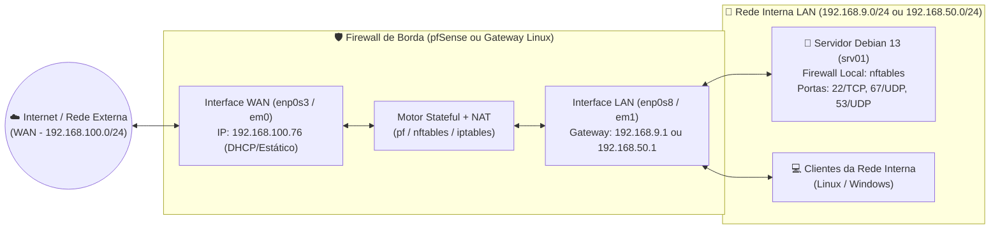

---

## 2. Firewall de Borda com pfSense — Instalação Passo a Passo

O **pfSense** é uma distribuição livre baseada em **FreeBSD** voltada para atuar como Firewall e Roteador de borda de alto desempenho.
- **Link oficial para download da ISO:** https://www.pfsense.org/download/ (selecione a arquitetura `AMD64 (64-bit)` e o instalador `DVD Image (ISO) Installer`).

### Requisitos da Máquina Virtual do pfSense no Hipervisor

- **Memória RAM:** 1024 MB a 2048 MB.
- **Disco Rígido Virtual:** 16 GB.
- **Placa de Rede 1 (Adaptador 1 — WAN):** Modo *NAT* ou *Bridge* (receberá acesso externo/Internet).
- **Placa de Rede 2 (Adaptador 2 — LAN):** Modo *Rede Interna* (`intnet` / `LAN-LAB`) conectada ao mesmo switch virtual dos servidores e clientes internos.

---

### Passo 1 — Aviso de Direitos Autorais e Boas-Vindas

1. Ao iniciar a máquina virtual pela imagem ISO do pfSense, aguarde o carregamento do sistema e na tela **Copyright and distribution notice**, pressione `Enter` em **`< Accept >`**.

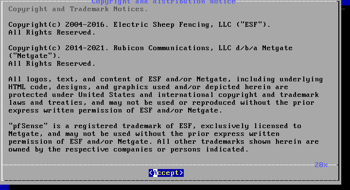

2. Na tela **Welcome to pfSense!**, mantenha a opção **`Install` (`Install pfSense`)** selecionada e pressione `Enter` em **`< OK >`**.

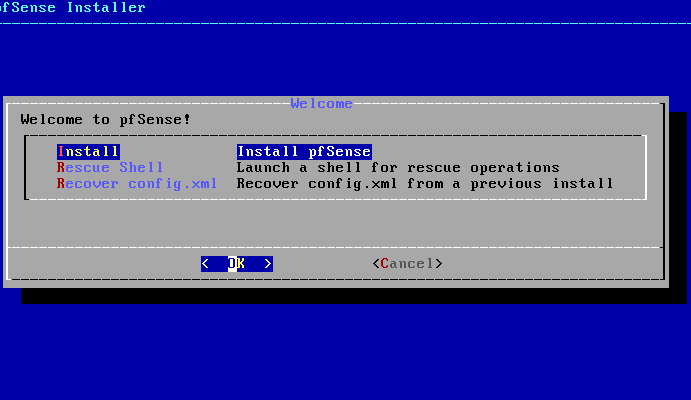

---

### Passo 2 — Seleção do Mapa de Teclado (Keymap)

1. Em **Keymap Selection**, utilize as setas para localizar o layout do seu teclado (por exemplo, **`Brazilian (accent keys)`** para ABNT2) e pressione `Enter` para marcar.

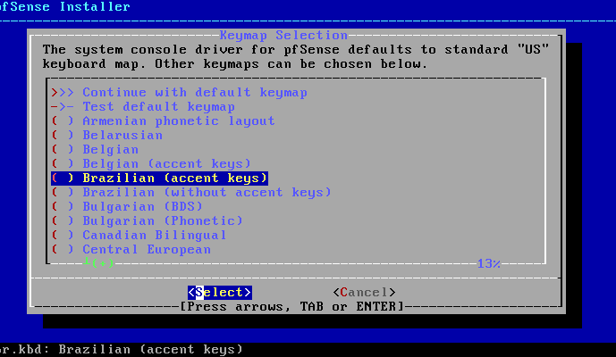

2. Após selecionar o idioma do teclado, volte ao topo da lista em **`>>> Continue with ... keymap`** e pressione `Enter`.

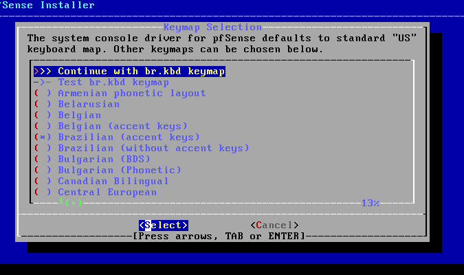

---

### Passo 3 — Particionamento do Disco com ZFS

1. Em **Partitioning**, selecione o sistema de arquivos moderno e resiliente **`Auto (ZFS)`** (*Guided Root-on-ZFS*) e pressione `Enter`.

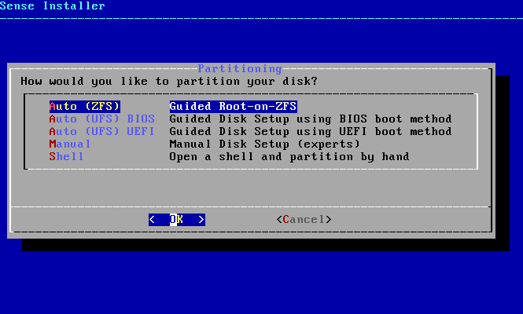

2. Na tela **ZFS Configuration**, mantenha a primeira opção **`>>> Install` (`Proceed with Installation`)** selecionada e pressione `Enter`.

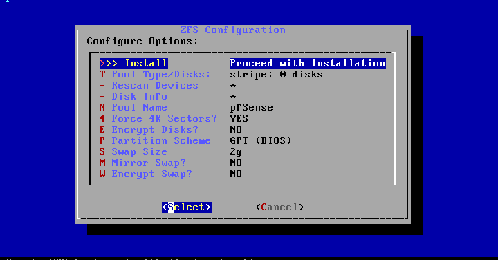

3. Em **Virtual Device Type**, como nossa máquina virtual possui apenas um disco virtual, selecione **`stripe` (`Stripe - No Redundancy`)** e pressione `Enter`.

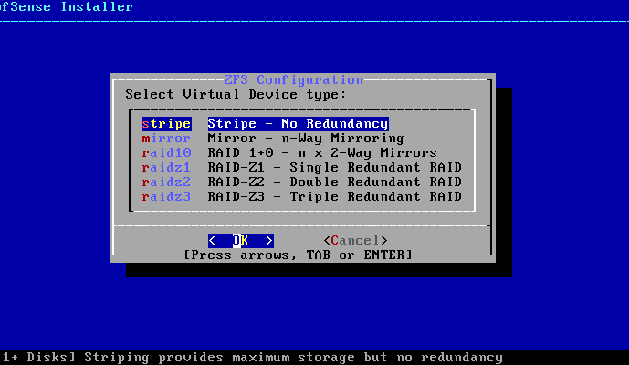

4. Na seleção de disco físico, marque o disco **`ada0`** (`VBOX HARDDISK`) pressionando a **Barra de Espaço (`[*]`)** e depois pressione `Enter` para confirmar.

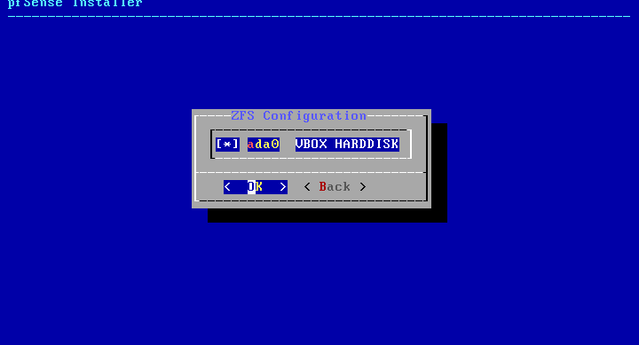

5. Na janela de confirmação **Last Chance!**, selecione **`< YES >`** com as setas para autorizar a formatação de `ada0` e pressione `Enter`.

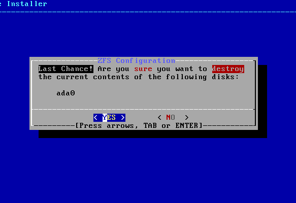

---

### Passo 4 — Extração dos Pacotes e Finalização da Instalação

1. Aguarde a barra de progresso de cópia e instalação dos pacotes do sistema no disco.

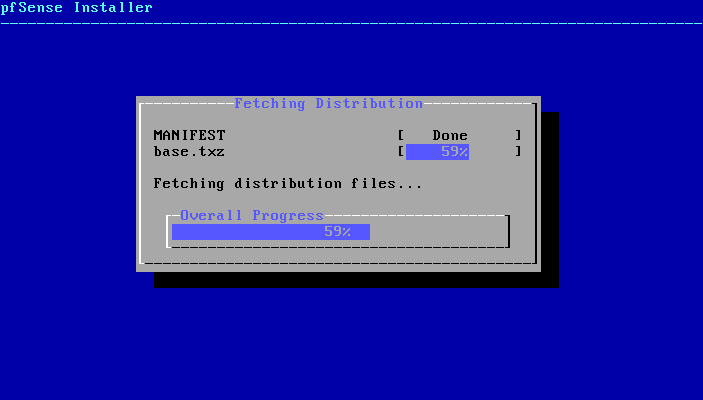

2. Ao concluir, na pergunta **Manual Configuration** (*Would you like to open a shell in the new system to make any final manual modifications?*), selecione **`< No >`** e pressione `Enter`. Em seguida, remova a mídia ISO do drive virtual e selecione **`< Reboot >`**.

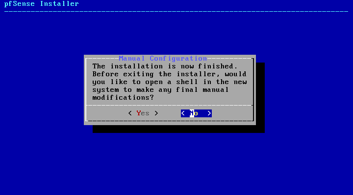

---

### Passo 5 — Configuração do IP da Interface LAN pelo Console

Após o reinício, o pfSense exibirá no terminal o **Menu de Console** listando as interfaces **`WAN (em0)`** e **`LAN (em1)`** e as opções numeradas de `0` a `16`:

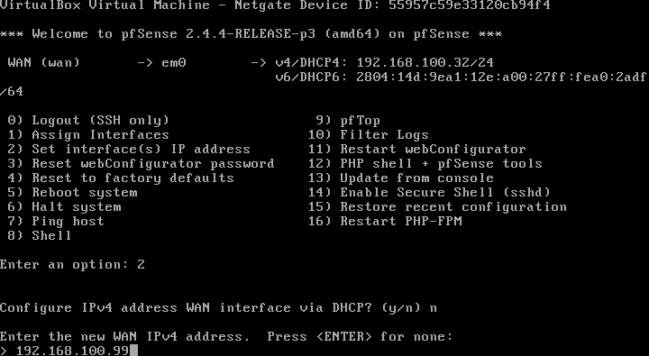

Caso precise alterar o endereço IP da interface interna (**LAN**) para o padrão da sua rede de laboratório:
1. Digite a opção **`2` (`Set interface(s) IP address`)** e pressione `Enter`.
2. Escolha a interface **`2` (`LAN`)**.
3. Digite o novo endereço IPv4 da interface LAN (ex.: `192.168.1.1`, `192.168.9.1` ou `192.168.50.1`).
4. Informe a máscara de sub-rede em bits CIDR: **`24`** (equivalente a `255.255.255.0`).
5. Para *Upstream gateway*, deixe **em branco** e pressione `Enter` (pois esta é uma interface LAN, não WAN).
6. Para IPv6, deixe em branco e pressione `Enter`.
7. Escolha se deseja habilitar o servidor DHCP na LAN (`y` ou `n`) e se deseja reverter o WebConfigurator para HTTP (`n` para manter HTTPS seguro).

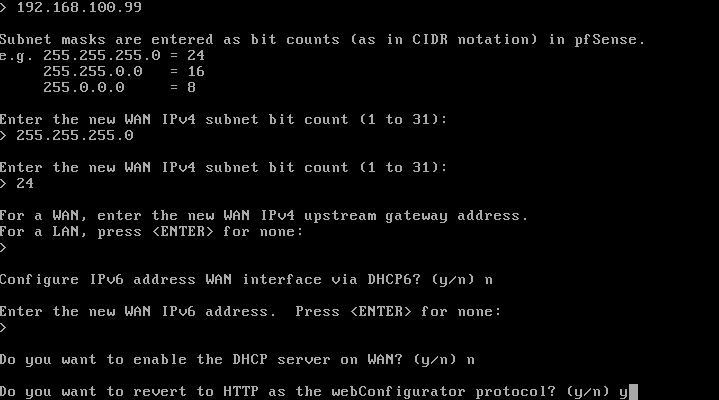

---

## 3. Configuração WebGUI do pfSense (`General Setup` e `System > Advanced`)

A partir de uma estação cliente conectada à **LAN**, abra o navegador e acesse o endereço IP da LAN do pfSense (ex.: `https://192.168.1.1`).
- **Usuário padrão:** `admin`
- **Senha padrão:** `pfsense`

### 3.1. Configuração Geral (`System > General Setup`)

No menu superior, acesse **`System` > `General Setup`** e siga os **10 pontos essenciais** de configuração:

1. **01 — Hostname:** Defina um nome para identificar o firewall na rede (ex.: `pfsense` ou `fw01`).
2. **02 — Domain:** Caso possua um domínio interno para a empresa/laboratório, configure-o neste campo (ex.: `localdomain`, `senac.corp` ou `lab.local`).
3. **03 — DNS Server Settings:** Defina os servidores DNS de propósito geral (ex.: `8.8.8.8` e `1.1.1.1` ou o IP do seu servidor DNS interno).

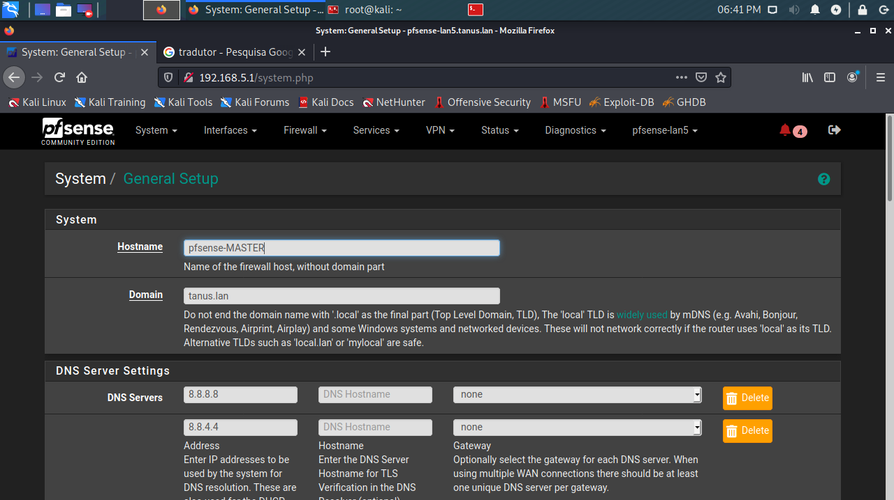

4. **04 — Timezone:** Defina o fuso horário para refletir a localidade correta (ex.: `America/Sao_Paulo`) para que os registros de logs e regras agendadas tenham carimbo de tempo exato.
5. **05 — Timeservers:** Mantenha ou defina o servidor NTP para sincronizar a hora automaticamente (ex.: `0.pfsense.pool.ntp.org` ou `a.st1.ntp.br`).
6. **06 — Language:** Defina o idioma da interface (preferencialmente **English**, facilitando a correlação com a documentação técnica oficial e fóruns de segurança).

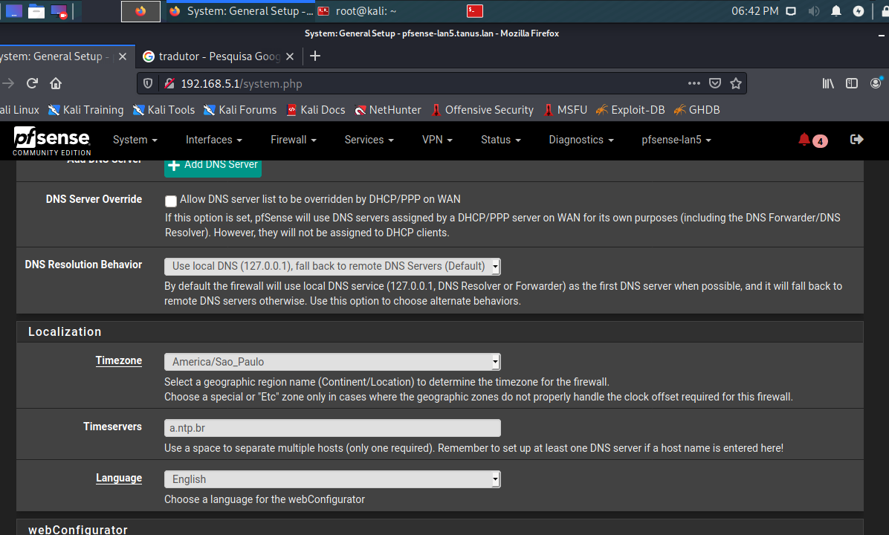

7. **07 — Theme:** Defina o tema visual do painel (`pfSense` claro, `pfSense-dark`, etc.).
8. **08 — Top Navigation:** Selecione `Fixed (Remains visible at top of page)` para fixar a barra de menu no topo da tela enquanto utiliza a rolagem (*scroll*).
9. **09 — Dashboard Columns:** Defina quantas colunas de widgets serão exibidas no painel inicial (ex.: `2`).

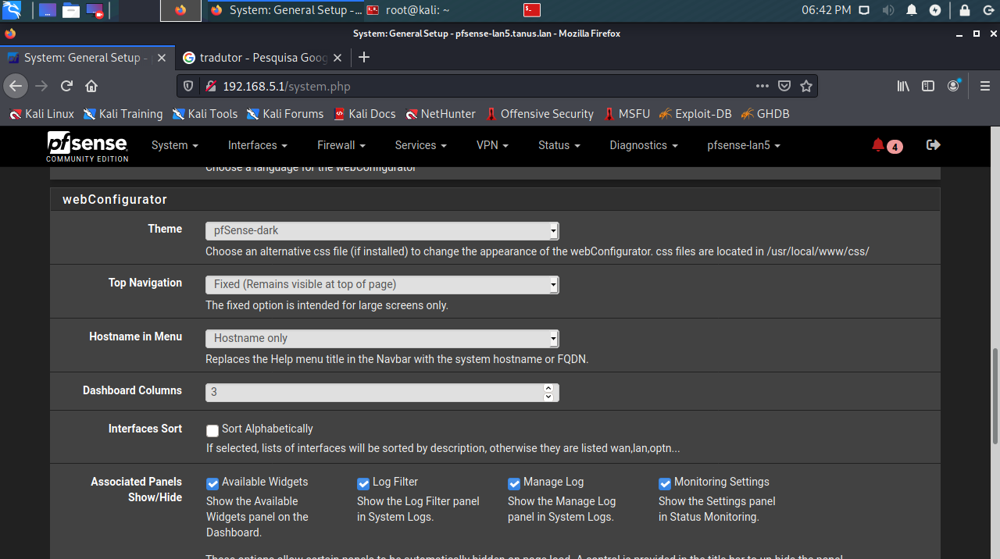

10. **10 — Save:** Clique no botão **`Save`** no final da página para gravar e aplicar as configurações!

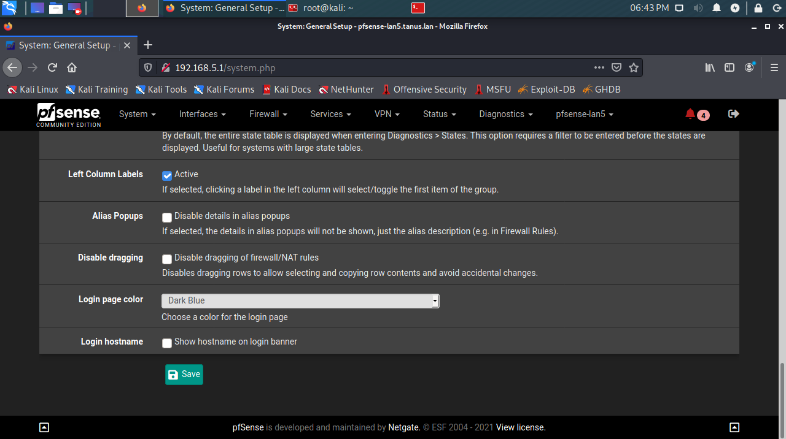

---

### 3.2. Configurações Avançadas de Segurança e Rede (`System > Advanced`)

Acesse **`System` > `Advanced`** para endurecer o controle de acesso administrativo ao firewall (aba **`Admin Access`**) e ajustar parâmetros da pilha de rede (aba **`Networking`**).

#### Aba `Admin Access` — Segurança do Painel Web, SSH e Console

1. **Protocolo HTTPS e Certificado SSL (`webConfigurator`):**
   - Mantenha o protocolo em **`HTTPS (SSL/TLS)`** para que a senha de administração nunca trafegue em texto claro pela rede.
   - Opcionalmente, você pode definir uma porta TCP customizada em **TCP port** (por padrão usa `443`) e limitar o número máximo de processos do servidor web (**Max Processes**).

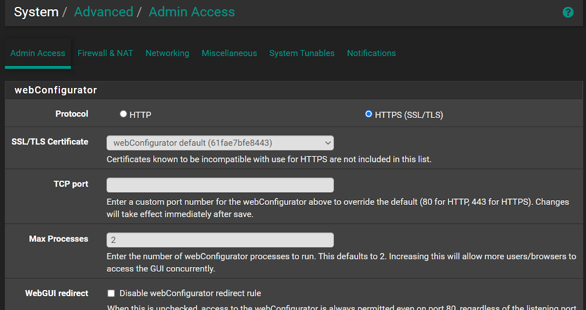

2. **Proteções do Navegador (`Anti-lockout`, `DNS Rebind Check`, `HTTP_REFERER`):**
   - **Anti-lockout:** Mantém uma regra automática na LAN que impede o administrador de se bloquear acidentalmente fora do painel web e do SSH.
   - **DNS Rebind Check** e **HTTP_REFERER enforcement:** Mantêm ativa a proteção contra ataques de falsificação de requisição cruzada (*CSRF*) e *DNS Rebinding* (deixe desmarcadas as caixas *Disable* para preservar a proteção ativa).

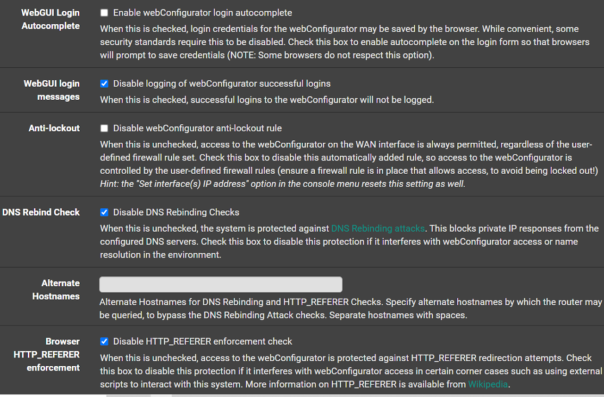

3. **Acesso Remoto via SSH (`Secure Shell`):**
   - Marque **`Enable Secure Shell`** caso deseje administrar o pfSense remotamente via terminal SSH.
   - Em **SSHd Key Only**, você pode exigir autenticação por chave pública (`Public Key Only` ou `Both`), e em **SSH port** alterar a porta padrão `22` se necessário.

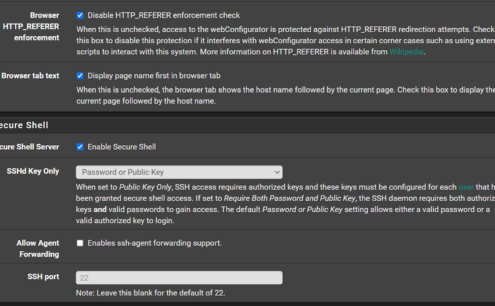

4. **Proteção contra Força Bruta (`Login Protection`):**
   - O recurso **Login Protection** monitora tentativas fracassadas de login tanto na interface WebGUI quanto no SSH e bloqueia automaticamente o IP atacante após atingir o limite configurado (**Threshold**, padrão `30`), pelo tempo definido em **Blocktime** (`120` segundos).
   - Em **Pass list**, você pode adicionar a sub-rede administrativa confiável para nunca ser bloqueada por engano.

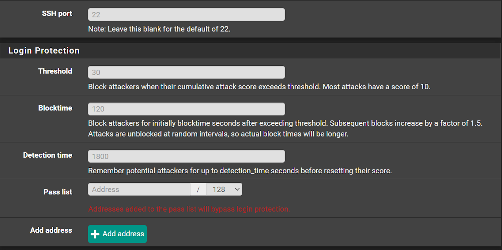

5. **Proteção por Senha do Menu de Console (`Console Options`):**
   - **Importante:** Por padrão, qualquer pessoa com acesso físico à tela da máquina virtual do pfSense encontra o menu de console aberto (podendo resetar a senha de `admin` na opção `3`).
   - Marque a opção **`Password protect the console menu`** para exigir usuário e senha antes de exibir o menu do console físico.

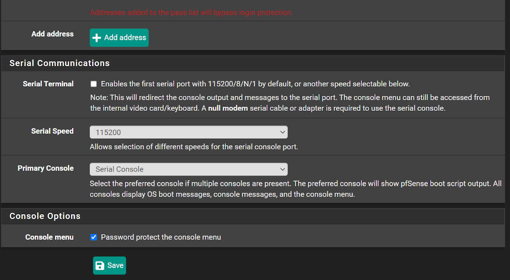

---

#### Aba `Networking` — IPv6 e Mensagens ARP

Ainda em **`System` > `Advanced`**, clique na aba **`Networking`**:

1. **Controle de IPv6 (`IPv6 Options`):**
   - A opção **`Allow IPv6`** vem marcada por padrão. Caso sua rede de laboratório opere exclusivamente em IPv4 e você queira bloquear todo o tráfego IPv6 sem precisar criar dezenas de regras manuais, basta desmarcar essa opção.

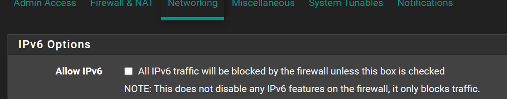

2. **Supressão de Logs de Mudança de MAC (`ARP Handling`):**
   - Na seção **ARP Handling**, a opção **`Suppress ARP messages`** permite silenciar mensagens excessivas de log quando dispositivos compartilham ou trocam endereços MAC na rede local. Clique em **`Save`** ao concluir.

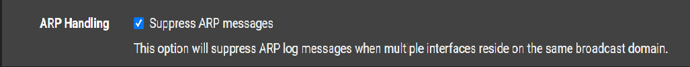

---

## 4. Firewall Linux Nativo no Debian 13 com `nftables` (NFT)

Desde o Debian 10 (Buster) e consolidado como padrão absoluto no **Debian 13 (Trixie)**, o framework **`nftables`** substituiu o antigo `iptables` como motor oficial de filtragem de pacotes e NAT do kernel Linux (`Netfilter`).

- **Documentação Oficial de Referência:** [Debian Wiki — nftables](https://wiki.debian.org/nftables)

### 4.1. Conceitos Fundamentais do `nftables`

Diferente do `iptables` (que já trazia tabelas pré-carregadas na memória mesmo sem uso), o `nftables` começa com um conjunto de regras limpo e organiza a filtragem em três níveis hierárquicos:
1. **Tabelas (*Tables*):** Contêineres associados a uma família de protocolos:
   - `ip` (somente IPv4)
   - `ip6` (somente IPv6)
   - `inet` (unifica **IPv4 e IPv6 simultaneamente** — recomendado para firewall de host no Debian 13!)
2. **Cadeias (*Chains*):** Agrupam as regras e se conectam aos ganchos (*hooks*) do kernel (`prerouting`, `input`, `forward`, `output`, `postrouting`).
3. **Regras (*Rules*):** Instruções sequenciais compostas por critérios de correspondência (*matches*) e uma ação final (*verdict*: `accept`, `drop`, `reject`, `snat`, `masquerade`).

---

### 4.2. Configurando Roteamento e NAT no Linux com `nftables`

Quando um servidor Debian possui duas interfaces de rede — por exemplo:
- **`enp0s3` (WAN):** Conectada à rede externa com o IP `192.168.100.76`
- **`enp0s8` (LAN):** Conectada à rede interna `192.168.9.0/24` (ou `192.168.50.0/24`)

podemos transformá-lo em um roteador/gateway NAT completo utilizando o `nftables`.

#### Passo 1 — Habilitar o encaminhamento de pacotes (`ip_forward`) no Kernel

Por padrão, o Linux descarta pacotes que chegam em uma placa de rede com destino a outra rede. Para transformar o sistema operacional em um roteador de pacotes:

```bash
# Ativação imediata (em tempo de execução, volátil até o próximo reboot):
echo 1 | sudo tee /proc/sys/net/ipv4/ip_forward
```

> [!IMPORTANT]
> **Atualização Debian 13 (Trixie) — Persistência de parâmetros do Kernel (`/etc/sysctl.d/`):**
> No Debian 13 (com `systemd` 257+ e `procps` moderno), o antigo arquivo monolítico `/etc/sysctl.conf` foi descontinuado em favor de arquivos modulares no diretório **`/etc/sysctl.d/`**. Para que o roteamento de pacotes permaneça ativo automaticamente após reiniciar o servidor, crie o arquivo `/etc/sysctl.d/99-ipforward.conf`:
> ```bash
> echo "net.ipv4.ip_forward = 1" | sudo tee /etc/sysctl.d/99-ipforward.conf
> sudo sysctl --system
> ```

---

#### Passo 2 — Adicionando regras de NAT manualmente via linha de comando (`nft`)

Você pode injetar a tabela, a cadeia de pós-roteamento (`postrouting`) e a regra de tradução de endereço de origem (`snat`) diretamente pelo terminal como `root`:

```bash
# 1. Cria a tabela 'nat' (família ip padrão)
sudo nft add table nat

# 2. Cria a chain 'postrouting' vinculada ao hook postrouting do kernel
sudo nft 'add chain nat postrouting { type nat hook postrouting priority -100; }'

# 3. Cria a regra de Source NAT: pacotes da LAN (192.168.9.0/24) saindo pela WAN (enp0s3)
#    recebem o endereço IP externo da WAN (192.168.100.76)
sudo nft add rule nat postrouting ip saddr 192.168.9.0/24 oif enp0s3 snat to 192.168.100.76
```

Onde:
- **`192.168.9.0/24`** $\rightarrow$ É a sub-rede interna (conectada na interface `enp0s8`).
- **`192.168.100.76`** $\rightarrow$ É o endereço IP da interface WAN (`enp0s3`). *(Dica: Caso o IP da WAN seja dinâmico via DHCP, você pode substituir `snat to 192.168.100.76` por `masquerade`)*.

---

#### Passo 3 — Criando um arquivo declarativo para o NAT (`nat.nft`)

Em vez de digitar comando por comando, a melhor prática é estruturar as regras em um arquivo de script declarativo:

```bash
sudo nano nat.nft
```

Conteúdo do arquivo `nat.nft`:

```nft
#!/usr/sbin/nft -f

table ip nat {
    chain postrouting {
        type nat hook postrouting priority srcnat; policy accept;
        ip saddr 192.168.9.0/24 oif "enp0s3" snat to 192.168.100.76
    }
}
```

Para carregar e executar as regras do arquivo imediatamente:

```bash
sudo nft -f nat.nft
```

---

#### Passo 4 — Listar, Apagar e Persistir Regras no Debian 13

Utilize os comandos abaixo para inspecionar, limpar ou tornar as regras permanentes no boot:

```bash
# Listar todas as regras ativas (ruleset completo)
sudo nft list ruleset

# Listar apenas as tabelas existentes
sudo nft list tables

# Listar apenas as chains configuradas
sudo nft list chains

# Caso precise apagar todas as regras criadas na memória:
sudo nft flush ruleset
```

**Para persistir as regras no boot do Debian 13:**
Após criar e validar o funcionamento das suas regras na memória, exporte o `ruleset` para `/etc/nftables.conf` e habilite o serviço no `systemd`:

```bash
# 1. Salva o conjunto de regras ativo no arquivo oficial de configuração
sudo sh -c 'nft list ruleset > /etc/nftables.conf'

# 2. Habilita o serviço nftables para iniciar automaticamente no boot
sudo systemctl enable --now nftables.service
```

---

### 4.3. Firewall de Host *Stateful* para o Servidor Debian 13 (`srv01`)

Quando o nosso servidor Debian (`srv01` — IP `192.168.50.10` ou `192.168.9.10`) atua como servidor de aplicação na LAN (fornecendo SSH, DHCP, DNS, etc.), podemos configurar o `/etc/nftables.conf` com uma tabela `inet filter` (que protege IPv4 e IPv6 simultaneamente):

```nft
#!/usr/sbin/nft -f

flush ruleset

table inet filter {
    chain input {
        type filter hook input priority filter; policy drop;

        # 1. Aceita todo tráfego na interface de loopback local (127.0.0.1 / ::1)
        iif "lo" accept

        # 2. Aceita pacotes de conexões já estabelecidas ou relacionadas (Stateful)
        ct state established,related accept

        # 3. Descarta pacotes corrompidos/inválidos
        ct state invalid drop

        # 4. Aceita diagnóstico ICMP (ping IPv4) e ICMPv6 (essencial para vizinhança IPv6)
        ip protocol icmp accept
        ip6 nexthdr ipv6-icmp accept

        # 5. Aceita conexões SSH (porta 22/TCP) vindas da rede interna
        tcp dport 22 accept

        # 6. Aceita requisições de clientes DHCP (portas 67/68 UDP) e DNS (porta 53 UDP/TCP)
        udp dport { 67, 68 } accept
        th dport 53 accept
    }

    chain forward {
        type filter hook forward priority filter; policy drop;
    }

    chain output {
        type filter hook output priority filter; policy accept;
    }
}
```

Para validar a sintaxe sem aplicar (`-c`) e depois recarregar o serviço:

```bash
sudo nft -c -f /etc/nftables.conf
sudo systemctl restart nftables
sudo nft list ruleset
```

---

## 5. Firewall Clássico e Script de Roteamento com `iptables`

Embora o `nftables` seja o padrão moderno, milhares de servidores em produção e provas de certificação utilizam scripts baseados no comando clássico **`iptables`**.

> [!NOTE]
> **Compatibilidade `iptables-nft` no Debian 13:**
> No Debian 13, se o pacote `iptables` estiver instalado (`sudo apt install iptables`), o binário `/usr/sbin/iptables` aponta automaticamente via sistema `alternatives` para o **`iptables-nft`**. Isso significa que você pode executar scripts clássicos `iptables` normalmente, e o Debian os traduz de forma transparente para o motor `nftables` do kernel!

### 5.1. Script Completo de Firewall e Roteamento (`firewall.sh`)

Abaixo está o script completo de firewall em Bash utilizado em laboratório para controlar o roteamento entre a interface **WAN (`enp0s3`)** e a **LAN (`enp0s8`)**, com suporte a parâmetros de execução:
- `./firewall.sh -i` $\rightarrow$ **Inclui** todas as regras de filtragem e encaminhamento da LAN.
- `./firewall.sh -x` $\rightarrow$ **Exclui** (limpa) as regras das tabelas, mantendo a política padrão restritiva.
- `./firewall.sh -l` $\rightarrow$ **Libera** qualquer acesso (`ACCEPT` total em `INPUT`, `OUTPUT` e `FORWARD` para diagnóstico).

Crie o arquivo `/usr/local/sbin/firewall.sh`:

```bash
#!/bin/bash
# Script de firewall usado no curso Técnico de Informática - P.I UC - 8
# Autor: Diogo Fragoso
# DATA: 22/02/2020 (Atualizado para Debian 13)
# -i Inclui regras conforme algoritmo
# -x Exclui todas as regras das tabelas
# -l Libera todo tipo de tráfego e encaminhamento

# Inicializando as variáveis WAN e LAN
WAN=enp0s3
LAN=enp0s8

# Limpa regras anteriores
# A primeira ação do programa é limpar regras de firewall anteriores
iptables -t nat -F
iptables -t filter -F
iptables -t mangle -F

# Habilitando encaminhamento de pacotes (transforma nosso SO em um roteador de pacotes)
echo 1 > /proc/sys/net/ipv4/ip_forward

# Criando regra NAT para Mascaramento (compartilha a conexão da WAN com a LAN)
iptables -t nat -A POSTROUTING -o $WAN -j MASQUERADE

# Bloquear o tráfego de entrada e encaminhamento por padrão; liberar apenas a saída
iptables -P INPUT DROP
iptables -P OUTPUT ACCEPT
iptables -P FORWARD DROP
#iptables -t filter -A INPUT -p tcp --syn -j DROP

case $1 in
-x)
    iptables -t nat -F
    iptables -t filter -F
    iptables -t mangle -F
    ;;

-i) ######################### DROP POR MAC !!!! MONSTRO ##############################
    # Exemplos de bloqueio granular por endereço físico (MAC) ou IP/Porta (descomente se necessário):
    # iptables -t filter -A FORWARD -m mac --mac-source 08:00:27:a0:47:c1 -j REJECT
    # DROP no encaminhamento do IP 192.168.9.5 com destino à porta 80 (HTTP):
    # iptables -t filter -A FORWARD -p tcp -s 192.168.9.5 --dport 80 -j DROP
    # DROP no encaminhamento do IP 192.168.9.5 com destino à porta 443 (HTTPS):
    # iptables -t filter -A FORWARD -p tcp -s 192.168.9.5/32 --dport 443 -j DROP
    # iptables -t filter -A FORWARD -p tcp -s 192.168.9.5/32 --dport 80 -j ACCEPT

    ######################################## IMPORTANTE (FORWARD) ####################################
    # Encaminhe pacotes TCP que entram na interface WAN com destino à rede interna 192.168.9.0/24
    iptables -t filter -A FORWARD -p tcp -i $WAN -d 192.168.9.0/24 -j ACCEPT
    # Aceite pacotes TCP que entram no firewall originados na rede interna 192.168.9.0/24
    iptables -t filter -A FORWARD -p tcp -s 192.168.9.0/24 -j ACCEPT
    # Aceite pacotes UDP que tenham origem ou destino na rede 192.168.9.0/24
    iptables -t filter -A FORWARD -p udp -s 192.168.9.0/24 -j ACCEPT
    iptables -t filter -A FORWARD -p udp -i $WAN -d 192.168.9.0/24 -j ACCEPT
    # OBS.: Qualquer pacote não descrito no ACCEPT acima sofrerá "DROP" pela política padrão (-P FORWARD DROP)

    ######################################## ENTRADA NO SERVIDOR (INPUT) #############################
    # Aceite pacotes ICMP (ping) que entram no servidor
    iptables -t filter -A INPUT -p icmp -j ACCEPT
    # Aceite pacotes TCP e UDP vindos da rede interna com destino ao próprio servidor
    iptables -t filter -A INPUT -p tcp -s 192.168.9.0/24 -j ACCEPT
    iptables -t filter -A INPUT -p udp -s 192.168.9.0/24 -j ACCEPT
    # Aceitar conexões SSH que tenham origem na interface externa (WAN)
    iptables -t filter -A INPUT -i $WAN -p tcp --dport 22 -j ACCEPT
    # Aceitar conexões SSH que tenham origem na rede interna
    iptables -t filter -A INPUT -s 192.168.9.0/24 -p tcp --dport 22 -j ACCEPT
    # Aceitar tráfego dos protocolos TCP e UDP destinados à rede WAN (192.168.100.0/24)
    iptables -t filter -A INPUT -p tcp -d 192.168.100.0/24 -j ACCEPT
    iptables -t filter -A INPUT -p udp -d 192.168.100.0/24 -j ACCEPT
    # Aceite resolução de nomes DNS (UDP 53)
    iptables -t filter -A INPUT -p udp -d 192.168.100.0/24 --dport 53 -j ACCEPT

    ##################### USO FUTURO #######################
    # iptables -t filter -A INPUT -p tcp --dport 22 -j ACCEPT
    # iptables -t filter -A INPUT -p tcp --dport 80 -j ACCEPT
    # iptables -t filter -A INPUT -p tcp --dport 21 -j ACCEPT
    ;;

-l) ############### LIBERAR QUALQUER ACESSO #####################
    iptables -P INPUT ACCEPT
    iptables -P OUTPUT ACCEPT
    iptables -P FORWARD ACCEPT
    ;;

*)
    echo "Firewall Padrão: DROP INPUT - DROP FORWARD - ACCEPT OUTPUT"
    ;;
esac

echo "Novas regras em vigor"
```

Torne o script executável e teste suas opções:

```bash
sudo chmod +x /usr/local/sbin/firewall.sh

# Aplica as regras completas de filtragem e NAT (-i)
sudo /usr/local/sbin/firewall.sh -i

# Inspeciona as regras carregadas na tabela filter e nat com contadores (-v -n)
sudo iptables -t filter -L -n -v
sudo iptables -t nat -L -n -v
```

---

### 5.2. Tabela de Equivalência: `iptables` vs `nftables`

Para facilitar a transição entre o modelo clássico e o padrão do Debian 13, consulte a equivalência direta dos comandos:

| Operação | Comando Clássico (`iptables`) | Comando Moderno Debian 13 (`nftables`) |
| :--- | :--- | :--- |
| **Listar todas as regras** | `iptables -L -n -v` | `nft list ruleset` |
| **Limpar todas as regras** | `iptables -F` / `iptables -t nat -F` | `nft flush ruleset` |
| **Política padrão DROP no INPUT** | `iptables -P INPUT DROP` | `chain input { type filter hook input priority 0; policy drop; }` |
| **Mascaramento NAT na WAN** | `iptables -t nat -A POSTROUTING -o enp0s3 -j MASQUERADE` | `nft add rule ip nat postrouting oifname "enp0s3" masquerade` |
| **Liberar porta SSH (22/TCP)** | `iptables -A INPUT -p tcp --dport 22 -j ACCEPT` | `nft add rule inet filter input tcp dport 22 accept` |
| **Bloquear por endereço MAC** | `iptables -A FORWARD -m mac --mac-source 08:00:27:a0:47:c1 -j REJECT` | `nft add rule inet filter forward ether saddr 08:00:27:a0:47:c1 reject` |
| **Bloquear IP para HTTPS (443)** | `iptables -A FORWARD -p tcp -s 192.168.9.5 --dport 443 -j DROP` | `nft add rule inet filter forward ip saddr 192.168.9.5 tcp dport 443 drop` |

---

## 6. Criação do Snapshot de Segurança

Após validar o funcionamento do firewall e do roteamento NAT, desligue ordenadamente a máquina virtual e registre o snapshot:

```bash
sudo poweroff
```

No hipervisor:
- **Nome do Snapshot:** `05-Firewall-Configurado`
- **Descrição:** *Firewall de borda (pfSense / NAT) e firewall local nftables configurados, persistidos no systemd e validados.*

---

## 7. Checklist de Validação do Estudante

- [ ] Realizou a instalação do **pfSense** com sistema de arquivos ZFS e configurou o IP da interface LAN pelo console.
- [ ] Concluiu os 10 passos do `System > General Setup` e as proteções de `System > Advanced` (`HTTPS`, `Login Protection`, proteção de console por senha) no pfSense.
- [ ] Habilitou o roteamento de pacotes IPv4 no Linux (`net.ipv4.ip_forward = 1`) de forma persistente em `/etc/sysctl.d/99-ipforward.conf`.
- [ ] Criou e testou regras de NAT e filtragem com **`nftables`** (`nft -f`, `nft list ruleset`) e ativou o serviço `nftables.service`.
- [ ] Compreendeu a lógica das cadeias `INPUT`, `OUTPUT`, `FORWARD` e `POSTROUTING` no script `firewall.sh` (`-i`, `-x`, `-l`).
- [ ] Criou o snapshot `05-Firewall-Configurado`.

---

## Exercícios Práticos e Teóricos

1. **Prático (`nftables`):** Adicione uma regra na chain `input` do `/etc/nftables.conf` do servidor Debian 13 que permita conexões HTTP (`80/tcp`) e HTTPS (`443/tcp`), valide a sintaxe com `sudo nft -c -f /etc/nftables.conf` e recarregue o serviço.
2. **Prático (`iptables` / `nftables`):** Descomente no script `firewall.sh` (ou crie em `nftables`) a regra que bloqueia o acesso do IP `192.168.9.5` à porta `443/tcp` (`HTTPS`), mantendo liberada a porta `80/tcp` (`HTTP`). Teste a partir do cliente.
3. **Teórico:** Qual a diferença técnica entre usar a ação `DROP` e a ação `REJECT` ao bloquear pacotes em um firewall? Em qual cenário cada uma é mais indicada?
4. **Teórico:** Por que é fundamental marcar a opção **`Password protect the console menu`** em `System > Advanced > Admin Access` no pfSense mesmo quando a interface web já possui uma senha forte configurada?

---

## Referências Oficiais

- [Debian Wiki — nftables](https://wiki.debian.org/nftables)
- [Debian Manpages (Trixie) — nft(8)](https://manpages.debian.org/trixie/nftables/nft.8.en.html)
- [Netgate Official Documentation — pfSense Software Installation and Configuration](https://docs.netgate.com/pfsense/en/latest/)
- [Debian Administrator's Handbook — Packet Filtering (netfilter)](https://www.debian.org/doc/manuals/debian-handbook/sect.firewall-packet-filtering.en.html)

---

[← Voltar para 05 · Usuários](05-usuarios.md) · [README](../README.md) · [Avançar para 07 · DHCP →](07-dhcp.md)

