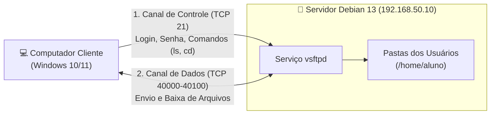
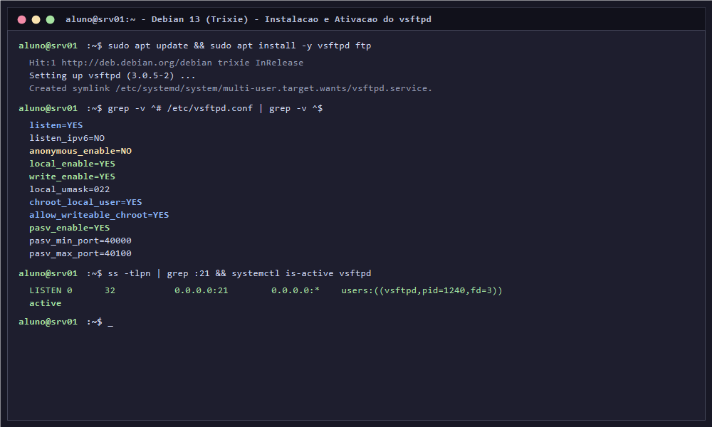
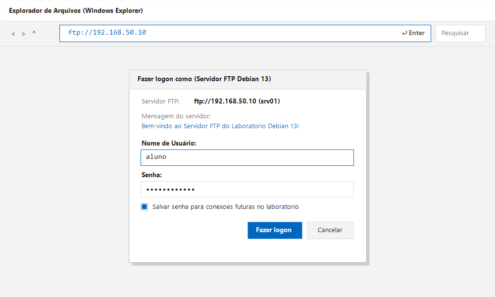
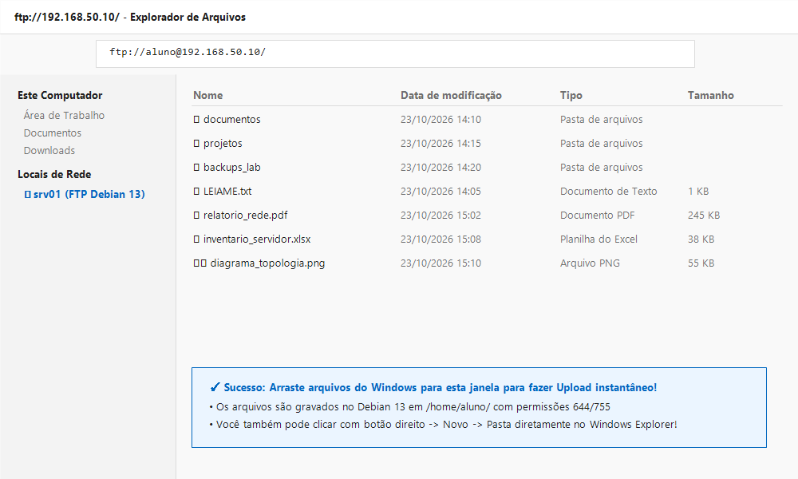
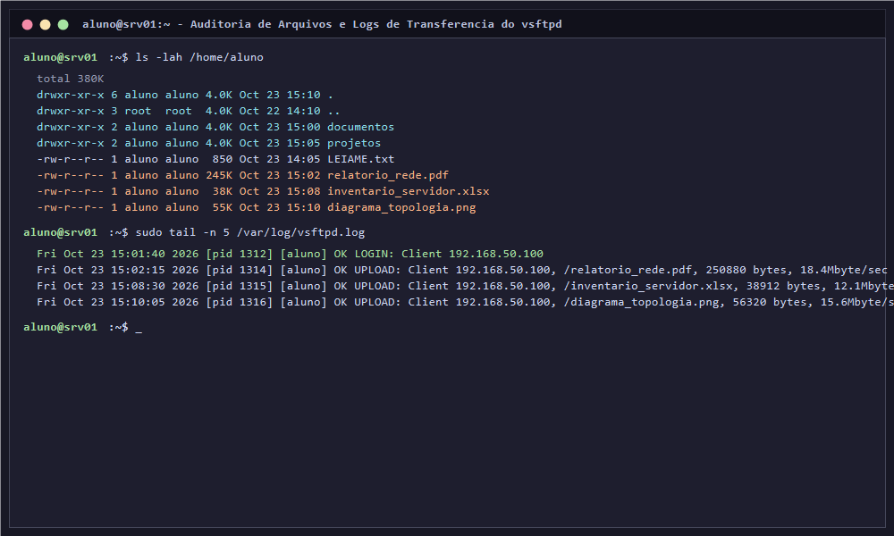

# 06 · Configuração do Servidor FTP no Debian 13 e Acesso via Windows Explorer

[← 05 · SSH](05-ssh.md) · [README](../README.md) · [Próximo: Firewall →](07-firewall.md)

## Objetivo e Competências

Capacitar o estudante — mesmo sem qualquer experiência prévia com servidores de arquivos — a instalar, configurar, proteger e testar um servidor **FTP (File Transfer Protocol)** no **Debian 13 (Trixie)** utilizando o software canônico **`vsftpd`**, realizando transferências bidirecionais de arquivos (*Upload* e *Download*) através do **Windows Explorer (Explorador de Arquivos do Windows)** e compreendendo a separação entre canais de controle, dados e permissões do Linux.

Ao final deste capítulo, o estudante será capaz de:
- Compreender o que é o protocolo FTP, diferenciando canal de controle (porta TCP 21) de canal de dados (modo ativo vs modo passivo).
- Instalar e gerenciar o daemon oficial **`vsftpd` (*Very Secure FTP Daemon*)** no Debian 13.
- Aplicar a regra de ouro de backup e editar o arquivo `/etc/vsftpd.conf` com o editor **Vim** de forma estruturada.
- Configurar autenticação de usuários locais do Linux, permissão de gravação e máscara de arquivos (`umask`).
- Compreender o conceito de enjaulamento (*chroot jail*) e evitar o erro clássico de inicialização com `allow_writeable_chroot=YES`.
- Configurar a faixa de portas do Modo Passivo (`PASV`) e habilitar suporte a nomes de arquivos com acentuação (`UTF-8`).
- Acessar o servidor FTP diretamente pelo **Windows Explorer** (`ftp://192.168.50.10`), autenticar com credenciais locais e transferir arquivos por arrastar e soltar (*Drag & Drop*).
- Mapear o servidor FTP como um local de rede permanente em "Este Computador" no Windows.
- Auditar logs de transferências em `/var/log/vsftpd.log` e solucionar as falhas mais comuns de iniciantes.

---

## 1. O que é o FTP e Como Ele Funciona? (Guia para Iniciantes)

O **FTP (*File Transfer Protocol* — Protocolo de Transferência de Arquivos)** é um dos padrões mais tradicionais e fundamentais da internet para a cópia de arquivos entre computadores através de uma rede TCP/IP.



### Dois termos que você precisa conhecer:

- **Upload (Envio):** Você envia um arquivo do seu computador local (ex: Windows) para o servidor Linux.
- **Download (Baixa):** Você copia um arquivo que está guardado no servidor Linux para o seu computador local.

---

### Por que o FTP utiliza DUAS conexões diferentes?

Diferente da maioria dos serviços (como a Web HTTP que usa apenas a porta 80 ou o SSH que usa apenas a 22), o FTP foi projetado para utilizar **duas conexões separadas**:

1. **Canal de Controle (Porta TCP 21):**
   - É a porta principal onde o cliente se conecta inicialmente.
   - Por ela trafegam a autenticação (nome de usuário e senha) e os comandos digitados (como pedir a lista de arquivos ou solicitar um arquivo).
2. **Canal de Dados (Portas de Dados):**
   - É uma conexão temporária aberta **exclusivamente no momento em que um arquivo está sendo transferido** ou quando a lista de pastas está sendo exibida.
   - Pode operar em dois modos:
     - **Modo Ativo:** O servidor tenta abrir uma conexão de volta para o cliente na porta TCP 20. *(Em redes modernas com roteador ou firewall residencial/laboratório, esse modo quase sempre falha porque o roteador do cliente bloqueia conexões de entrada).*
     - **Modo Passivo (`PASV`):** O cliente pede para o servidor abrir uma porta alta livre (ex: portas entre 40000 e 40100) e o próprio cliente se conecta a ela. **Este é o modo obrigatório para que o Windows Explorer funcione perfeitamente sem travar!**

---

### Tabela Comparativa: FTP vs FTPS vs SFTP

| Protocolo | Base Tecnológica | Criptografia | Portas Típicas | Quando é Utilizado? |
| :--- | :--- | :--- | :--- | :--- |
| **FTP Tradicional** | Protocolo FTP puro (RFC 959) | Texto claro (sem criptografia) | TCP 21 + portas passivas | Redes locais isoladas, equipamentos legados, aprendizado em laboratório. |
| **FTPS** | FTP encapsulado em SSL/TLS | Criptografado com certificado | TCP 21 + 990 + portas passivas | Transferência FTP segura em internet pública exigindo certificados TLS. |
| **SFTP** | Subsistema do SSH (OpenSSH) | Criptografia nativa do SSH | TCP 22 (apenas uma porta) | Administração moderna de sistemas via SSH (visto no Capítulo 05). |

> [!NOTE]
> Neste capítulo configuramos o **FTP tradicional** no laboratório da rede interna `LAB` (`192.168.50.0/24`), pois ele é nativamente suportado pelo **Windows Explorer** sem a necessidade de instalar nenhum programa adicional no Windows.

---

## 2. Preparação e Instalação do `vsftpd` no Debian 13

O programa que utilizaremos como servidor FTP é o **`vsftpd`** (*Very Secure FTP Daemon*). Ele é o servidor FTP padrão recomendado pela documentação oficial do Debian por ser extremamente rápido, leve no consumo de memória RAM e imune às falhas de estouro de memória que afetavam servidores FTP antigos.

### Passo 1: Verificar o IP da máquina Debian 13

Antes de instalar qualquer serviço de rede, confirme que seu servidor está com o endereço estático configurado no Capítulo 03:

```bash
# Confirma o endereço IPv4 da placa de rede
ip -br address
```

*Saída esperada:* A interface (ex: `enp0s3`) deve exibir o endereço **`192.168.50.10/24`**.

---

### Passo 2: Instalar o pacote `vsftpd` e o cliente `ftp`

Execute no terminal do `srv01`:

```bash
# Atualiza os índices e instala o servidor vsftpd e o utilitário de teste de terminal ftp
sudo apt update && sudo apt install -y vsftpd ftp
```

O Debian 13 baixará os pacotes e habilitará automaticamente o serviço no `systemd`.

---

### Passo 3: Inspecionar o estado inicial do serviço

Confirme que o serviço já foi iniciado pelo instalador:

```bash
# Verifica se o daemon vsftpd está em execução
sudo systemctl status vsftpd --no-pager

# Confirma que a porta TCP 21 está aberta aguardando conexões
ss -tlpn | grep :21
```

*Saída esperada do `ss`:*
```text
LISTEN 0      32           0.0.0.0:21        0.0.0.0:*    users:(("vsftpd",pid=1240,fd=3))
```



---

## 3. A Regra de Ouro e o Arquivo `/etc/vsftpd.conf`

Toda a configuração do servidor FTP no Debian 13 é controlada por um único arquivo de texto: **`/etc/vsftpd.conf`**.

### Passo 4: Fazer a cópia de segurança antes de editar

```bash
# Cria uma cópia fiel do arquivo original fornecido pelo Debian
sudo cp /etc/vsftpd.conf /etc/vsftpd.conf.ori
```

> [!CAUTION]
> **Aviso Crítico para Iniciantes sobre a Sintaxe do vsftpd:**
> No arquivo `/etc/vsftpd.conf`, **NÃO PODE HAVER ESPAÇOS** antes ou depois do sinal de igual (`=`).
> - Correto: `write_enable=YES`
> - **Incorreto:** `write_enable = YES` *(o serviço falhará ao reiniciar e acusará erro de sintaxe!)*

---

## 4. Passo a Passo da Configuração no Vim (`/etc/vsftpd.conf`)

Vamos agora editar o arquivo de configuração aplicando as técnicas do editor **Vim** que você aprendeu no Capítulo 01.

### Passo 5: Abrir o arquivo no Vim com permissão de administrador

```bash
sudo vim /etc/vsftpd.conf
```

Para uma experiência limpa, descomplicada e à prova de erros para iniciantes, vamos configurar o arquivo com as opções essenciais. Você pode apagar o conteúdo antigo digitando `gg` seguido de `dG` no Modo Normal do Vim, e colar as diretivas abaixo no Modo de Inserção (`i`):

```ini
# /etc/vsftpd.conf - Configuração Oficial do Laboratório no Debian 13

# 1. Modo de Execução do Daemon
listen=YES
listen_ipv6=NO

# 2. Controle de Acesso e Autenticação
# Bloqueia acessos anônimos de usuários sem conta (exige login e senha do Linux)
anonymous_enable=NO

# Permite que usuários locais cadastrados no sistema (/etc/passwd) acessem o FTP
local_enable=YES

# Permite enviar arquivos (upload), criar novas pastas e renomear/apagar itens
write_enable=YES

# Define a máscara padrão de permissões para arquivos enviados (022 gera 644 para arquivos e 755 para pastas)
local_umask=022

# 3. Mensagens e Registro de Auditoria (Logs)
dirmessage_enable=YES
use_localtime=YES
xferlog_enable=YES
connect_from_port_20=YES
ftpd_banner=Bem-vindo ao Servidor FTP do Laboratorio Debian 13!

# 4. SEGURANÇA CRÍTICA: Enjaulamento de Usuários (Chroot Jail)
# Prende cada usuário dentro da sua própria pasta pessoal (/home/usuario)
chroot_local_user=YES

# INDISPENSÁVEL NO DEBIAN 13: Permite que a pasta do chroot tenha permissão de escrita
allow_writeable_chroot=YES

# 5. MODO PASSIVO: Obrigatório para o Windows Explorer funcionar sem travar
pasv_enable=YES
pasv_min_port=40000
pasv_max_port=40100

# 6. Compatibilidade de Nomes de Arquivos e Sistema PAM
secure_chroot_dir=/var/run/vsftpd/empty
pam_service_name=vsftpd
utf8_filesystem=YES
```

---

### O que significa cada bloco da configuração? (Entendendo o porquê)

| Diretiva | Valor | Por que configuramos assim? |
| :--- | :--- | :--- |
| `anonymous_enable` | `NO` | Impede que qualquer pessoa na rede acesse o servidor sem senha. Apenas usuários autenticados entram. |
| `local_enable` | `YES` | Informa ao `vsftpd` para aceitar as contas de usuários comuns criadas no Linux (como o usuário `aluno`). |
| `write_enable` | `YES` | **Sem essa linha, o FTP opera em modo somente leitura!** Ela é necessária para que o Windows Explorer consiga colar arquivos. |
| `chroot_local_user` | `YES` | Cria a "jaula": impede que o usuário faça `cd ..` e passeie pelas pastas do sistema como `/etc` ou `/var`. |
| `allow_writeable_chroot` | `YES` | **Salva o laboratório:** Por padrão de segurança, o vsftpd recusa login se a pasta enjaulada tiver permissão de escrita. Esta opção autoriza o login normal. |
| `pasv_enable` | `YES` | Ativa o Modo Passivo, permitindo que o cliente Windows escolha portas altas para receber a listagem de arquivos. |
| `pasv_min_port` / `max_port`| `40000` a `40100` | Delimita um intervalo controlado de 100 portas para o tráfego de dados, facilitando a liberação no Firewall posteriormente. |
| `utf8_filesystem` | `YES` | Garante que arquivos com acentuação e cedilha (`relatório.pdf`, `ação.docx`) vindos do Windows não fiquem corrompidos. |

---

### Passo 6: Salvar no Vim e reiniciar o serviço

1. Pressione a tecla `Esc` para retornar ao Modo Normal do Vim.
2. Digite `:wq` e tecle `Enter` para gravar e sair.
3. Reinicie o serviço no Debian para carregar a nova configuração:

```bash
sudo systemctl restart vsftpd
```

4. Valide se o serviço reiniciou sem erros:

```bash
sudo systemctl status vsftpd --no-pager
```

> [!TIP]
> Se o status exibir a palavra verde `active (running)`, a configuração está perfeita! Caso exiba `failed`, revise o arquivo com `sudo vim /etc/vsftpd.conf` e confira se não ficou nenhum espaço antes ou depois do sinal `=`.

---

## 5. Preparando Pastas e Arquivos de Teste no Servidor

Para que você visualize arquivos imediatamente assim que conectar pelo Windows Explorer, vamos criar algumas pastas e um documento de texto de boas-vindas na pasta do usuário `aluno`:

```bash
# 1. Garante que estamos na pasta pessoal do aluno
cd /home/aluno

# 2. Cria três subpastas organizacionais
mkdir -p documentos projetos backups_lab

# 3. Cria um arquivo de texto de teste com informações do laboratório
cat << 'EOF' > LEIAME.txt
==================================================
  SERVIDOR FTP DEBIAN 13 (TRIXIE) - LAB REDES
==================================================
Parabens! Voce conectou com sucesso ao servidor FTP.
Este arquivo esta hospedado em /home/aluno no Debian.
Voce pode enviar novos arquivos arrastando para ca!
==================================================
EOF

# 4. Confirma que os arquivos pertencem ao usuário aluno
ls -lah /home/aluno
```

---

## 6. Acessando o Servidor FTP pelo Windows Explorer

Agora realizaremos a conexão a partir do seu computador com **Windows** (físico ou máquina virtual cliente) conectado à mesma rede `LAB`.

> [!IMPORTANT]
> **Atenção sobre Navegadores Web:**
> Os navegadores modernos (Google Chrome, Microsoft Edge, Mozilla Firefox) **removeram o suporte ao protocolo `ftp://`**. Se você tentar abrir `ftp://192.168.50.10` no Chrome ou no Edge, o navegador tentará fazer uma busca na web ou exibirá um erro.
> O acesso oficial e nativo no Windows é feito através do **Windows Explorer (Explorador de Arquivos)**!

---

### Método 1: Acesso Direto pela Barra de Endereços (`Win + E`)

Siga o passo a passo:

1. No teclado do Windows, pressione o atalho **`Tecla Windows + E`** para abrir o **Explorador de Arquivos (Windows Explorer)**.
2. Clique na **barra de endereços** superior (onde normalmente está escrito *"Este Computador"* ou *"Acesso Rápido"*).
3. Apague o texto que estiver lá e digite exatamente:
   ```text
   ftp://192.168.50.10
   ```
   e pressione a tecla **`Enter`**.



4. O Windows Explorer abrirá imediatamente uma janela modal intitulada **"Fazer logon como"** (*Log On As*):
   - **Servidor:** `ftp://192.168.50.10`
   - **Nome de Usuário:** digite `aluno`
   - **Senha:** digite a senha da conta `aluno` do seu Debian 13
   - *(Opcional)* Marque a caixa de seleção **"Salvar senha"** para não precisar digitar novamente.
5. Clique no botão **Fazer logon**.

---

### Teste Prático de Transferência: Arrastar e Soltar (*Drag & Drop*)

Assim que você clicar em "Fazer logon", a janela do Windows Explorer se transformará em uma pasta remota do seu servidor Debian 13!



Execute os seguintes testes práticos na janela:

1. **Baixar um arquivo (Download):**
   - Dê um duplo clique no arquivo `LEIAME.txt`. Ele abrirá no Bloco de Notas do Windows com o texto que criamos no Debian!
2. **Criar uma pasta remotamente:**
   - Na janela do Windows Explorer conectada ao FTP, clique com o **botão direito do mouse em uma área vazia** $\rightarrow$ selecione **Novo** $\rightarrow$ **Pasta**.
   - Dê o nome de `financeiro` e pressione `Enter`.
3. **Enviar um arquivo do Windows para o Linux (Upload):**
   - Na sua Área de Trabalho do Windows, crie um arquivo de texto qualquer (ex: `teste-windows.txt`).
   - Arraste esse arquivo para dentro da janela do Windows Explorer do FTP.
   - O arquivo será transferido instantaneamente pela rede!

---

### Método 2: Mapear um Local de Rede Permanente em "Este Computador"

Se você quiser deixar um atalho fixo do servidor FTP salvo dentro do seu Windows Explorer para acessar com um clique todos os dias:

1. Abra o Windows Explorer (`Win + E`) e clique em **Este Computador** no painel esquerdo.
2. Na barra de ferramentas superior, clique nos três pontinhos (`...`) ou clique com o botão direito em uma área vazia e selecione **Adicionar um local de rede**.
3. O assistente será exibido. Clique em **Avançar**.
4. Na tela seguinte, clique em **Escolher um local de rede personalizado** e clique em **Avançar**.
5. No campo *"Endereço de rede ou da Internet"*, digite:
   ```text
   ftp://192.168.50.10
   ```
   e clique em **Avançar**.
6. Na tela de nome de usuário, **desmarque** a caixa *"Fazer logon anonimamente"* e digite o nome de usuário: `aluno`. Clique em **Avançar**.
7. Escolha um nome amigável para o atalho, por exemplo: `Servidor FTP - Debian 13 (srv01)`. Clique em **Avançar** e depois em **Concluir**.
8. Pronto! Agora, dentro de **Este Computador**, haverá um ícone de globo de rede com o nome do seu servidor Linux. Basta dar dois cliques nele a qualquer momento para abrir seus arquivos!

> [!TIP]
> **Como alternar de usuário no Windows Explorer:**
> Se você precisar trocar de conta no Windows Explorer (por exemplo, para testar outro usuário criado no sistema), basta clicar com o **botão direito em qualquer espaço vazio dentro da pasta FTP** e selecionar a opção **Fazer logon como...** (*Log On As...*).

---

## 7. Conferindo os Arquivos e os Logs de Auditoria no Servidor

Volte ao terminal da sua máquina virtual Debian 13 e verifique as evidências técnicas de que tudo funcionou:

### 1. Listar os arquivos recebidos no Linux

```bash
# Inspeciona o diretório pessoal do usuário aluno
ls -lah /home/aluno
```

Observe que o arquivo `teste-windows.txt` e a pasta `financeiro` criados pelo Windows Explorer aparecem perfeitamente listados, com propriedade pertencente ao usuário `aluno:aluno` e permissões corretas (`644` para arquivos e `755` para pastas geradas pelo `umask 022`).

---

### 2. Auditar o arquivo de log de transferências (`/var/log/vsftpd.log`)

O `vsftpd` mantém um registro rigoroso de quem conectou, o endereço IP do cliente e quais arquivos foram enviados ou baixados:

```bash
# Exibe as últimas linhas do arquivo de log do vsftpd
sudo tail -n 10 /var/log/vsftpd.log
```

*Exemplo de saída de auditoria registrada:*
```text
Fri Oct 23 15:01:40 2026 [pid 1312] [aluno] OK LOGIN: Client "192.168.50.100"
Fri Oct 23 15:02:15 2026 [pid 1314] [aluno] OK UPLOAD: Client "192.168.50.100", "/teste-windows.txt", 1024 bytes, 15.2Mbyte/sec
```



---

## 8. Guia de Solução de Problemas para Iniciantes (*Troubleshooting*)

Se algo der errado na primeira tentativa, consulte esta tabela com os 5 erros mais comuns e a solução imediata:

| Sintoma / Mensagem de Erro | Causa Provável | O que fazer para corrigir |
| :--- | :--- | :--- |
| **`500 OOPS: vsftpd: refusing to run with writable root inside chroot()`** | O `chroot_local_user=YES` está ativo, mas faltou a liberação de escrita no Debian 13. | Abra `/etc/vsftpd.conf` no Vim e adicione a linha: `allow_writeable_chroot=YES`. Depois reinicie com `sudo systemctl restart vsftpd`. |
| **`530 Login incorrect`** | 1. Senha digitada incorretamente.<br>2. Tentativa de logar com a conta `root`. | 1. Confirme a senha do usuário com `sudo passwd aluno`.<br>2. O `root` é bloqueado por segurança pelo arquivo `/etc/ftpusers`. Nunca acesse FTP como `root`. |
| **`550 Permission denied` ao colar arquivos pelo Windows** | A diretiva de escrita não foi habilitada no servidor. | Verifique se a linha `write_enable=YES` está presente em `/etc/vsftpd.conf` e reinicie o serviço. |
| **O Windows Explorer conecta, pede a senha, mas depois trava ou exibe erro de pasta** | O Modo Passivo está desligado ou bloqueado. | Garanta que `pasv_enable=YES`, `pasv_min_port=40000` e `pasv_max_port=40100` estão configurados em `/etc/vsftpd.conf`. |
| **O Windows Explorer diz que não foi possível encontrar o servidor** | Problema de conectividade IP entre o Windows e a VM. | No Windows, abra o Prompt de Comando (`cmd`) e teste `ping 192.168.50.10`. Confirme se a VM e o cliente estão na mesma rede virtual. |

---

## 9. Checklist de Validação do Estudante

Antes de avançar para o **Capítulo 07 · Firewall**, confirme que você realizou com sucesso cada uma das seguintes atividades:

- [ ] O pacote `vsftpd` está instalado e o comando `systemctl is-active vsftpd` retorna `active`.
- [ ] O comando `ss -tlpn` confirma que a porta `21/tcp` está em escuta no servidor.
- [ ] O arquivo `/etc/vsftpd.conf` foi editado no Vim sem espaços ao redor dos sinais `=` e inclui `allow_writeable_chroot=YES` e `pasv_enable=YES`.
- [ ] O usuário `aluno` conseguiu conectar com sucesso pelo Windows Explorer digitando `ftp://192.168.50.10`.
- [ ] Você conseguiu realizar o *Upload* de pelo menos um arquivo arrastando do Windows para o Windows Explorer.
- [ ] Você conseguiu criar uma nova pasta diretamente pelo Windows Explorer.
- [ ] No terminal do Linux, o comando `ls -lah /home/aluno` confirma que os novos arquivos e pastas existem fisicamente no disco.
- [ ] O arquivo `/var/log/vsftpd.log` registrou o evento de login (`OK LOGIN`) e upload (`OK UPLOAD`).

---

## Exercícios Práticos e Teóricos

1. **Prático:** Crie um novo usuário no Debian 13 chamado `operador` (`sudo adduser operador`). No Windows Explorer, clique com o botão direito no fundo da janela FTP, escolha **Fazer logon como...** e acesse com as credenciais do `operador`. Verifique se o operador tem acesso apenas aos seus próprios arquivos e não vê a pasta do `aluno`.
2. **Prático:** No terminal do Debian 13, visualize o arquivo de auditoria com `sudo tail -f /var/log/vsftpd.log`. Em seguida, envie um arquivo pelo Windows Explorer e observe a linha de log sendo gerada em tempo real na tela do terminal.
3. **Teórico:** Por que os servidores FTP modernos utilizam o Modo Passivo (`PASV`) como padrão em vez do antigo Modo Ativo (`PORT`) quando os clientes operam atrás de roteadores com NAT?
4. **Teórico:** Qual é o objetivo de segurança da diretiva `chroot_local_user=YES`? O que aconteceria se essa opção estivesse desligada (`NO`) e um usuário comum acessasse o servidor FTP?

---

## Referências Oficiais Debian e vsftpd

- [vsftpd Official Homepage and Manual](https://security.appspot.com/vsftpd.html)
- [Debian Manpages (Trixie) — vsftpd.conf(5)](https://manpages.debian.org/trixie/vsftpd/vsftpd.conf.5.en.html)
- [Debian Manpages (Trixie) — vsftpd(8)](https://manpages.debian.org/trixie/vsftpd/vsftpd.8.en.html)
- [Debian Wiki — FTP Server Setup](https://wiki.debian.org/FTP)
- [Microsoft Learn — Conectar a um servidor FTP no Explorador de Arquivos](https://learn.microsoft.com/pt-br/troubleshoot/windows-client/networking/connect-to-ftp-server-in-file-explorer)

---

[← Voltar para 05 · SSH](05-ssh.md) · [README](../README.md) · [Avançar para 07 · Firewall →](07-firewall.md)
