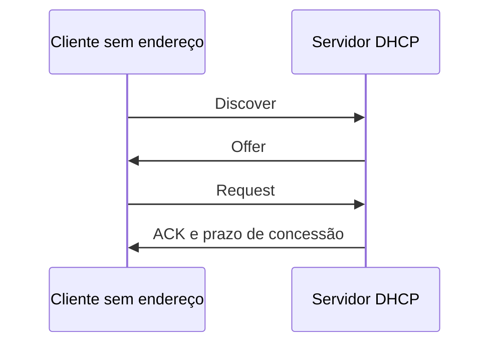

# 07 · DHCP com Kea

[← Firewall](06-firewall.md) · [README](../README.md) · [Backup →](08-backup.md)

## Objetivo e conceitos

DHCP entrega automaticamente endereço, máscara, gateway e DNS por um prazo chamado **concessão** (*lease*). No fluxo inicial típico, o cliente descobre servidores, recebe uma oferta, solicita o endereço e recebe confirmação: Discover, Offer, Request, ACK.



O ISC DHCP antigo chegou ao fim de vida no projeto de origem. Para um novo laboratório, usamos Kea, sem afirmar que a configuração antiga pode ser copiada diretamente. Fonte: [aviso oficial do ISC](https://www.isc.org/dhcp/). No Debian 13, o pacote é [kea-dhcp4-server](https://packages.debian.org/stable/net/kea-dhcp4-server).

## Pré-requisitos

- `srv01` com `192.168.50.10/24` fixo na interface LAB.
- pfSense como gateway/DNS `.1`, com **DHCP da LAN desativado** antes de ativar Kea.
- Cliente configurado para obter endereço automaticamente, na mesma rede interna.
- Intervalo `.100`–`.199` livre; endereços estáticos `.1`, `.10` e `.20` fora dele.
- Regra UDP para DHCP prevista no [firewall](06-firewall.md).

> [!WARNING]
> Confirme a rede interna e desligue qualquer DHCP concorrente, inclusive do hipervisor se usar outra modalidade de rede. Não use bridge para este exercício.

## Instalar e configurar

```bash
sudo apt update
sudo apt install kea-dhcp4-server
sudo systemctl stop kea-dhcp4-server
sudo cp -a /etc/kea/kea-dhcp4.conf /etc/kea/kea-dhcp4.conf.anterior
sudo nano /etc/kea/kea-dhcp4.conf
```

Substitua `enp0s3` pelo nome da interface LAB e use:

```json
{
  "Dhcp4": {
    "interfaces-config": {
      "interfaces": ["enp0s3"]
    },
    "lease-database": {
      "type": "memfile",
      "persist": true,
      "name": "/var/lib/kea/kea-leases4.csv"
    },
    "valid-lifetime": 3600,
    "renew-timer": 900,
    "rebind-timer": 1800,
    "subnet4": [
      {
        "id": 1,
        "subnet": "192.168.50.0/24",
        "pools": [
          { "pool": "192.168.50.100 - 192.168.50.199" }
        ],
        "option-data": [
          { "name": "routers", "data": "192.168.50.1" },
          { "name": "domain-name-servers", "data": "192.168.50.1" }
        ]
      }
    ]
  }
}
```

O exemplo usa JSON sem comentários. `interfaces` limita onde o servidor escuta; `subnet4` descreve a rede; `pools` define o conjunto de endereços. As opções anunciam serviços **que precisam existir**: DHCP não transforma o Debian em gateway ou resolvedor DNS. A estrutura é documentada no [manual DHCPv4 do Kea](https://kea.readthedocs.io/en/kea-2.6.3/arm/dhcp4-srv.html).

```bash
sudo kea-dhcp4 -t /etc/kea/kea-dhcp4.conf
sudo systemctl enable --now kea-dhcp4-server
systemctl status kea-dhcp4-server --no-pager
sudo journalctl -u kea-dhcp4-server -n 50 --no-pager
```

Se a validação falhar, corrija antes de iniciar. Confira diretório de concessões, permissões do pacote e se a interface existe. O teste de configuração não comprova comunicação real com o cliente.

## Renovar e validar no cliente

No cliente Linux gerenciado por NetworkManager, confira se o perfil está em IPv4 automático e reconecte-o pelo console. No Windows cliente, use `ipconfig /release`, depois `ipconfig /renew` e `ipconfig /all` em um terminal com as permissões necessárias. Isso interrompe temporariamente a conexão do cliente.

No cliente Linux:

```bash
ip -br address
ip route
getent hosts debian.org
```

Espere endereço no intervalo planejado, rota padrão por `.1` e DNS `.1`. No Windows, `ipconfig /all` deve identificar `.10` como servidor DHCP. No servidor, examine o journal e `/var/lib/kea/kea-leases4.csv` sem editar manualmente as concessões.

| Falha | Hipótese e verificação |
| --- | --- |
| Cliente fica sem IP | DHCP concorrente, interface errada, serviço parado ou segmento incorreto |
| Recebe IP de outra faixa | Outro servidor respondeu; identifique a origem da concessão |
| Recebe IP, mas sem internet | Gateway, NAT ou regras no pfSense |
| Internet por IP, mas sem nomes | DNS anunciado não atende a rede |

**Recuperação:** pare Kea antes de reativar o DHCP do pfSense. Nunca deixe ambos oferecendo a mesma faixa. **Exercício:** obtenha uma concessão, registre os quatro parâmetros recebidos e explique por que o endereço do servidor DHCP pode ser diferente do gateway.
