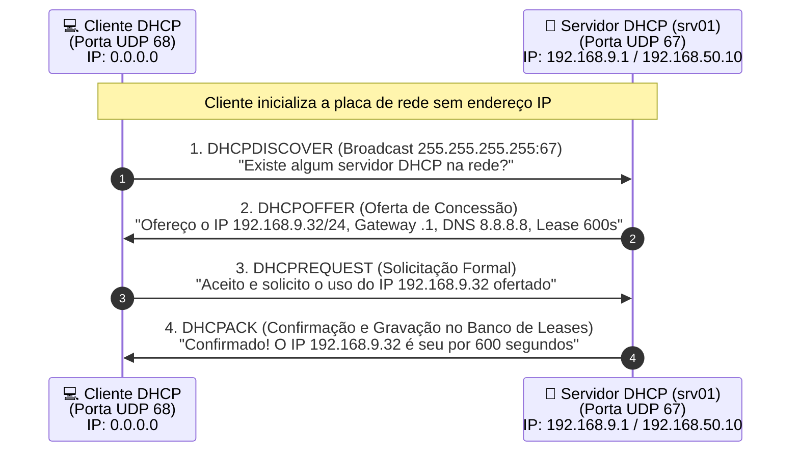

# 08 · Servidor DHCP no Debian 13 (Trixie): ISC DHCP e Kea DHCP

[← 07 · Firewall](07-firewall.md) · [README](../README.md) · [Próximo: Backup →](09-backup.md)

## Objetivo e Competências

Planejar, instalar, configurar e auditar o serviço de atribuição dinâmica e reserva estática de endereçamento IPv4 (**DHCP — Dynamic Host Configuration Protocol**) no servidor **Debian 13 (Trixie)**, dominando tanto a configuração clássica de referência (**`isc-dhcp-server`**) quanto o novo padrão moderno recomendado pela ISC e pelo projeto Debian (**`kea-dhcp4-server`**).

Ao final deste capítulo, o estudante será capaz de:
- Compreender o funcionamento do protocolo DHCP, as portas UDP `67` (servidor) e `68` (cliente), e as quatro mensagens do ciclo **DORA** (*Discover, Offer, Request, Acknowledge*).
- Isolar o serviço DHCP exclusivamente na interface de rede interna (**LAN**), prevenindo o incidente crítico de *Rogue DHCP* na rede física.
- Configurar o servidor clássico **`isc-dhcp-server`** (`/etc/default/isc-dhcp-server` e `/etc/dhcp/dhcpd.conf`), parametrizando domínio, servidores DNS, *lease time*, escopo dinâmico (`range`), gateway (`option routers`) e reservas fixas por endereço MAC (`host` / `hardware ethernet` / `fixed-address`).
- Configurar o servidor moderno **`kea-dhcp4-server`** (`/etc/kea/kea-dhcp4.conf`), compreendendo a equivalência direta entre a sintaxe declarativa legada e o padrão JSON do Debian 13.
- Validar a sintaxe dos arquivos de configuração antes de reiniciar os daemons (`dhcpd -t` e `kea-dhcp4 -t`).
- Realizar testes de renovação de IP em estações clientes Linux e Windows e auditar a tabela de concessões ativas (*leases*).

---

## 1. Fundamentos do Protocolo DHCP e o Ciclo DORA

O **DHCP (*Dynamic Host Configuration Protocol*, RFC 2131)** automatiza a entrega de parâmetros de rede para estações clientes. Sem ele, o administrador precisaria configurar manualmente o endereço IP, máscara de sub-rede, gateway padrão e servidores DNS em cada computador, smartphone ou impressora da empresa, aumentando o risco de conflitos de IP duplicado.

### O Ciclo de Negociação DORA (Portas UDP 67 e 68)

Quando um cliente se conecta à rede local sem endereço IP configurado, ocorre uma negociação em quatro etapas conhecida pelo acrônimo **DORA**:



1. **Discover (`DHCPDISCOVER`):** O cliente envia um pacote em *broadcast* (`255.255.255.255`, origem UDP `68` $\rightarrow$ destino UDP `67`) procurando servidores DHCP ativos no segmento local.
2. **Offer (`DHCPOFFER`):** O servidor DHCP consulta seu pool de endereços livres e responde oferecendo um endereço IP e parâmetros de rede por um tempo determinado (*lease time*).
3. **Request (`DHCPREQUEST`):** O cliente responde solicitando formalmente a utilização dos parâmetros oferecidos pelo servidor escolhido.
4. **Acknowledge (`DHCPACK`):** O servidor registra a concessão em seu arquivo de banco de dados (*leases*) e envia a confirmação final ao cliente, que aplica o endereço IP na interface.

> [!CAUTION]
> **Regra de Ouro no Laboratório — Isolamento de Rede:**
> O serviço DHCP **só deve estar disponível para a rede interna isolada (`Internal Network` / `LAN-LAB`)**. Jamais ative um servidor DHCP de laboratório em uma interface configurada em modo *Bridge* na rede física da escola ou empresa, pois o seu servidor responderá aos pacotes `DHCPDISCOVER` de máquinas reais da instituição (*Rogue DHCP*), derrubando a conectividade de outros ambientes.

---

## 2. Evolução no Debian 13 (Trixie): `isc-dhcp-server` vs `kea-dhcp4-server`

O consórcio **ISC (*Internet Systems Consortium*)**, criador do clássico `isc-dhcp-server`, encerrou o ciclo de vida (*End-of-Life*) do código legado e desenvolveu seu sucessor moderno: o **ISC Kea DHCP** (`kea-dhcp4-server`).

No **Debian 13 (Trixie)**, ambos os pacotes estão disponíveis nos repositórios oficiais:
- **`isc-dhcp-server`:** Mantido para compatibilidade com infraestruturas existentes, provas técnicas e scripts clássicos baseados em `/etc/dhcp/dhcpd.conf`.
- **`kea-dhcp4-server`:** O novo padrão oficial recomendado pelas *Release Notes* do Debian 13 para novas implantações, utilizando configuração estruturada em JSON (`/etc/kea/kea-dhcp4.conf`), recarregamento sem queda e suporte nativo a bancos de dados modernos.

| Recurso / Parâmetro | Padrão Clássico (`isc-dhcp-server`) | Padrão Moderno Debian 13 (`kea-dhcp4-server`) |
| :--- | :--- | :--- |
| **Pacote via APT** | `isc-dhcp-server` | `kea-dhcp4-server` |
| **Serviço no `systemd`** | `isc-dhcp-server.service` | `kea-dhcp4-server.service` |
| **Arquivo de Configuração** | `/etc/dhcp/dhcpd.conf` ( mais `/etc/default/isc-dhcp-server`) | `/etc/kea/kea-dhcp4.conf` (formato JSON com comentários) |
| **Teste de Sintaxe** | `sudo dhcpd -t -cf /etc/dhcp/dhcpd.conf` | `sudo kea-dhcp4 -t /etc/kea/kea-dhcp4.conf` |
| **Banco de Dados de Leases** | `/var/lib/dhcp/dhcpd.leases` | `/var/lib/kea/kea-leases4.csv` |
| **Faixa Dinâmica de IPs** | `range 192.168.9.32 192.168.9.63;` | `"pools": [ { "pool": "192.168.9.32 - 192.168.9.63" } ]` |
| **Reserva Fixa por MAC** | `host desktop { hardware ethernet ...; fixed-address ...; }` | `"reservations": [ { "hw-address": "...", "ip-address": "..." } ]` |

A seguir, apresentamos o passo a passo completo de **ambas as abordagens** para que você domine tanto o material clássico de referência quanto a atualização oficial do Debian 13.

---

## 3. Método A — Implementação Clássica de Referência (`isc-dhcp-server`)

> [!IMPORTANT]
> **Pré-requisito obrigatório:** Antes de iniciar qualquer servidor DHCP, a interface de rede interna do servidor (`eno1`, `enp0s3` ou `enp0s8`) **deve possuir um endereço IP estático** pertencente à mesma sub-rede que será distribuída (por exemplo, `192.168.9.1/24` ou `192.168.50.10/24`). Se a placa não tiver IP fixo na sub-rede declarada, o daemon `dhcpd` recusará iniciar.

### 3.1. Instalação do pacote

Atualize o índice de pacotes e instale o `isc-dhcp-server`:

```bash
sudo apt update
sudo apt install -y isc-dhcp-server
```

---

### 3.2. Definindo a Interface de Rede Interna (`/etc/default/isc-dhcp-server`)

O serviço DHCP só deve propagar endereçamento pela interface interna (ex.: `eno1`, `enp0s8` ou `enp0s3` conforme o nome da sua placa LAN verificada com `ip -br a`). Essa restrição é definida no arquivo `/etc/default/isc-dhcp-server`:

```bash
sudo nano /etc/default/isc-dhcp-server
```

Ajuste a diretiva de interfaces IPv4 informando o nome da sua placa de rede interna entre aspas:

```bash
# Defaults for isc-dhcp-server (sourced by /etc/init.d/isc-dhcp-server)
#
# On what interfaces should the DHCP server (dhcpd) serve DHCP requests?
# Separate multiple interfaces with spaces, e.g. "eth0 eth1".
INTERFACESv4="eno1"
INTERFACESv6=""
```

> [!NOTE]
> Em versões anteriores do Debian utilizava-se a variável `INTERFACES="eno1"`. No Debian moderno, o script de inicialização lê explicitamente **`INTERFACESv4="eno1"`** (substitua `eno1` por `enp0s8` ou `enp0s3` de acordo com o nome da sua interface LAN).

---

### 3.3. Configurando o Escopo Principal (`/etc/dhcp/dhcpd.conf`)

A parte principal da configuração é mantida no arquivo **`/etc/dhcp/dhcpd.conf`**. Antes de editá-lo, crie uma cópia de segurança do arquivo original documentado:

```bash
sudo cp /etc/dhcp/dhcpd.conf /etc/dhcp/dhcpd.conf.bkp
sudo nano /etc/dhcp/dhcpd.conf
```

#### Parâmetros Globais de Domínio, DNS e Tempo de Concessão (*Lease Time*)

No início do arquivo `/etc/dhcp/dhcpd.conf`, definimos as diretivas globais válidas para todas as sub-redes:
- **`ddns-update-style none;`**: Define que o servidor DHCP não tentará atualizar dinamicamente zonas de DNS por padrão.
- **`option domain-name "senac.corp";`** (ou `"home.lan"`): Sufixo de domínio entregue aos clientes.
- **`option domain-name-servers 8.8.8.8, 1.1.1.1;`**: Endereços IP dos servidores DNS (você também pode informar o IP ou nome do seu servidor DNS local, ex.: `192.168.9.10` ou `ns.home.lan`).
- **`default-lease-time 600;`** e **`max-lease-time 7200;`**: Duração padrão (`600` segundos = 10 minutos) e duração máxima (`7200` segundos = 2 horas) da atribuição do endereço IP. O cliente solicita renovação automaticamente quando atinge 50% do tempo de concessão (T1).
- **`authoritative;`**: Declara que este servidor DHCP é a autoridade oficial para a rede local (permitindo responder com `DHCPNAK` caso um cliente peça um IP inválido de outra rede).

```dhcpd
# /etc/dhcp/dhcpd.conf — Parâmetros Globais
ddns-update-style none;

# Definições globais comuns a todas as redes suportadas:
option domain-name "senac.corp";
option domain-name-servers 8.8.8.8, 1.1.1.1;

default-lease-time 600;
max-lease-time 7200;

# Servidor oficial para a rede local:
authoritative;
```

---

#### Declaração do Segmento de Rede (`subnet`) e Faixa Dinâmica (`range`)

Para o segmento de rede **`192.168.9.0/24`**, indicamos:
- A gama de endereços disponíveis para atribuição automática (**`range 192.168.9.32 192.168.9.63;`**).
- O gateway padrão a utilizar (**`option routers 192.168.9.1;`**).
- O endereço de broadcast da sub-rede (**`option broadcast-address 192.168.9.255;`**).

```dhcpd
## SubNet senac.corp
subnet 192.168.9.0 netmask 255.255.255.0 {
    range 192.168.9.32 192.168.9.63;
    option routers 192.168.9.1;
    option broadcast-address 192.168.9.255;
}
```

---

#### Reserva de Endereços IP Específicos por Endereço MAC (`host` / `fixed-address`)

O protocolo DHCP possibilita atribuir sempre o **mesmo endereço IP fixo** a determinados sistemas (como impressoras de rede, servidores secundários ou estações da diretoria), associando o endereço físico da placa de rede (**MAC Address** — `hardware ethernet`) ao endereço IP pretendido (`fixed-address`).

> [!WARNING]
> **Boa Prática de Endereçamento:** Os endereços IP fixos reservados em blocos `host` **não devem estar dentro da faixa (`range`) reservada para atribuição dinâmica**, evitando qualquer possibilidade de colisão. No nosso exemplo, a faixa dinâmica começa em `.32`, deixando os finais `.2` a `.31` livres para reservas estáticas!

```dhcpd
# Reservas de IP fixo por endereço físico (MAC Address)
host desktop {
    hardware ethernet 01:23:45:67:89:10;
    fixed-address 192.168.9.2;
}

host laptop {
    hardware ethernet 01:23:45:67:89:11;
    fixed-address 192.168.9.3;
}
```

---

### 3.4. Exemplo de um `dhcpd.conf` Completo comentando todos os recursos

Abaixo está a listagem integral de referência do arquivo `/etc/dhcp/dhcpd.conf` (incluindo os blocos comentados de referência para múltiplas sub-redes, BOOTP e classes de clientes):

```dhcpd
# dhcpd.conf
#
# Sample configuration file for ISC dhcpd
#

# option definitions common to all supported networks...
#option domain-name "senac.corp";
#option domain-name-servers 8.8.8.8, 1.1.1.1;

#default-lease-time 600;
#max-lease-time 7200;

# The ddns-updates-style parameter controls whether or not the server will
# attempt to do a DNS update when a lease is confirmed. We default to the
# behavior of the version 2 packages ('none', since DHCP v2 didn't
# have support for DDNS.)
ddns-update-style none;

# If this DHCP server is the official DHCP server for the local
# network, the authoritative directive should be uncommented.
authoritative;

# Use this to send dhcp log messages to a different log file (you also
# have to hack syslog.conf to complete the redirection).
#log-facility local7;

# No service will be given on this subnet, but declaring it helps the
# DHCP server to understand the network topology.
#subnet 10.152.187.0 netmask 255.255.255.0 {
#}

# This is a very basic subnet declaration.
#subnet 10.254.239.0 netmask 255.255.255.224 {
#  range 10.254.239.10 10.254.239.20;
#  option routers rtr-239-0-1.example.org, rtr-239-0-2.example.org;
#}

# This declaration allows BOOTP clients to get dynamic addresses,
# which we don't really recommend.
#subnet 10.254.239.32 netmask 255.255.255.224 {
#  range dynamic-bootp 10.254.239.40 10.254.239.60;
#  option broadcast-address 10.254.239.31;
#  option routers rtr-239-32-1.example.org;
#}

# Configuração ativa para a sub-rede interna senac.corp:
subnet 192.168.9.0 netmask 255.255.255.0 {
    range 192.168.9.20 192.168.9.253;
    option domain-name-servers 8.8.8.8, 1.1.1.1;
    option domain-name "senac.corp";
    option routers 192.168.9.254;
    option broadcast-address 192.168.9.255;
    default-lease-time 600;
    max-lease-time 7200;
}

# Reservas fixas de hosts por endereço MAC:
host desktop {
    hardware ethernet 01:23:45:67:89:10;
    fixed-address 192.168.9.2;
}

host laptop {
    hardware ethernet 01:23:45:67:89:11;
    fixed-address 192.168.9.3;
}
```

### 3.5. Validação de Sintaxe e Inicialização do Serviço

Antes de reiniciar o serviço, teste sempre se não há erros de digitação (como a falta de um ponto e vírgula `;`) com a flag `-t`:

```bash
# Valida a sintaxe do arquivo /etc/dhcp/dhcpd.conf
sudo dhcpd -t -cf /etc/dhcp/dhcpd.conf

# Reinicia e verifica o status do serviço no systemd
sudo systemctl restart isc-dhcp-server
sudo systemctl status isc-dhcp-server
```

---

## 4. Método B — Padrão Moderno Oficial do Debian 13 (`ISC Kea DHCP`)

Se você optar por utilizar o novo servidor DHCP padrão do **Debian 13 (Trixie)**, instale o pacote **`kea-dhcp4-server`**.

> [!NOTE]
> Caso já tenha instalado o `isc-dhcp-server` na mesma máquina virtual, pare e desabilite o serviço antigo (`sudo systemctl disable --now isc-dhcp-server`) antes de iniciar o Kea, pois dois servidores DHCP não podem disputar a porta UDP `67` na mesma interface.

### 4.1. Instalação do `kea-dhcp4-server`

```bash
sudo apt update
sudo apt install -y kea-dhcp4-server
```

### 4.2. Configurando o arquivo `/etc/kea/kea-dhcp4.conf`

Faça um backup do arquivo original e crie uma configuração limpa e equivalente ao nosso cenário corporativo (`senac.corp` — `192.168.9.0/24`):

```bash
sudo cp /etc/kea/kea-dhcp4.conf /etc/kea/kea-dhcp4.conf.bkp
sudo nano /etc/kea/kea-dhcp4.conf
```

Conteúdo completo do `/etc/kea/kea-dhcp4.conf`:

```json
{
"Dhcp4": {
    // 1. Define a interface interna onde o Kea escutará requisições DHCP
    "interfaces-config": {
        "interfaces": [ "eno1" ]
    },

    // 2. Banco de dados local onde as concessões (leases) são gravadas
    "lease-database": {
        "type": "memfile",
        "lfc-interval": 3600,
        "name": "/var/lib/kea/kea-leases4.csv"
    },

    // 3. Tempos de concessão em segundos (equivalentes a default-lease-time e max-lease-time)
    "valid-lifetime": 600,
    "renew-timer": 300,
    "rebind-timer": 500,
    "max-valid-lifetime": 7200,

    // 4. Opções globais entregues aos clientes (DNS e Domínio)
    "option-data": [
        {
            "name": "domain-name-servers",
            "data": "8.8.8.8, 1.1.1.1"
        },
        {
            "name": "domain-name",
            "data": "senac.corp"
        }
    ],

    // 5. Declaração da sub-rede, pool dinâmico, gateway e reservas por MAC
    "subnet4": [
        {
            "id": 1,
            "subnet": "192.168.9.0/24",
            "pools": [
                { "pool": "192.168.9.32 - 192.168.9.63" }
            ],
            "option-data": [
                {
                    "name": "routers",
                    "data": "192.168.9.1"
                },
                {
                    "name": "broadcast-address",
                    "data": "192.168.9.255"
                }
            ],
            "reservations": [
                {
                    "hostname": "desktop",
                    "hw-address": "01:23:45:67:89:10",
                    "ip-address": "192.168.9.2"
                },
                {
                    "hostname": "laptop",
                    "hw-address": "01:23:45:67:89:11",
                    "ip-address": "192.168.9.3"
                }
            ]
        }
    ]
}
}
```

### 4.3. Testando a Sintaxe e Iniciando o `kea-dhcp4-server`

```bash
# 1. Valida a sintaxe do arquivo JSON do Kea
sudo kea-dhcp4 -t /etc/kea/kea-dhcp4.conf

# 2. Habilita e reinicia o serviço no systemd
sudo systemctl enable --now kea-dhcp4-server
sudo systemctl restart kea-dhcp4-server
sudo systemctl status kea-dhcp4-server
```

---

## 5. Validação nos Clientes e Auditoria de Concessões (*Leases*)

Para comprovar que o servidor DHCP está distribuindo os endereços e respeitando as reservas por MAC, realize o teste a partir de uma máquina virtual cliente conectada na mesma rede interna (**LAN**).

### 5.1. Testando em um Cliente Linux (Debian)

Configure a interface da VM cliente em modo `dhcp` no `/etc/network/interfaces` (ou via `dhcpcd` / `NetworkManager`) e solicite a renovação:

```bash
# Libera a concessão atual e solicita novo IP via dhcpcd (padrão no Debian 13):
sudo dhcpcd -k enp0s3
sudo dhcpcd enp0s3

# Ou reiniciando a pilha ifupdown:
sudo systemctl restart networking

# Confirma o IP recebido, o gateway padrão e os servidores DNS:
ip -br a
ip r
cat /etc/resolv.conf
```

### 5.2. Testando em um Cliente Windows

No Prompt de Comando (`cmd` ou PowerShell) da máquina virtual cliente Windows:

```powershell
# Libera o endereço IP atual
ipconfig /release

# Solicita um novo endereço ao servidor DHCP (executa o ciclo DORA)
ipconfig /renew

# Exibe todos os detalhes recebidos (IP, Máscara, Gateway, Servidor DHCP, DNS e Sufixo senac.corp)
ipconfig /all
```

---

### 5.3. Auditando os Endereços Entregues no Servidor

No servidor Debian (`srv01`), você pode verificar em tempo real quais clientes receberam IP e acompanhar o diálogo `DHCPDISCOVER` $\rightarrow$ `DHCPOFFER` $\rightarrow$ `DHCPREQUEST` $\rightarrow$ `DHCPACK`:

```bash
# 1. Se estiver usando o isc-dhcp-server clássico:
cat /var/lib/dhcp/dhcpd.leases
sudo journalctl -u isc-dhcp-server -f

# 2. Se estiver usando o kea-dhcp4-server moderno:
cat /var/lib/kea/kea-leases4.csv
sudo journalctl -u kea-dhcp4-server -f

# 3. Confirma a porta UDP 67 em escuta no servidor:
sudo ss -ulpn | grep :67
```

---

## 6. Criação do Snapshot de Segurança

Após validar a entrega automática de IPs e a reserva fixa por MAC nos clientes, desligue a máquina virtual e registre o snapshot:

```bash
sudo poweroff
```

No hipervisor:
- **Nome do Snapshot:** `06-DHCP-Configurado`
- **Descrição:** *Servidor DHCP configurado na interface interna, escopo dinâmico, opções de gateway/DNS e reservas por MAC testados.*

---

## 7. Checklist de Validação do Estudante

- [ ] A interface LAN do servidor possui endereço IP estático configurado na mesma sub-rede do escopo DHCP.
- [ ] O serviço DHCP foi vinculado exclusivamente à interface de rede interna (`INTERFACESv4` ou `interfaces-config`).
- [ ] O escopo de sub-rede, a faixa de distribuição (`range` / `pools`), o gateway (`routers`) e os servidores DNS foram parametrizados.
- [ ] Ao menos uma reserva de IP fixo por endereço MAC foi configurada **fora** da faixa de distribuição dinâmica.
- [ ] A sintaxe do arquivo de configuração foi validada sem erros (`dhcpd -t` ou `kea-dhcp4 -t`).
- [ ] O serviço está ativo (`active (running)`) e escutando na porta `67/udp` (`ss -ulpn`).
- [ ] Uma máquina cliente obteve endereço IP, máscara, gateway e DNS automaticamente e consta no arquivo de *leases*.
- [ ] O snapshot `06-DHCP-Configurado` foi registrado no hipervisor.

---

## Exercícios Práticos e Teóricos

1. **Prático:** Descubra o endereço MAC real da placa de rede da sua máquina virtual cliente (`ip link` no Linux ou `ipconfig /all` no Windows). Crie uma reserva fixa no servidor DHCP associando esse endereço MAC ao IP `.15` da sua sub-rede, reinicie o serviço DHCP, renove o IP no cliente e comprove que ele recebeu exatamente o IP `.15`.
2. **Prático:** Altere os parâmetros `default-lease-time` para `1800` (30 minutos) e `max-lease-time` para `14400` (4 horas), valide a sintaxe do arquivo e reinicie o serviço.
3. **Teórico:** Explique por que as mensagens iniciais `DHCPDISCOVER` e `DHCPOFFER` precisam utilizar tráfego em **Broadcast (`255.255.255.255`)** na camada de rede.
4. **Teórico:** O que acontece com uma estação cliente que já possui um endereço IP atribuído via DHCP caso o servidor DHCP saia do ar temporariamente antes de o tempo `max-lease-time` expirar?

---

## Referências Oficiais Debian e ISC

- [Debian Wiki — DHCP Server](https://wiki.debian.org/DHCP_Server)
- [ISC Kea Administrator Reference Manual (DHCPv4)](https://kea.readthedocs.io/)
- [Debian Manpages (Trixie) — dhcpd.conf(5)](https://manpages.debian.org/trixie/isc-dhcp-server/dhcpd.conf.5.en.html)
- [Debian Manpages (Trixie) — kea-dhcp4(8)](https://manpages.debian.org/trixie/kea-dhcp4-server/kea-dhcp4.8.en.html)
- [Debian 13 (Trixie) Release Notes — Transition from ISC DHCP to Kea](https://www.debian.org/releases/trixie/release-notes/)

---

[← Voltar para 07 · Firewall](07-firewall.md) · [README](../README.md) · [Avançar para 09 · Backup →](09-backup.md)

