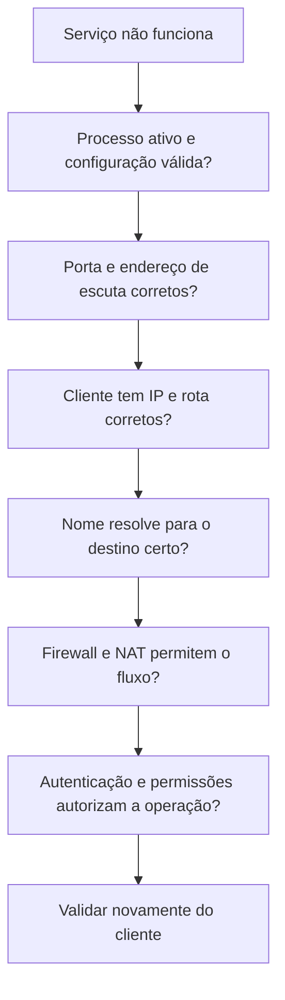

# 11 · Segurança e diagnóstico

[← Logs e MariaDB](10-logs-mariadb.md) · [README](../README.md) · [UCS →](12-ucs.md)

## Objetivo

Revisar o sistema inteiro e investigar falhas a partir de evidências. Segurança depende de manutenção, controle de acesso, exposição de serviços, recuperação e observação. Um firewall não corrige senha vazada, aplicação vulnerável ou backup irrecuperável.

Pré-requisitos: capítulos anteriores concluídos e console disponível.

## Revisão prática

| Pergunta | Verificação | Interpretação |
| --- | --- | --- |
| O que está escutando? | `sudo ss -lntup` | Diferencie loopback, LAN e todas as interfaces |
| Quais serviços falharam? | `systemctl --failed` | Leia o journal antes de reiniciar |
| Há atualizações? | `sudo apt update` e `apt list --upgradable` | Planeje aplicação e eventuais reinícios |
| Quem tem sudo? | `getent group sudo` e `sudo -l` | O grupo não é a única fonte possível: confira sudoers e regras locais |
| Há espaço livre? | `df -h` e `df -i` | Espaço e quantidade de inodes são limites diferentes |
| O relógio está coerente? | `timedatectl` | Afeta certificados, logs, agendamentos e autenticação |
| O firewall persistiu? | `sudo nft list ruleset` | Compare o estado carregado com o arquivo planejado |
| Consigo recuperar os dados? | Restauração do capítulo 08 | Um arquivo de backup existente não comprova recuperabilidade |

`0.0.0.0` significa todas as interfaces IPv4; `[::]` indica escuta IPv6, com comportamento dual-stack dependente da aplicação e sistema. Um listener local não prova acesso externo: valide também rotas e filtros a partir do cliente autorizado.

## Atualizações automáticas com supervisão

Você pode estudar `unattended-upgrades`:

```bash
sudo apt install unattended-upgrades
sudo dpkg-reconfigure unattended-upgrades
sudo unattended-upgrade --dry-run --debug
```

Revise as origens permitidas e as opções em `/etc/apt/apt.conf.d/`. O teste simulado mostra a proposta; não significa que os pacotes já foram atualizados. Decida como acompanhar falhas, reiniciar serviços e tratar atualizações que exigem intervenção. Veja a [documentação Debian sobre atualizações automáticas](https://wiki.debian.org/UnattendedUpgrades).

## Investigar em uma ordem que faça sentido



1. Registre o horário, a origem, o destino e a mensagem exata de erro.
2. Confira estado do serviço e logs, sem mudar várias configurações ao mesmo tempo.
3. Teste primeiro o componente local e depois o caminho completo a partir do cliente.
4. Altere uma hipótese por vez e repita o mesmo teste.
5. Documente a causa e a correção; desfaça alterações temporárias.

| Sintoma | Distinção útil |
| --- | --- |
| SSH responde “Permission denied” | A rede pode estar funcionando; investigue método de autenticação, usuário e chaves |
| SSH recebe “Connection refused” | Pode não haver listener ou haver rejeição explícita |
| SSH expira por timeout | Pode haver descarte, rota incorreta ou destino indisponível |
| SFTP conecta, mas upload falha | Verifique caminho, permissões, espaço e quotas |
| DHCP entrega IP, mas domínio falha | Verifique DNS anunciado, registros de serviço e horário |

Esses sintomas indicam hipóteses, não provas únicas. Por exemplo, um firewall também pode rejeitar ativamente uma porta.

## Preparar o repositório público

- [ ] Use IPs e nomes de laboratório nos relatos.
- [ ] Remova senhas, chaves privadas, dumps, tokens e configurações reais de firewall.
- [ ] Revise imagens para identificar dados pessoais ou endereços sensíveis.
- [ ] Não publique arquivos de `authorized_keys` de pessoas reais sem necessidade e autorização.
- [ ] Se um segredo foi publicado, revogue-o; apagar apenas o arquivo atual não remove o histórico Git.

## Exercício integrador

Simule **uma falha reversível de cada vez** em uma VM de teste, como DNS incorreto ou serviço SSH parado. Mantenha console disponível. Para cada caso, entregue hipótese, comando usado, evidência encontrada, correção e resultado após reiniciar. Termine restaurando a configuração funcional.
